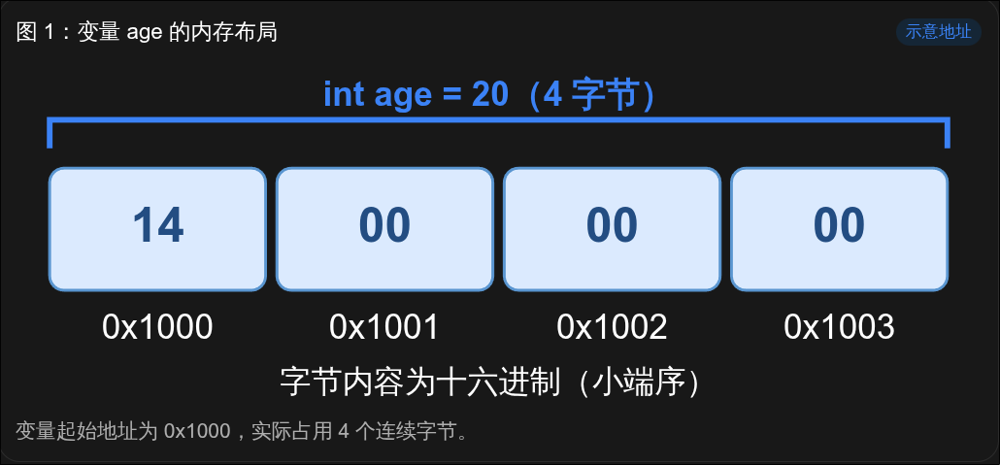
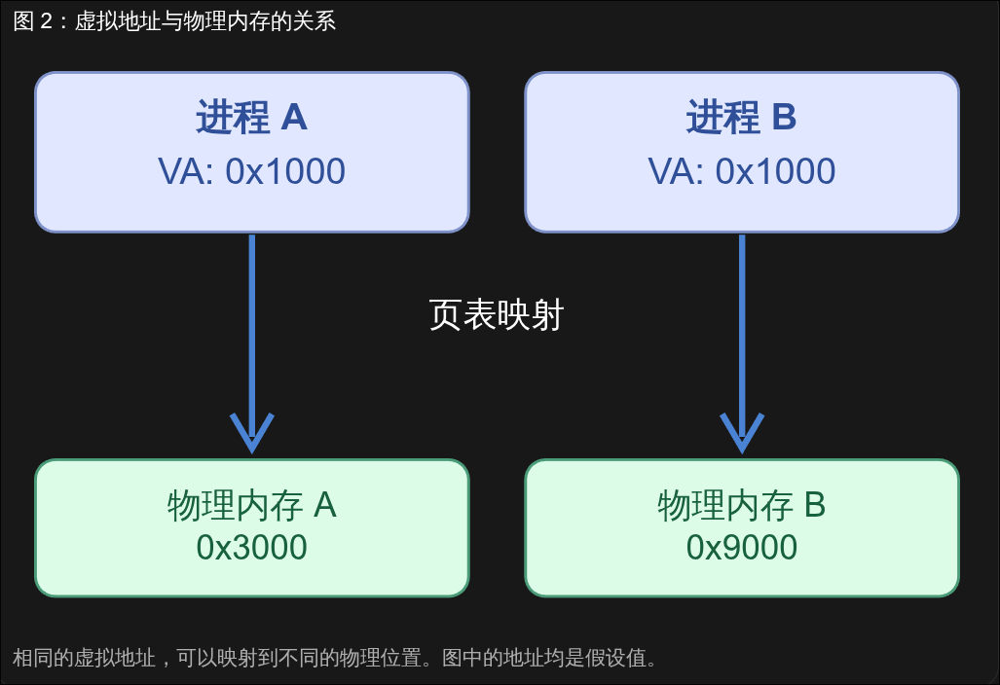

# C 语言指针与结构体入门 - 内存概述

## 0x00 前言

在开始学习指针之前，我认为有必要先了解一下计算机内存的基本概念。

对于刚刚接触 C 语言的同学来说，指针可能是整个 C 语言学习过程中最难理解的知识点之一。我们经常能在教材中看到“指针就是地址”这样的解释，但是，如果连内存地址是什么都不知道，那么这句话实际上和没说也没有多大区别。

所以，在正式介绍指针之前，我们先花一点时间，了解一下计算机中的内存究竟是什么，以及程序是如何在内存中存储和访问数据的。

## 0x01 什么是内存？

在平常购买电脑或手机的时候，我们经常能看到类似“256GB 内存 + 12GB 运行内存”这样的商品描述。

实际上，这种说法并不严谨。前面的 256GB 通常指的是设备的存储容量，也就是 SSD、闪存等外部存储设备；后面的 12GB 才是我们通常所说的运行内存（RAM）。

那么，这两种存储设备有什么区别呢？

简单来说，外存主要负责长期保存数据，而内存则主要保存程序运行过程中需要使用的数据。

例如，我们编写了一个 C 语言程序，并将其编译为可执行文件。这个可执行文件通常保存在 SSD 中。当我们运行它时，操作系统会为程序建立运行环境，将需要使用的程序指令和数据映射到内存中，CPU 随后执行程序中的指令。

不过，CPU 并不一定每次都直接从 RAM 中读取数据。现代 CPU 内部还存在寄存器（Register）和多级缓存（Cache），用于减少数据访问所需要的时间。

这里我们简单介绍一下：

| 存储部件               | 主要作用                                   |
| ---------------------- | ------------------------------------------ |
| 外存（SSD、HDD）       | 长期保存程序和文件，断电后数据通常不会丢失 |
| 内存（RAM）            | 保存程序运行时需要使用的指令和数据         |
| CPU 缓存（Cache）      | 保存部分近期使用的数据副本，加快访问速度   |
| CPU 寄存器（Register） | 保存 CPU 当前运算和执行指令所需要的数据    |

通常情况下，越接近 CPU 核心的存储部件，访问速度就越快，但是容量也越小。

本篇文章主要关注 RAM 和程序使用的内存地址，至于寄存器和 CPU 缓存的具体工作原理，这里暂时不展开介绍。

## 0x02 内存是如何存储数据的？

我们先从一个简单的 C 语言变量开始：

```c
int age = 20;
```

这段代码定义了一个名为 `age` 的整型变量，并将其初始化为 `20`。

这行代码应该很好理解。但是，这里有一个问题：

**计算机究竟把这个 20 保存在哪里了？**

为了方便理解，我们先将程序使用的内存空间看成一个**非常巨大的字节数组**。

数组中的每一个元素都占用一个字节，也就是 8 bit。同时，每个字节都有一个独立的编号，这个编号就是我们所说的**内存地址（Memory Address）**。

例如，假设现在有一段连续的内存空间：

| 内存地址 | 存储的数据 |
| -------- | ---------- |
| `0x1000` | `0x14`     |
| `0x1001` | `0x00`     |
| `0x1002` | `0x00`     |
| `0x1003` | `0x00`     |
| `0x1004` | `0xFF`     |
| `0x1005` | `0x12`     |

这里左边是内存地址，右边是该地址所保存的一个字节的数据。

需要注意的是，**内存地址和内存中保存的数据是两个完全不同的概念。**

例如，`0x1000` 是一个地址，而存放在这个地址中的 `0x14` 才是数据。

我们再回到前面的 C 语言代码：

```c
int age = 20;
```

在常见的 x86-64 环境中，`int` 类型通常占用 4 个字节。

假设 `age` 从地址 `0x1000` 开始存储，那么它就会占用 `0x1000` 到 `0x1003` 这四个连续的字节。



由于 x86-64 通常采用小端序（Little Endian），十进制整数 `20` 在这四个字节中的存储情况就是上图中的前四项。

到这里，我们就可以得到一个结论：

一个变量不仅有名称和值，还可以占据一定大小的存储空间，而这段空间具有对应的内存地址。

不过，上面的地址只是为了方便讲解而假设的。实际运行时，变量的地址并不一定是 `0x1000`，编译器也可能将变量保存在寄存器中，或者进行其他优化。

## 0x03 物理内存与虚拟内存

前面我们说，每个字节都有自己的地址。

但是，这里还有一个问题。

假设我们同时运行两个程序，它们都需要使用地址 `0x1000`，难道不会发生冲突吗？

为了解释这个问题，我们还需要了解两个概念：

- 物理内存（Physical Memory）
- 虚拟内存（Virtual Memory）

物理内存很好理解，它就是计算机中实际存在的 RAM 硬件。

而虚拟内存则不同。

在现代 Linux、Windows 等操作系统中，程序通常不会直接使用物理内存地址，而是使用操作系统和硬件共同提供的虚拟地址空间。

一般情况下，每个进程都有自己独立的虚拟地址空间。

也就是说，进程 A 和进程 B 都可以使用虚拟地址 `0x1000`，但它们最终对应的物理内存位置可以完全不同。

那么，虚拟地址是如何对应到物理地址的呢？

这里就涉及到内存管理单元（MMU）和页表（Page Table）。



简单来说，操作系统负责建立和管理地址映射关系，CPU 则通过 MMU 等硬件完成虚拟地址到物理地址的转换。

至于页表的具体结构和 MMU 的地址转换流程，已经涉及操作系统和计算机体系结构的知识，这里就不继续深入了。

我们只需要知道：

**在普通 C 语言程序中接触到的内存地址，通常是虚拟地址，而不是物理内存地址。**

另外，需要注意的是，虚拟地址空间并不代表所有地址都可以随意访问。

有些虚拟地址没有映射到有效的内存，有些地址则只有读取权限。如果程序访问了没有权限访问的内存，就可能触发我们以后经常会遇到的段错误（Segmentation Fault）。

## 0x04 小结

到这里，我们已经了解了内存的几个基础概念：

1. 内存主要用于保存程序运行时需要的数据，与长期存储文件的外存不同。
2. 可以将程序使用的内存空间理解为大量按字节编址的存储位置，每个字节都有对应的地址。
3. 一个变量可能占用多个连续的字节，它的地址和它保存的数据是两个不同的概念。
4. 在现代操作系统中，程序通常使用虚拟地址，虚拟地址通过页表等机制映射到物理内存。

有了这些基础，接下来我们就可以正式学习指针了。

既然一个变量在内存中拥有自己的地址，那么我们能不能创建另一个变量，专门用来保存这个地址，并通过它访问原来的变量呢？

当然可以。

这就是下一部分将要介绍的 **C 语言指针**。
