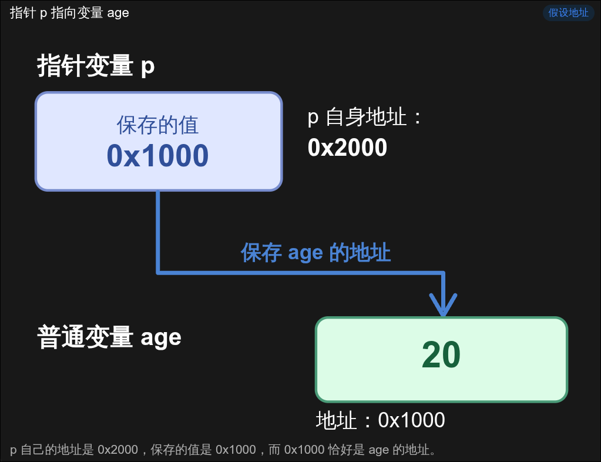

# C 语言指针与结构体入门 - 指针基础

## 0x00 前言

在上一部分中，我们简单介绍了计算机的内存，以及内存地址的基本概念。

我们已经知道，一个变量不仅有自己的名称和值，还可以占据一定大小的内存空间，而这段空间有对应的内存地址。

那么，这里就有一个问题：

既然变量在内存中有自己的地址，我们能不能创建另一个变量，专门保存这个地址，然后通过地址访问原来的变量呢？

当然可以，而这就是我们今天要介绍的指针（Pointer）。

指针是 C 语言中非常重要的一个知识点，尤其是在后续学习数组、结构体、动态内存分配，以及 Pwn 中的内存漏洞时，我们会频繁接触到它。

不过，指针并没有想象中那么复杂。只要理解了内存地址和变量之间的关系，指针实际上就是一种比较特殊的变量。

## 0x01 什么是指针？

我们先来看一段简单的 C 语言代码：

```c
int age = 20;
int *p = &age;
```

第一行代码应该很好理解，定义了一个名为 `age` 的整型变量，并将它的值初始化为 `20`。

但是第二行代码就有些奇怪了，既有 `*`，又有 `&`，这两个符号究竟是什么意思呢？

先不要着急，我们暂时忽略这两个符号，直接来看程序执行后，变量在内存中的关系。

假设现在：

- 变量 `age` 的地址是 `0x1000`。
- 变量 `p` 的地址是 `0x2000`。

那么它们在内存中的情况如下：

| 变量名称 | 变量地址 | 保存的数据 |
| -------- | -------- | ---------- |
| `age`    | `0x1000` | `20`       |
| `p`      | `0x2000` | `0x1000`   |



> ~~AI 真是太好用了（bushi）~~

可以发现，`age` 保存的是一个整数 `20`，而 `p` 保存的却是 `age` 的地址 `0x1000`。

这就是指针变量和普通变量之间最主要的区别。

**指针变量保存的是一个地址，通过这个地址，我们可以找到它所指向的对象。**

在上面的例子中，我们就可以说，指针 `p` 指向变量 `age`。

这里还有一个需要注意的地方：指针变量本身也是变量，因此它也需要占用内存空间，也有自己的地址。

在常见的 64 位 Linux 环境中，一个普通数据指针通常占用 8 个字节。至于它保存的地址指向什么类型的数据，则由指针的类型决定。

## 0x02 取地址与解引用

现在，我们再回到最开始的代码：

```c
int age = 20;
int *p = &age;
```

首先来看 `&`。

### 取地址运算符 `&`

在这里，`&` 是 C 语言中的取地址运算符（Address-of Operator）。

它的作用就是取得一个对象的地址。

例如：

```c
&age
```

表示取得变量 `age` 的地址。

假设 `age` 的地址是 `0x1000`，那么 `&age` 得到的就是一个指向 `age` 的地址值。

因此：

```c
int *p = &age;
```

就是创建一个指针变量 `p`，并将 `age` 的地址保存到 `p` 中。

### 解引用运算符 `*`

接下来就是 `*`。

这里需要注意，`*` 在指针声明和普通表达式中具有不同的含义。

我们先来看声明：

```c
int *p;
```

这表示定义一个名为 `p` 的指针变量，它的类型为 `int *`，也就是指向 `int` 类型对象的指针。

但是，在表达式中：

```c
*p
```

这里的 `*` 就是解引用运算符（Dereference Operator），用于访问指针所指向的对象。

例如：

```c
#include <stdio.h>

int main(void) {
    int age = 20;
    int *p = &age;

    printf("%d\n", *p);

    return 0;
}
```

程序输出：

```text
20
```

为什么输出的是 `20` 呢？

其实很好理解。

首先，`p` 保存的是 `age` 的地址。假设这个地址是 `0x1000`，那么 `*p` 就是在访问这个地址处的 `int` 对象，也就是 `age`。

所以 `*p` 得到的值就是 `20`。

到这里，我们可以总结一下：

| 表达式 | 含义                        |
| ------ | --------------------------- |
| `age`  | 访问变量 `age`              |
| `&age` | 获取变量 `age` 的地址       |
| `p`    | 获取指针变量 `p` 保存的地址 |
| `*p`   | 访问指针 `p` 所指向的对象   |
| `&p`   | 获取指针变量 `p` 自己的地址 |

这里建议大家一定要分清 `p`、`*p` 和 `&p`，因为后续涉及多级指针时，这几个概念很容易搞混。

## 0x03 使用指针修改变量

既然我们可以通过指针访问一个变量，那么能不能通过指针修改这个变量呢？

当然可以。

我们来看下面的代码：

```c
#include <stdio.h>

int main(void) {
    int age = 20;
    int *p = &age;

    *p = 30;

    printf("age = %d\n", age);

    return 0;
}
```

运行结果：

```c
age = 30
```

可以看到，我们并没有直接执行：

```c
age = 30;
```

而是执行了：

```c
*p = 30;
```

但是，`age` 的值依旧发生了变化。

这是因为 `p` 指向的就是 `age`，所以 `*p = 30` 修改的实际上也是 `age` 这个对象。

这里我们还需要区分两个操作：

```c
*p = 30;
```

以及：

```c
p = &other;
```

第一种操作修改的是指针所指向的对象，而第二种操作修改的则是指针变量自身保存的地址。

例如：

```c
int age = 20;
int other = 40;

int *p = &age;

*p = 30;       // age = 30

p = &other;    // p now points to other

*p = 50;       // other = 50
```

执行完之后：

```c
age = 30
other = 50
```

这里的关键在于，指针可以改变自己的指向，但是修改指针的指向，并不会自动修改原来对象的值。

## 0x04 指针的类型

前面我们使用的都是 `int *` 类型的指针，但是实际上，指针也有不同的类型。

例如：

```c
int age = 20;
double score = 95.5;
char grade = 'A';

int *p1 = &age;
double *p2 = &score;
char *p3 = &grade;
```

这里定义了三个指针：

- `p1`：指向 `int` 类型的对象。
- `p2`：指向 `double` 类型的对象。
- `p3`：指向 `char` 类型的对象。

可能会问，指针不就是保存地址吗？为什么还要区分不同的类型？

这是因为，指针的类型不仅决定了它能够指向什么类型的对象，还会影响解引用、类型检查以及指针运算。

例如，在常见的系统中，`int` 占用 4 个字节，而 `double` 占用 8 个字节。

当我们通过一个 `int *` 指针访问整数时，编译器会按照 `int` 类型的要求生成访问代码。

但是需要注意，这并不意味着我们可以随意修改指针类型，然后按照其他类型读取同一块内存。合法访问还需要满足对象类型、内存对齐以及对象生命周期等要求。

另外，指针运算也和类型有关。

例如，在一个 `int` 数组中，如果 `p` 指向数组的第一个元素，那么：

```c
p + 1
```

表示指向数组的下一个 `int` 元素，而不是简单地将地址增加一个字节。

如果 `sizeof(int)` 为 4，那么这次指针运算通常会使地址增加 4 个字节。

指针和数组的关系，我们会在后面的部分详细介绍。

## 0x05 指针使用中的注意事项

最后，我们再介绍一个初学者非常容易犯的错误。

来看下面的代码：

```c
int *p;

*p = 20;
```

这段代码看起来似乎没有什么问题，但是实际上，它存在严重的错误。

我们虽然创建了一个指针变量 `p`，但是并没有给它初始化。

因此，此时 `p` 保存的值是不确定的，我们无法保证它指向一个有效的对象。

直接执行 `*p = 20` 属于未定义行为，可能导致程序崩溃，也可能破坏其他数据。

如果暂时不需要指针指向任何对象，可以先将它初始化为空指针：

```c
#include <stddef.h>

int *p = NULL;
```

这里的 `NULL` 表示空指针常量。

但是要注意，空指针不指向任何有效对象，因此也不能直接进行解引用。

除此之外，还有一种常见的错误叫做悬空指针（Dangling Pointer），指的是指针原本指向一个有效对象，但是这个对象的生命周期已经结束。

例如，使用 `free()` 释放动态分配的内存后，原本指向那块内存的指针就不能继续用于访问已经释放的对象。

在后续学习动态内存分配时，我们还会进一步讨论这个问题。

