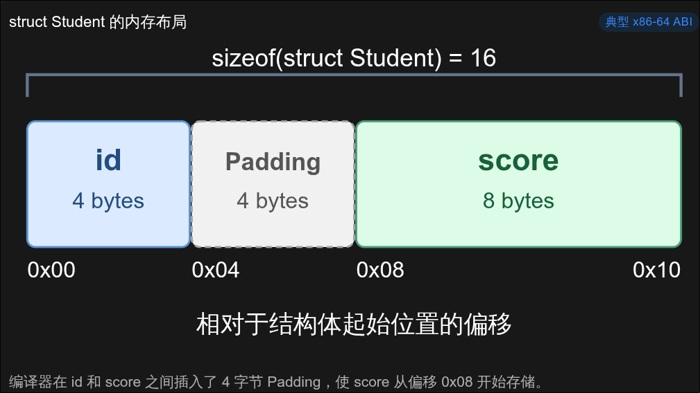
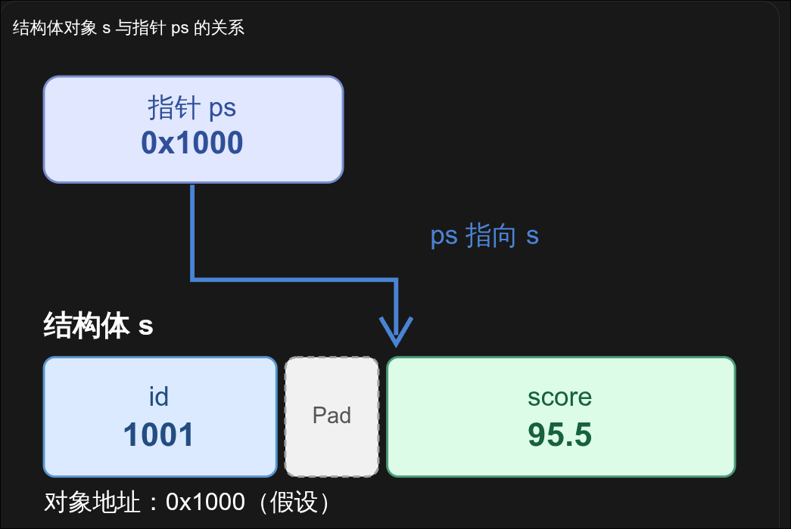

# C 语言指针与结构体入门 - 结构体基础

## 0x00 前言

在前面的两篇文章中，我们已经学习了内存地址、普通变量以及指针的基本概念。

我们知道，C 语言中的变量可以用来保存整数、浮点数、字符等不同类型的数据，而指针则可以通过保存对象的地址，实现对对象的间接访问。

但是，在实际编程过程中，我们经常需要将多个不同类型的数据组织在一起。

例如，我们现在需要编写一个用于保存学生信息的程序，每个学生都有自己的学号和成绩。

如果使用前面学习过的变量，我们可以这样编写：

```c
int id = 1001;
double score = 95.5;
```

这当然没有问题。

但是，如果我们需要保存 100 个学生的信息呢？

总不能为每一个学生都单独定义两个变量吧。即使使用数组来保存学号和成绩，仍然需要额外考虑如何确保两个数组中的数据对应同一个学生。

有没有一种方法，可以把一个学生的学号和成绩组织成一个整体呢？

当然有，这就是我们今天要介绍的结构体（Structure）。

## 0x01 什么是结构体？

结构体是 C 语言提供的一种自定义数据类型，它允许我们将多个不同类型的数据组织在一起。

我们先来看下面的代码：

```c
struct Student {
    int id;
    double score;
};
```

这段代码定义了一个名为 `Student` 的结构体类型。

其中：

- `struct` 是 C 语言定义结构体时使用的关键字。
- `Student` 是结构体的标签名称。
- `id` 和 `score` 是结构体的成员（Member）。

需要注意的是，**上面的代码只是定义了一种结构体类型，并没有创建一个实际的学生对象。**

这和我们之前学习的变量声明是有区别的。

例如：

```c
int age = 20;
```

这里定义了一个 `int` 类型的变量 `age`。

而在定义结构体类型之后，如果我们想创建一个对应的变量，还需要再写：

```c
struct Student s;
```

这样，我们就创建了一个名为 `s` 的结构体对象。

当然，也可以在创建时直接初始化：

```c
struct Student s = {1001, 95.5};
```

这里的 `1001` 对应第一个成员 `id`，`95.5` 对应第二个成员 `score`。

到这里，我们就可以把一个学生的学号和成绩保存在同一个结构体对象中了。

## 0x02 结构体成员的访问

既然我们已经创建了一个结构体对象，那么应该怎样访问它的成员呢？

在 C 语言中，我们可以使用成员访问运算符 `.`。

例如：

```c
#include <stdio.h>

struct Student {
    int id;
    double score;
};

int main(void) {
    struct Student s = {1001, 95.5};

    printf("id = %d\n", s.id);
    printf("score = %.1f\n", s.score);

    return 0;
}
```

程序输出：

```c
id = 1001
score = 95.5
```

这里的：

```c
s.id
```

表示访问结构体对象 `s` 中的 `id` 成员。

而：

```c
s.score
```

表示访问结构体对象 `s` 中的 `score` 成员。

同样，我们也可以直接修改结构体中的某个成员：

```c
s.score = 99.0;
```

这样就将学生的成绩修改为了 `99.0`，而学号 `id` 不会受到影响。

## 0x03 结构体在内存中如何排列？

前面我们已经介绍了结构体的定义和基本使用方法。

但是，这里有一个问题。

既然结构体可以将多个不同类型的成员组织在一起，那么这些成员在内存中究竟是怎样保存的？

我们还是使用前面的结构体：

```
struct Student {
    int id;
    double score;
};
```

在常见的 x86-64 Linux 环境中：

- `int` 通常占用 4 字节。
- `double` 通常占用 8 字节。

那么，整个结构体的大小是不是 `4 + 8 = 12` 字节呢？

还真不一定。

我们可以使用 `sizeof` 运算符来查看：

```c
#include <stdio.h>

struct Student {
    int id;
    double score;
};

int main(void) {
    printf("%zu\n", sizeof(struct Student));

    return 0;
}
```

在常见的 x86-64 Linux 环境中，运行结果通常是：

```
16
```

为什么是 16 字节，而不是我们计算出来的 12 字节呢？

这是因为，结构体在内存中排列时，需要考虑一个叫作**内存对齐（Memory Alignment）**的概念。

为了满足不同类型的对齐要求，编译器可能会在结构体成员之间插入一些额外的字节，这些字节被称为填充字节（Padding）。

还是以上面的结构体为例。

在典型的 x86-64 ABI 下，其内存布局如下：

| 偏移   | 大小   | 内容    |
| ------ | ------ | ------- |
| `0x00` | 4 字节 | `id`    |
| `0x04` | 4 字节 | Padding |
| `0x08` | 8 字节 | `score` |

可以看到：

`id` 位于结构体开头，占据 4 字节。

但是，后面的 `score` 并没有紧接着 `id` 存储，而是从偏移 `0x08` 的位置开始。

这是因为在该环境下，`double` 通常需要按照 8 字节边界对齐。

因此，编译器在 `id` 和 `score` 之间插入了 4 个填充字节。



最终，整个结构体的大小就变成了 16 字节。

这里需要注意两点：

1. 结构体成员的排列顺序与声明顺序一致，但是成员之间可能存在 Padding。
2. `sizeof` 得到的是整个结构体对象的大小，包括其中的填充字节，而不仅仅是各个成员大小的总和。

另外，不同的 CPU 架构、ABI 和编译器配置可能具有不同的对齐要求，因此不能认为所有平台上的 `Student` 都一定占用 16 字节。

结构体的内存布局在后续学习 Pwn 和逆向分析时非常重要，尤其是在恢复结构体成员偏移、分析堆对象，以及构造漏洞利用数据时，我们都需要考虑这些填充字节。

## 0x04 结构体指针

现在，我们已经知道，结构体本身也是一个对象，会占据一段连续的内存空间。

既然它是一个对象，那么自然也就有自己的地址。

而在上一篇文章中，我们已经学习过如何使用指针保存对象的地址。

所以，结构体当然也可以使用指针。

例如：

```c
struct Student s = {1001, 95.5};

struct Student *ps = &s;
```

这里定义了一个名为 `ps` 的指针变量。

它的类型是：

```c
struct Student *
```

也就是指向 `struct Student` 类型对象的指针。

而：

```c
& s
```

这里实际写代码时应当使用 `&s`，表示获取结构体对象 `s` 的地址。

因此，`ps` 保存的就是结构体对象 `s` 的地址。

这里的原理和前面介绍的 `int *` 指针完全相同，只不过现在指针所指向的不再是一个整数，而是一个结构体对象。

## 0x05 `.` 和 `->` 的区别

前面我们已经学习了如何使用 `.` 访问结构体成员。

但是，当我们使用结构体指针时，还会遇到另一个运算符：

```c
->
```

它叫作箭头运算符，用来通过结构体指针访问其所指向对象的成员。

我们先来看下面的代码：

```c
struct Student {
    int id;
    double score;
};

struct Student s = {1001, 95.5};

struct Student *ps = &s;
```

这里的 `s` 是一个结构体对象，而 `ps` 是指向它的指针。

如果我们想直接通过 `s` 访问成绩，可以使用：

``` c
s.score
```

但是，如果想通过指针 `ps` 访问成绩，就可以使用：

```c
ps->score
```

例如：

```c
ps->score = 99.0;
```



执行之后，`s.score` 的值也会变成 `99.0`。

这是因为 `ps` 指向的就是 `s`，所以它们访问的实际上是同一个对象。

可能有同学会问，为什么结构体指针需要使用 `->`，而不能直接使用 `.` 呢？

实际上，我们也可以通过之前学过的解引用运算符来理解。

```c
(*ps).score
```

这段表达式与：

```c
ps->score
```

完全等价。

我们来分析一下前面的表达式：

首先，`ps` 是一个指针，保存的是结构体对象 `s` 的地址。

因此：

```c
*ps
```

表示访问 `ps` 所指向的结构体对象，也就是 `s`。

接下来：

```c
(*ps).score
```

自然就是访问这个结构体对象中的 `score` 成员。

所以，C 语言提供了 `->` 运算符，让我们可以直接通过结构体指针访问成员，而不必每次都先写出解引用操作。

这里还有一个需要注意的地方：

```c
(*ps).score
```

外面的括号不能省略。

这是因为成员访问运算符 `.` 的优先级高于一元解引用运算符 `*`。

如果写成：

```
*ps.score
```

编译器会优先解析 `ps.score`，但是 `ps` 是指针，并不是结构体对象，因此这种写法是错误的。

最后，我们总结一下：

| 表达式        | 含义                     |
| ------------- | ------------------------ |
| `s.score`     | 直接访问结构体对象的成员 |
| `ps->score`   | 通过结构体指针访问成员   |
| `(*ps).score` | 先解引用指针，再访问成员 |

**记住一个最简单的判断方法：左边是结构体对象，就使用** `**.**`**；左边是指向结构体的指针，就使用** `**->**`**。**

