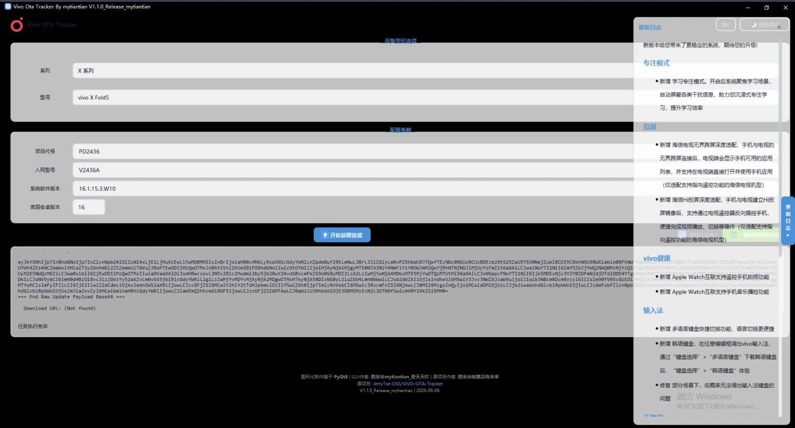
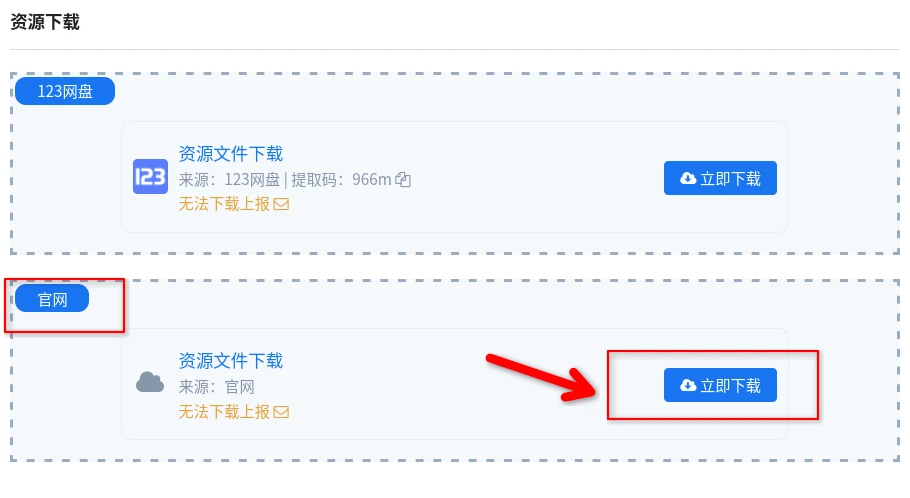



# 0x00 前言

笔者并非专业的 Android 安全研究员，目前只是一名大学生。出于个人兴趣与实验室任务，我尝试将 IonStack 移植到 vivo X Fold5。本文记录此次移植过程中完成的分析、验证过的利用路径，以及当前仍未解决的问题。

本次移植尚未成功。当前的主要阻塞点是缺少可用的 KASLR 地址泄露或 kernel base 推导方法。到目前为止，笔者借助 AI 分析并尝试了以下五类方案：

1. **通过 perf 泄露 KASLR**

   `tools/perf_leak*.c` 使用 `perf_event_open` 对 IP 和调用链（call chain）进行采样，目标是泄露 kernel text 地址，并据此推导 `KIMAGE_TEXT_BASE`。实际测试中，设备的 shell 域调用 `perf_event_open` 返回 `EACCES`，因此该路径不可用。

2. **利用 pselect/futex 的同线程内核栈重叠**

   原 IonStack 路线尝试通过 `pselect` 的 `fdset` 覆盖 stale futex waiter。静态分析确认，waiter 位于 `entry_sp - 0x2d8`，而 `pselect` 的 `fdset` 位于 `entry_sp - 0x200`。`fdset` 位于 waiter 上方 `0xd8` 字节，且写入方向为正向，无法覆盖目标结构。强制执行会导致 kernel panic，因此相关代码中已加入安全守卫。

3. **寻找可替代的 syscall 内核栈写入路径**

   分析范围包括 `ppoll`、`io_uring_register`、`keyctl`、`quotactl` 和 xattr 等路径，目标是在 native 64-bit 环境下，将用户可控数据写入 `entry_sp - 0x2d8`。目前尚未找到可用候选：多数路径的写入位置偏高，或写入内容无法由用户态有效控制。

4. **验证 pipe、SKB 与 KernelSnitch 相关路径**

   已验证 SKB、pipe 跨页和 direct-map anchor 等基础行为，并尝试盲写 pipe、UAF pipe 与页面复用。分析结果表明，pipe 数据页由 `alloc_page` 分配，不会落入内核数据区；UAF 复用尚未稳定触发，同时 `kzalloc` 的清零行为也会影响后续利用。

5. **cred 喷射与结构喷射**

   分析中考虑了 `cred_jar` 非清零特性及 cred 喷射方案。当前仍缺少可靠的 cred 地址泄露手段，并且现有 FOPS payload 与 cred 结构不匹配，因此该方向暂时无法形成有效利用链。

虽然尚未完成 IonStack 的移植，但此次尝试获得了 vivo X Fold5 的全量卡刷包，并整理出相应的获取方法。截至本文撰写时，该卡刷包尚未见于公开网络。这是本次研究最主要的阶段性成果，也为后续的固件分析和利用路径验证提供了完整基础。

# 0x01 测试环境与设备信息

## 主机环境

| 项目 | 配置 |
| --- | --- |
| 操作系统 | Arch Linux x86_64 |
| 设备 | ROG Strix G18 G814JVR |
| 内核 | Linux 7.1.3-zen1-2-zen |
| Shell | zsh 5.9.1 |
| 桌面环境 | KDE Plasma 6.7.2 |
| 窗口系统 | KWin / Wayland |
| CPU | Intel Core i9-14900HX |
| 独立显卡 | NVIDIA GeForce RTX 4060 Laptop GPU |
| 集成显卡 | Intel Raptor Lake-S UHD Graphics |

在 Arch Linux 上安装 ADB：

```bash
sudo pacman -S android-tools
```

本次实验使用的 `android-tools` 与 ADB 版本如下：

```text
android-tools 36.0.1-2

Android Debug Bridge version 1.0.41
Version 36.0.1-android-tools
Installed as /usr/bin/adb
Running on Linux 7.1.3-zen1-2-zen (x86_64)
```

## 设备连接确认

通过 ADB 确认测试设备已连接：

```bash
adb devices
```

输出如下：

```text
List of devices attached
<device-serial>       device
```

## 基础设备信息

使用 Android property 获取设备型号、系统版本与 CPU ABI：

```bash
adb shell '
getprop ro.product.brand
getprop ro.product.model
getprop ro.product.device
getprop ro.product.name
getprop ro.product.board
getprop ro.hardware
getprop ro.soc.model
getprop ro.vivo.product.version
getprop ro.build.version.release
getprop ro.build.version.sdk
getprop ro.build.version.security_patch
getprop ro.build.fingerprint
getprop ro.product.cpu.abilist
'
```

对应输出：

```text
vivo
V2436A
PD2436
PD2436
pineapple
qcom
SM8650
PD2436_A_16.1.15.3.W10.V000L1
16
36
2026-05-01
vivo/PD2436/PD2436:16/BP2A.250605.031.A3_V000L1/compiler260528183728:user/release-keys
arm64-v8a
```

## 内核与权限状态

```bash
adb shell uname -a
adb shell getenforce
adb shell id -Z
```

输出如下：

```text
Linux localhost 6.1.145-android14-11-maybe-dirty #1 SMP PREEMPT Thu Jan  1 00:00:00 UTC 1970 aarch64 Toybox
Enforcing
u:r:shell:s0
```

## 内核配置与关键运行时参数

```bash
adb shell 'zcat /proc/config.gz | grep CONFIG_ARM64_PAGE_SHIFT'
adb shell 'cat /proc/slabinfo | grep "^mm_struct"'
adb shell 'cat /proc/sys/kernel/perf_event_paranoid'
adb shell 'getprop ro.boot.verifiedbootstate; getprop ro.boot.vbmeta.device_state'
```

输出如下：

```text
CONFIG_ARM64_PAGE_SHIFT=12

mm_struct            608    896   1024   32    8 : tunables    0    0    0 : slabdata     28     28      0

-1
green
locked
```

上述命令确认的测试设备信息如下：

| 项目 | 信息 |
| --- | --- |
| 设备名称 | vivo X Fold5 |
| 项目代号 | PD2436 |
| 入网型号 | V2436A |
| 产品名称 | PD2436 |
| SoC | Qualcomm SM8650 |
| 平台代号 | pineapple |
| 硬件平台 | qcom |
| 软件系统版本 | PD2436_A_16.1.15.3.W10.V000L1 |
| Android 版本 | Android 16 |
| SDK 版本 | 36 |
| Android 安全补丁 | 2026-05-01 |
| 内核版本 | Linux 6.1.145-android14-11-maybe-dirty |
| CPU 架构 | aarch64 |
| 用户态 ABI | arm64-v8a |
| SELinux 状态 | Enforcing |
| ADB shell 域 | u:r:shell:s0 |
| 内核页大小 | 4 KiB（`CONFIG_ARM64_PAGE_SHIFT=12`） |
| mm_struct slab 对象大小 | 1024 字节 |
| Verified Boot 状态 | green |
| Bootloader 状态 | locked |

# 0x02 全量卡刷包获取

在确认设备的基础信息后，我首先尝试使用开源项目 `VIVO-OTA-Tracker` 查询对应版本的 OTA 信息。该工具通过模拟 vivo OTA 查询流程获取升级包元数据。本次测试在 Windows 10 KVM 虚拟机中完成，并根据测试设备的信息设置以下参数：

```ini
DEVICE_TYPE=phone
MODEL_SW_VER=PD2436
DEVICE_MODEL=V2436A
SW_VERSION=16.1.15.3.W10
ANDROID_VER=16
```

工具运行后未能直接解析出最终下载地址：

```text
Download URL: (Not found)
```

但日志中已经返回目标版本的完整 OTA 元数据：

```text
Version: 16.1.15.3.W10.V000L1
Filename: 2026052821145077f86aec649bf3d0b4a53c4be252c1ff.zip
Size: 10825340931 bytes (10323 MB)
SHA256: f9ebcad65d433cc45a868499687b3dbe54c48b56bdecb1f6475b31523a95d30b
```



尽管工具没有直接给出下载地址，但目标版本全量包的真实文件名、文件大小和 SHA-256 校验值已经确定。其中，文件名是后续推导官方 CDN 下载地址的关键。

## 确认官方 CDN 路径

随后，我在 onfix.cn 购买了相邻版本 `PD2436_A_16.1.14.9.W10.V000L1` 的全量卡刷包下载链接：

```text
https://sysuptxdl.vivo.com.cn/upgrade/oem/files/20260518135530fbd8e912d8becaa46ee9f32e52f0f3ed.zip?sign=5fd0598092a396858f095a4af2cf5c41&t=6a5083f1
```



该链接指向 vivo 官方下载域名：

```text
sysuptxdl.vivo.com.cn
```

其路径格式为：

```text
/upgrade/oem/files/<package-filename>.zip
```

由此可以将两部分信息组合起来：相邻版本的有效链接用于确认官方 CDN 域名与路径模板，`VIVO-OTA-Tracker` 日志则提供目标版本的真实文件名。将路径中的 ZIP 文件名替换为目标版本文件名，并移除原链接中的查询参数，即可构造目标版本的无参数下载地址。

## 下载目标版本

最终使用以下命令下载目标版本全量卡刷包：

```bash
curl -L -o PD2436_A_16.1.15.3.W10.V000L1.zip \
  'https://sysuptxdl.vivo.com.cn/upgrade/oem/files/2026052821145077f86aec649bf3d0b4a53c4be252c1ff.zip'
```

该地址成功返回目标版本的全量卡刷包：

```text
Filename: PD2436_A_16.1.15.3.W10.V000L1.zip
Size: 10825340931 bytes
SHA256: f9ebcad65d433cc45a868499687b3dbe54c48b56bdecb1f6475b31523a95d30b
```

## 完整性校验

下载完成后，使用 `sha256sum` 计算文件摘要：

```bash
sha256sum PD2436_A_16.1.15.3.W10.V000L1.zip
```

校验结果如下：

```text
f9ebcad65d433cc45a868499687b3dbe54c48b56bdecb1f6475b31523a95d30b  PD2436_A_16.1.15.3.W10.V000L1.zip
```

计算结果与 `VIVO-OTA-Tracker` 日志中的 `pkSha256` 完全一致，可以确认下载文件是 `PD2436_A_16.1.15.3.W10.V000L1` 对应的官方全量卡刷包。随后即可继续解包并提取 `boot.img`，用于后续的内核镜像分析、符号偏移恢复与漏洞移植。

# 0x03 提取 boot.img 与生成 output.elf

获得全量卡刷包后，需要先从 OTA 包中提取 `boot.img`，再从 Android boot image 中取出 kernel Image，最后将裸内核镜像转换为便于 IDA 加载和分析的 ELF 文件。

## 使用的工具

本阶段使用了以下两类工具：

- `tools/unpack_boot.py`：来自开朗的网友所写的[《CVE-2026-43499/Android IonStack 漏洞复现》](https://qhyz.holyfun.cn/CVE202643499.html)，用于解包 Android boot image。
- `rom_unpack/extract_payload_partitions.py`：由 AI 生成的脚本，用于从 Android OTA 包内的 `payload.bin` 中提取指定分区。

本次移植没有修改 `tools/unpack_boot.py` 或 `tools/parse_kallsyms.py`。下文单独给出由 AI 生成的 `extract_payload_partitions.py` 源码，以区分外部工具与本次实验新增的代码。

## 从 OTA 包提取 boot.img

首先创建目标版本的输出目录：

```bash
mkdir -p rom_unpack/PD2436_A_16.1.15.3/extracted
```

随后从全量卡刷包的 `payload.bin` 中提取 `boot` 分区：

```bash
python3 rom_unpack/extract_payload_partitions.py \
  PD2436_A_16.1.15.3.W10.V000L1.zip \
  -o rom_unpack/PD2436_A_16.1.15.3/extracted \
  -p boot
```

提取得到的文件位于：

```text
rom_unpack/PD2436_A_16.1.15.3/extracted/boot.img
```

使用 `file` 和 `sha256sum` 检查文件类型与摘要：

```bash
file rom_unpack/PD2436_A_16.1.15.3/extracted/boot.img
sha256sum rom_unpack/PD2436_A_16.1.15.3/extracted/boot.img
```

结果如下：

```text
boot.img: Android bootimg, kernel, ramdisk (0x630)
7bda8a5a704e08d824a1f7c0012d882f98dbbcfbdc78eb195a8de28bac28dd0a  boot.img
```

## 从 boot.img 提取 kernel Image

将 `boot.img` 复制到版本工作目录，并运行 `unpack_boot.py`：

```bash
cd rom_unpack/PD2436_A_16.1.15.3
cp extracted/boot.img .
python3 ../../tools/unpack_boot.py
```

解包得到的 kernel Image 位于：

```text
rom_unpack/PD2436_A_16.1.15.3/boot_unpacked/kernel
```

同样检查文件类型与 SHA-256：

```bash
file boot_unpacked/kernel
sha256sum boot_unpacked/kernel
```

结果如下：

```text
kernel: Linux kernel ARM64 boot executable Image, little-endian, 4K pages
33a0cd618edafaf5ec3f29d163a043cb12a07870fe32b1aabaf389e597d7df67  kernel
```

该结果与设备的 `CONFIG_ARM64_PAGE_SHIFT=12` 一致，确认提取出的内核镜像使用 4 KiB 页。

## 生成 output.elf

裸 kernel Image 不包含标准 ELF 文件头，直接导入 IDA 不便于后续的段映射与符号分析。这里使用 `vmlinux-to-elf` 将内核镜像转换为 ELF：

```bash
/tmp/vmlinux-to-elf-venv/bin/vmlinux-to-elf \
  --base-address 0xffffffc008000000 \
  rom_unpack/PD2436_A_16.1.15.3/boot_unpacked/kernel \
  rom_unpack/PD2436_A_16.1.15.3/output.elf
```



检查生成文件：

```bash
file rom_unpack/PD2436_A_16.1.15.3/output.elf
sha256sum rom_unpack/PD2436_A_16.1.15.3/output.elf
```

结果如下：

```text
output.elf: ELF 64-bit LSB executable, ARM aarch64, statically linked, not stripped
7fed217a9471a2a6319b58269a7a77b1cbb76bfc2aefbe9704271c4fbf2fc41a  output.elf
```

生成的 `output.elf` 可直接导入 IDA，用于恢复函数边界、核对符号偏移并分析后续利用链。

## AI 生成的 payload 分区提取脚本

`rom_unpack/extract_payload_partitions.py` 的完整源码如下：

```python
#!/usr/bin/env python3
import argparse
import bz2
import hashlib
import lzma
import os
import struct
import sys
import zipfile

import zstandard as zstd

sys.path.insert(0, os.path.join(os.path.dirname(__file__), "rom_unpack"))
from update_metadata_min_pb2 import DeltaArchiveManifest


OP_REPLACE = 0
OP_REPLACE_BZ = 1
OP_ZERO = 6
OP_DISCARD = 7
OP_REPLACE_XZ = 8
OP_REPLACE_ZSTD = 14


def payload_data_offset(zip_path: str, member: str) -> int:
    with zipfile.ZipFile(zip_path) as z:
        info = z.getinfo(member)
        if info.compress_type != zipfile.ZIP_STORED:
            raise RuntimeError(f"{member} is compressed in zip; direct seeking is unsupported")
        with open(zip_path, "rb") as f:
            f.seek(info.header_offset)
            local = f.read(30)
            if local[:4] != b"PK\x03\x04":
                raise RuntimeError("bad local zip header")
            name_len, extra_len = struct.unpack("<HH", local[26:30])
            return info.header_offset + 30 + name_len + extra_len


def read_manifest(zip_path: str):
    with zipfile.ZipFile(zip_path) as z, z.open("payload.bin") as p:
        header = p.read(24)
        if header[:4] != b"CrAU":
            raise RuntimeError("payload.bin magic mismatch")
        version = struct.unpack(">Q", header[4:12])[0]
        manifest_size = struct.unpack(">Q", header[12:20])[0]
        metadata_sig_size = struct.unpack(">I", header[20:24])[0]
        manifest = DeltaArchiveManifest()
        manifest.ParseFromString(p.read(manifest_size))
        payload_body_off = 24 + manifest_size + metadata_sig_size
        return version, manifest_size, metadata_sig_size, payload_body_off, manifest


def decode_op(op_type: int, data: bytes) -> bytes:
    if op_type == OP_REPLACE:
        return data
    if op_type == OP_REPLACE_BZ:
        return bz2.decompress(data)
    if op_type == OP_REPLACE_XZ:
        return lzma.decompress(data)
    if op_type == OP_REPLACE_ZSTD:
        return zstd.ZstdDecompressor().decompress(data)
    raise RuntimeError(f"unsupported data operation type: {op_type}")


def write_extents(out, block_size: int, extents, data: bytes):
    expected = sum(e.num_blocks for e in extents) * block_size
    if len(data) != expected:
        raise RuntimeError(f"decoded size mismatch: got {len(data)}, expected {expected}")
    pos = 0
    for e in extents:
        n = e.num_blocks * block_size
        out.seek(e.start_block * block_size)
        out.write(data[pos:pos + n])
        pos += n


def extract(zip_path: str, out_dir: str, wanted: set[str]):
    version, manifest_size, metadata_sig_size, body_off, manifest = read_manifest(zip_path)
    zip_payload_off = payload_data_offset(zip_path, "payload.bin")
    base = zip_payload_off + body_off
    os.makedirs(out_dir, exist_ok=True)

    print(f"payload_version={version}")
    print(f"manifest_size={manifest_size}")
    print(f"metadata_sig_size={metadata_sig_size}")
    print(f"block_size={manifest.block_size}")
    print(f"partitions={len(manifest.partitions)}")
    print(f"output={out_dir}")

    by_name = {p.partition_name: p for p in manifest.partitions}
    missing = sorted(wanted - set(by_name))
    if missing:
        print("missing:", ", ".join(missing))

    with open(zip_path, "rb") as src:
        for name in sorted(wanted & set(by_name)):
            p = by_name[name]
            size = p.new_partition_info.size
            out_path = os.path.join(out_dir, f"{name}.img")
            print(f"extract {name}: size={size} ops={len(p.operations)} -> {out_path}")
            with open(out_path, "wb") as out:
                out.truncate(size)
                for idx, op in enumerate(p.operations, 1):
                    op_type = int(op.type)
                    if op_type in (OP_ZERO, OP_DISCARD):
                        continue
                    src.seek(base + op.data_offset)
                    data = src.read(op.data_length)
                    if len(data) != op.data_length:
                        raise RuntimeError(f"short read in {name} op {idx}")
                    if op.HasField("data_sha256_hash"):
                        h = hashlib.sha256(data).digest()
                        if h != op.data_sha256_hash:
                            raise RuntimeError(f"sha256 mismatch in {name} op {idx}")
                    decoded = decode_op(op_type, data)
                    write_extents(out, manifest.block_size, op.dst_extents, decoded)
            with open(out_path, "rb") as f:
                digest = hashlib.sha256(f.read()).hexdigest()
            expected = p.new_partition_info.hash.hex() if p.HasField("new_partition_info") else ""
            ok = "OK" if expected and digest == expected else "NOHASH"
            print(f"  sha256={digest} {ok}")


def main():
    ap = argparse.ArgumentParser()
    ap.add_argument("zip")
    ap.add_argument("-o", "--out", default="rom_unpack/extracted")
    ap.add_argument("-p", "--partitions", required=True,
                    help="comma-separated partition names")
    args = ap.parse_args()
    wanted = {x.strip() for x in args.partitions.split(",") if x.strip()}
    extract(args.zip, args.out, wanted)


if __name__ == "__main__":
    main()
```

# 0x04 基于 output.elf 的目标机适配



获得 `output.elf` 后，针对目标内核的静态分析条件已经具备。下一步需要将原 exploit 依赖的内核符号地址、结构体偏移和内核配置参数，替换为 vivo X Fold5 当前系统版本对应的值，并据此编译目标专用的 `preload.so`。

## 提取关键内核符号偏移

本次适配需要确认以下内核符号相对于静态 kernel base 的偏移：

| 符号 | 用途分类 |
| --- | --- |
| `ashmem_fops` | 文件操作结构 |
| `configfs_read_iter` | configfs 读路径 |
| `configfs_bin_write_iter` | configfs 二进制属性写路径 |
| `copy_splice_read` | splice 读路径 |
| `init_task` | 初始任务结构 |
| `init_uts_ns` | 初始 UTS namespace |
| `empty_zero_page` | ARM64 零页 |
| `root_task_group` | 根任务调度组 |
| `selinux_state` | SELinux 全局状态 |
| `security_hook_heads` | LSM hook 表 |
| `kmalloc_caches` | kmalloc slab cache 表 |
| `anon_pipe_buf_ops` | 匿名管道 buffer operations |

这些值从 `output.elf` 的符号与反汇编结果中提取，并以相对偏移的形式写入目标配置。使用相对偏移可以保持静态分析结果与运行时地址计算逻辑分离，但最终换算为有效内核地址仍然依赖正确的 KASLR slide。

## 确认关键结构体偏移

除全局符号外，exploit 还依赖多个内核结构体的字段布局。本次主要核对以下对象：

- `task_struct`
- `mm_struct`
- `rt_mutex_waiter`
- configfs binary attribute 相关结构
- futex 与 task PI 相关字段

结构体偏移通过 `output.elf` 中可恢复的类型和符号信息、目标内核反汇编以及相关访问指令交叉确认。由于厂商内核可能包含补丁或配置差异，不能直接沿用其他设备或相邻内核版本的偏移。

## 创建目标配置

为 vivo X Fold5 当前固件创建独立的目标目录：

```text
exploit/src/targets/vivo-PD2436-16.1.15.3/
```

目标相关的符号偏移、结构体字段偏移和配置参数统一写入该目录下的 `target.h`。独立目标目录可以避免修改公共利用逻辑，也便于后续针对不同固件版本维护各自的适配数据。

## 编译目标 payload

使用目标名称指定构建配置：

```bash
make PROJECT=vivo-PD2436-16.1.15.3
```

编译成功后生成：

```text
build/vivo-PD2436-16.1.15.3/bin/preload.so
```

至此，针对 vivo X Fold5 当前固件的静态偏移适配和 payload 编译已经完成，但该产物仍缺少运行时 KASLR slide，尚不能形成完整且稳定的利用链。

## KASLR slide 获取失败

当前的主要 blocker 是无法获取目标设备运行时的 KASLR slide 或 kernel base。已经验证的两条路线均无法在当前设备上使用。

### perf 泄露路线

`tools` 目录中的 KASLR 泄露方法依赖 `perf_event_open`，尝试从 perf sample 的 IP 或调用链中获得 kernel text 地址，再计算相对于静态基址的 slide。

设备当前的运行时参数为：

```text
perf_event_paranoid = -1
```

从该参数看，perf 的常规权限限制较为宽松，但在 `u:r:shell:s0` 域中实际调用仍然失败：

```text
perf_event_open -> errno=13 (EACCES)
```

这表明 `perf_event_paranoid` 并非本机唯一的访问控制条件，SELinux 或厂商附加安全策略仍可能阻止 shell 域使用 perf。由于该接口无法建立采样事件，后续的 IP/CALLCHAIN 地址泄露也无法进行。

### pselect/futex 同线程栈重叠路线

原 exploit 还包含一条基于 `pselect` 与 futex 同线程 syscall 栈复用的 slide 获取路径，其目标是使用 `pselect` 的 `fdset` 覆盖 stale futex waiter。

针对 vivo X Fold5 的 Linux 6.1.145 内核进行静态分析后，得到以下栈偏移：

```text
stale futex waiter: entry_sp - 0x2d8
pselect fdset:      entry_sp - 0x200
delta:              0xd8
```

`pselect` 的 `fdset` 位于 stale waiter 上方 `0xd8` 字节，并且 `fdset` 按地址递增方向写入，因此无法覆盖位于更低地址的 waiter。在本机上强制运行该路径曾导致 kernel panic 和设备重启，说明原利用中的栈布局假设不适用于该目标内核。

为避免重复触发崩溃，后续代码加入了安全守卫：

- 检测到 `delta > 0` 时，默认跳过 pselect slide 路线。
- 仅在显式设置 `ALLOW_UNSAFE_SLIDE=1` 时允许继续执行该实验路径。
- 设置 `SLIDE_ONLY=1` 进行验证时，程序会安全退出，不再触发设备重启。

该守卫只能避免已知不匹配的栈覆盖路径造成崩溃，不能解决 KASLR slide 的获取问题。

## 当前适配状态

| 阶段 | 状态 |
| --- | --- |
| 获取全量卡刷包 | 已完成 |
| 提取 `boot.img` | 已完成 |
| 提取 kernel Image | 已完成 |
| 生成 `output.elf` | 已完成 |
| 确认主要符号和结构体偏移 | 大部分已完成 |
| 编译目标 `preload.so` | 已完成 |
| 获取 KASLR slide / kernel base | 未完成 |
| 稳定复现完整 exploit | 未完成 |

后续工作的核心是寻找适用于该内核与权限环境的新 KASLR 泄露方式，定位能够覆盖目标 waiter 的同线程内核栈写入原语，或在未知 slide 的条件下先建立受限读写能力，再从可识别的内核对象反推出 kernel base。

# 0x05 后记

这次移植最终是一次未完成的尝试。虽然已经完成全量卡刷包获取、内核镜像提取、静态符号与结构体偏移分析，并成功编译出目标版本的 `preload.so`，但始终没有解决运行时 KASLR slide 的获取问题，因此未能达到原 IonStack 利用链的预期效果。

在当前设备的软件版本与权限环境下，perf 泄露受到访问控制限制，pselect/futex 路线又因内核栈布局不匹配而无法覆盖目标 waiter。继续强制执行已知不匹配的路径只会增加触发 kernel panic 的风险。经过现有方案的验证后，我也没有找到其他能够稳定获取 root 的方法。

本文保留了这次尝试中确认有效的准备工作、目标机适配过程，以及已被排除的技术路线。失败的验证结果同样能够缩小后续分析范围，避免在相同前提下重复测试不可行方案。希望这些记录能为研究相近设备、内核版本或 Android 漏洞利用链的读者提供一些思路。
