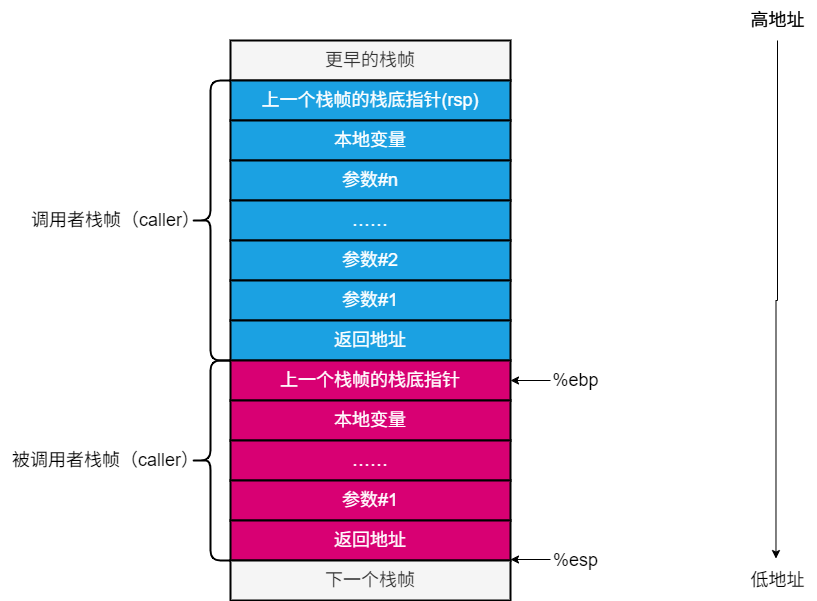
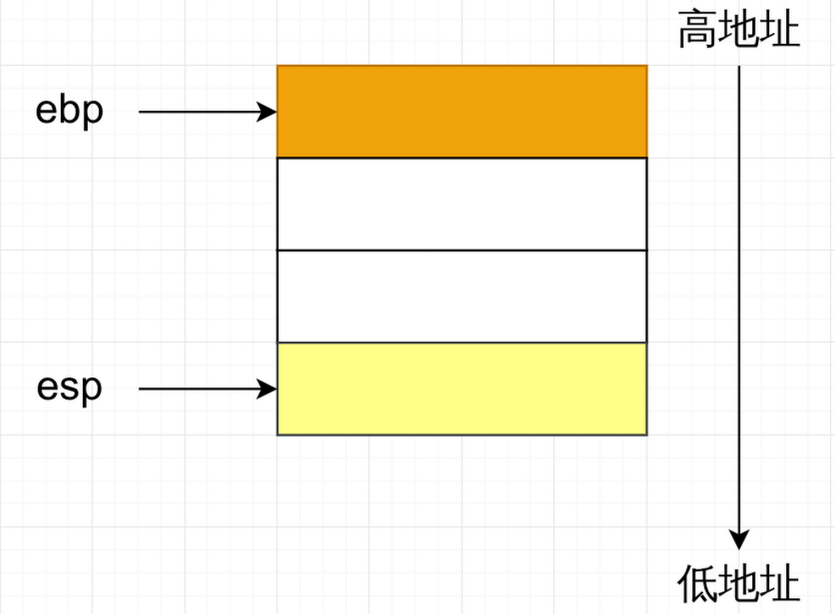
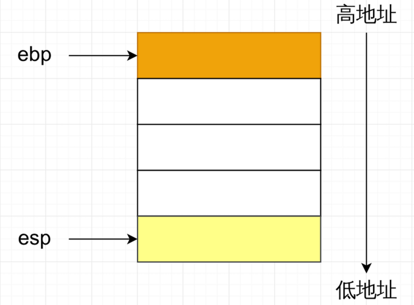
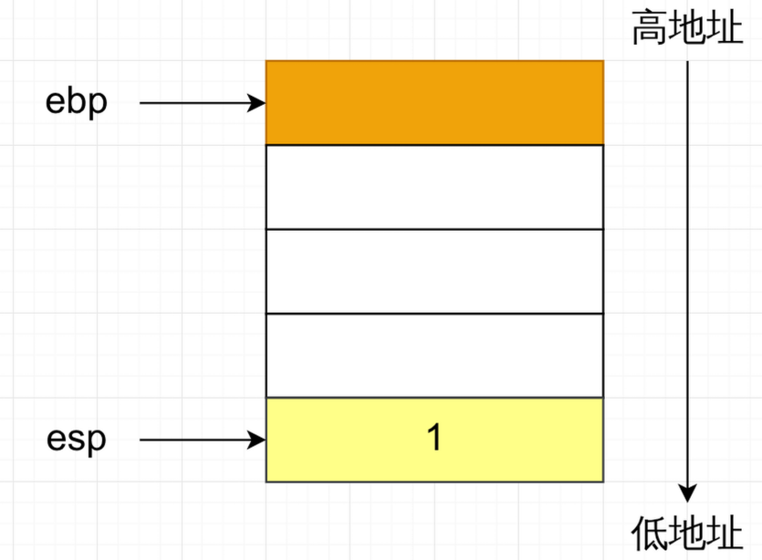
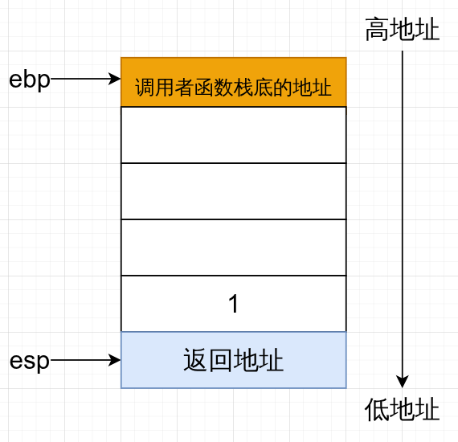
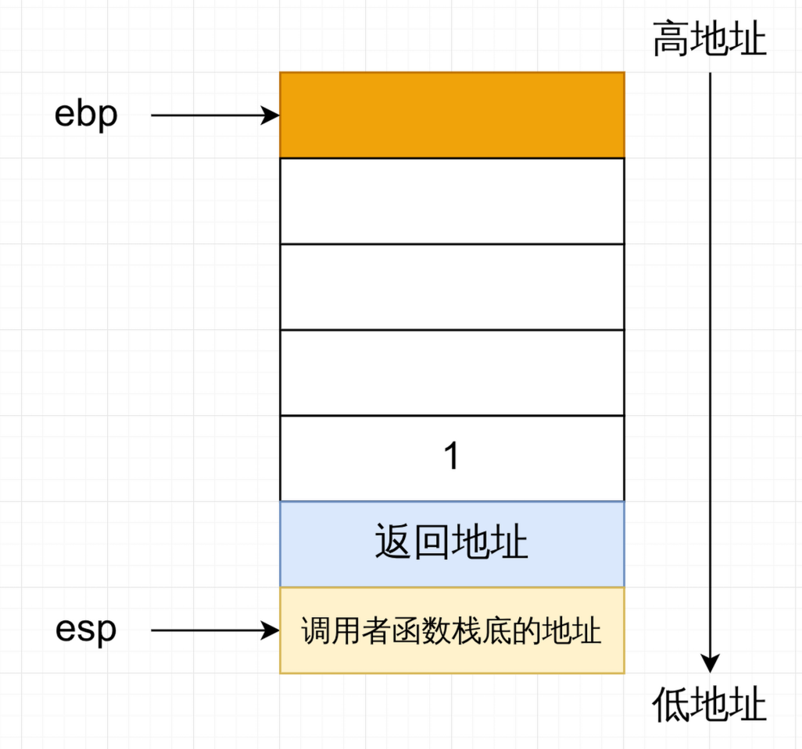
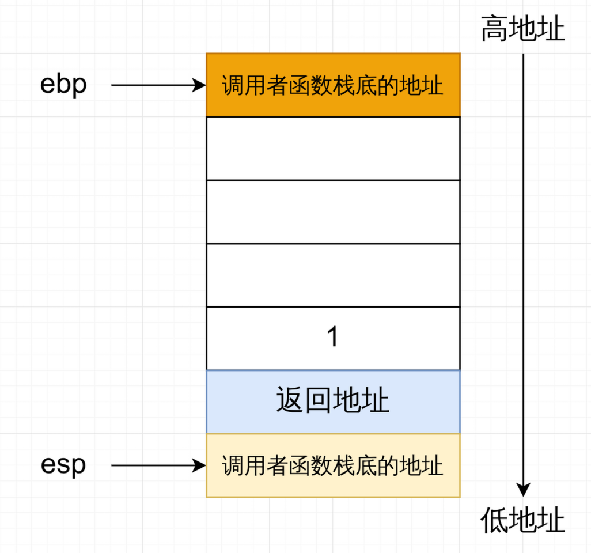
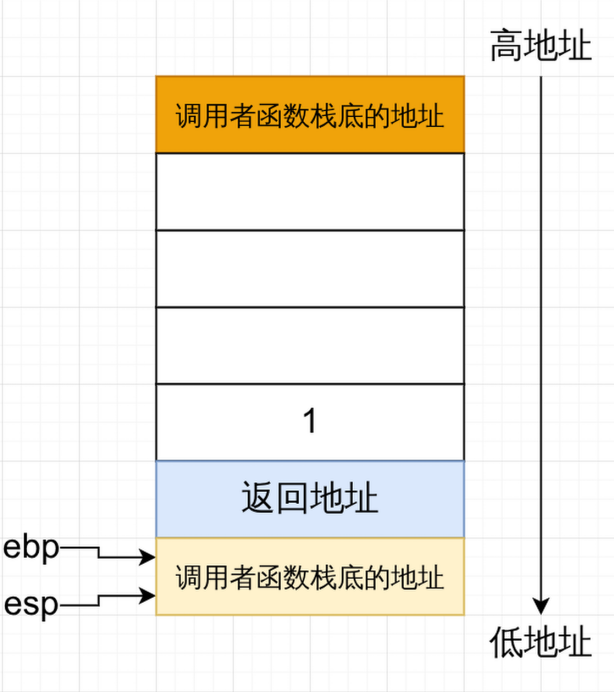
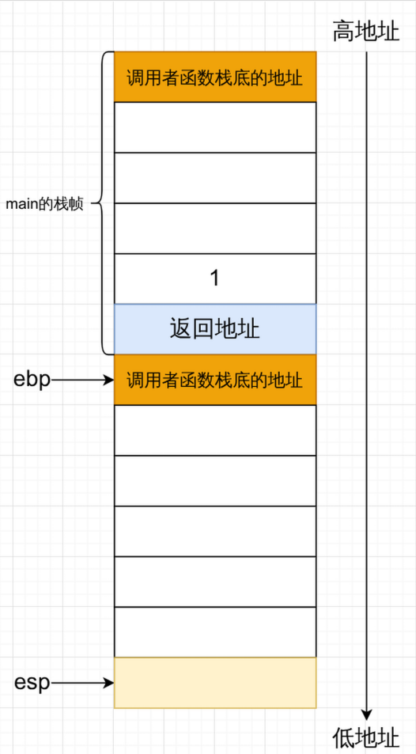

# PWN入门之四：C语言调用栈

> 参考文章：
> [PWN入门（1-1-1）-C函数调用过程原理及函数栈帧分析（Intel）](https://www.yuque.com/cyberangel/rg9gdm/gcz7x2)
> [C语言函数调用栈(一)](https://www.cnblogs.com/clover-toeic/p/3755401.html)
> [C语言函数调用栈(二)](https://www.cnblogs.com/clover-toeic/p/3756668.html)
> [Hello算法](https://www.hello-algo.com/)

## 0x00 内存简述

`内存`，更专业点应该叫`主存`。由一组`动态随机存取器(DRAM)`芯片组成。逻辑上，存储器是一个**线性的字节数组**，每个字节都有其唯一的地址(数组索引)。而我们平常操控以及看到的，是操作系统抽象出的`虚拟内存`，而非物理上的芯片。

## 0X01 什么是栈

栈，是一种特殊的线性结构，其特殊在于其对于数据的操作受限，是一种`LIFO`（Last In, First out）形式的数据结构，所有数据都是后进者先出。栈的组成包括`数据储存区域`、`栈顶指针`、`栈底指针`。对栈内数据的操作有两种：`push（入栈\压栈）`和`pop（出栈\弹栈）`，push将数据压入栈中，pop将数据弹出栈。


这幅图很好的展示了栈这种数据结构的工作模式，但是这样还是太干涩了，我们换一种更加简单的理解方式。栈其实是程序向内存申请的一片连续的[^1]，线性的内存空间。我们可以把它类比成一个放书箱子，但是这个箱子的大小是专门定制的，只能允许书躺着往里面放。上文`数据存储区域`就是箱子里用来存放书的空间，`栈顶指针`可以想象成你的手，因为你的手永远只能访问且操作到箱子中最顶上的那本书，`栈底指针`就是箱子的底板。由于箱子本身的限制，你的书也只能一本一本的放，那也只能一本一本的拿，当你想拿到箱子中最底下的那本书的时候，你就必须把上面的书一层层拿掉，才能拿到底下的书。并且，由于放书的顺序，越晚放的书，越在箱子中书的上方，所以拿书的的时候，它越早的出去，`LIFO`（Last In, First out）形式。

## 0x02 什么是栈帧

栈帧(stack frame)，其本质也是栈，只不过是这种栈专门用来保存函数调用过程中的各种信息，比如参数，返回地址，临时变量等等。栈帧也有栈顶栈底之分，但是较为反直觉的是，栈底在高地址，而栈顶在低地址，所以说不要被“底”和“顶”这两个字迷惑了。在x86-32bit下，我们使用`ebp`寄存器储存栈底的地址，`esp`寄存器储存栈顶的地址（x86-64bit就是`rbp`和`rsp`，下文中统一使用x86-32bit形式的寄存器），但是为了方便阐述与理解，你可以理解为，`ebp`是指向栈底的指针，`esp`是指向栈顶的指针，同时，也能看得出，栈帧的边界由`esp`和`ebp`界定。下面是一个栈帧的示意图。



上文说到，栈帧是用来保存函数调用过程中的各种信息的，所以在栈空间内不可能就一个栈帧，**每调用一个函数，就会生成一个新的栈帧**，调用函数的函数称为“`调用者（caller）`”，被调用的函数称为“`被调用者（callee）`”。

同时，栈的操作，需要一来上一篇文章中提到的`PUSH`和`POP`指令，需要注意的是，“栈”本身是一种数据面结构，对起内数据有`push`和`pop`两种操作方法，但是，不要把数据结构“栈”以及其操作方法与函数栈帧中的汇编指令`PUSH`和`POP`搞混，这是两个不同的概念。

## 函数调用的过程

下面，我们就从一个简单的程序，来学习函数调用的底层逻辑以及栈帧是如何工作的。

```c
// stack_min.c
#include <stdio.h>

void FunA(int x);
void FunB(int y);

int main(void) {
  int m = 100;
  FunA(1);
  return 0;
}

void FunA(int x) {
  int a = 200;
  int b = 300;
  int c = 400;
  FunB(a);
}

void FunB(int y) { int b = 500; }
```

很简单的代码，很好理解，但是要理解栈帧，我们需要从汇编来看。下面这是简化的`main`函数。

```x86asm
; 简化main函数汇编
push ebp
mov ebp, esp
; -----这是我们重点要关注的部分-----
push 1
call FunA
; -------------END--------------
leave
retn
```

可以看到， `main`函数调用了`FunA`函数，下面我将用`<--`这个小箭头表示程序**该**执行那个步骤了，因为在gdb动态调试中也是这样的显示的。

```x86asm
push ebp
mov ebp, esp
; -----这是我们重点要关注的部分-----
push 1        <--
call FunA
; -------------END--------------
leave
retn
```

我们直接来到`call FunA`附近，此时内存中的`main`函数的栈帧如下图：



这里再次强调，`ebp`和`esp`是寄存器，这里为了方便理解，将它们类比为指针。

这里的`push 1`的意思是将`1`这个立即数压入栈中，其中`push`指令等效于下面两句汇编：

```x86asm
sub esp, 4
mov [esp], eax
```

先将`esp`寄存器中的储存的数（main栈顶的地址）减去4。对应到栈上就是栈又向下“生长”了4个字节。

然后向`esp`指向的那块内存中，写入立即数`1`



**但是要注意！我上面说的是“等效”，而不是“等于”。`push`指令是一个单独指令，只是执行后的效果与上文中提到的等效汇编效果一致，不要搞混！**

下面，将要执行的指令是`call FunA`

```x86asm
push ebp
mov ebp, esp
; -----这是我们重点要关注的部分-----
push 1        
call FunA    <--
; -------------END--------------
leave
retn
```

`call`在`x86`架构下是一个单一的命令，但是其实际执行时会分解成几个微操作。**等效**于下面两句汇编：

```x86asm
push eip + 5
jmp FunA
```

`push eip + 5`的作用是将`call FunA`的下一条指令压入栈中保存。这样做的原因也不难理解，CPU中只有一个eip寄存器，也就是说，CPU只能跟踪并顺序执行一段在内存中连续指令，但是程序需要执行另一个函数`FunA`，所以需要让eip指向`FunA`函数中指令的地址。但是，在`FunA`执行完之后，我们仍想回到`main`函数中，执行`call FunA`之后的命令。由于寄存器中的值有易失性，变了就回不去了，所以才需要将`call FunA`之后的那条指令的地址保存在栈中，然后在`FunA`执行完后，再从栈中将这个地址重新赋值给`eip`，让CPU继续执行`main`函数的指令。

至于为什么下一条命令地址值是当前的`eip`中的地址加5个字节的偏移，这是因为，在计算机底层，`call`指令也只不过是一个十六进制的数字而已，占一个字节，而在x86_32bit架构下，一个地址的字长是4个字节，所以`call FunA`在内存中一共占用5个字节，所以+5才是下一个指令的地址。

`jmp FunA`很好理解，**无条件**跳转到`FunA`所在的地址上。

所以，`call`就干两件事，将`call`指令的下一条指令的地址压入栈保存，其中这个地址，也叫做**返回地址**，然后**无条件**跳转到调用函数的地址上，继续执行指令。

当执行完`call FunA`，内存中栈如下图所示



此时，我们仍在`main`函数的栈帧中。

下面，该执行`FunA`函数了。

```x86asm
_FunA:
  push ebp       <--
  mov ebp, esp
  sub esp, 24
  mov [ebp-20], 200
  mov [ebp-16], 300
  mov [ebp-12], 400
  sub esp, 12
  push [ebp-20]
  call FunB
 函数调用的过程
  add esp, 16
  nop
  leave
  retn
```

`push ebp`，将`ebp`寄存器的值，也就是`main`函数栈帧的栈底地址保存在栈中。这样做的原因也很简单，和保存`eip`中的值一样，都是为了保存现场。在`FunA`执行的时候，`ebp`指向的是`FunA`的栈底。当`FunA`（被调用者函数）执行完后，`ebp`又可以根据栈中保存的值，恢复到原来呃状态，指向`main`（调用者函数）的栈底继续工作。

总结成一句话：**被调用者函数栈帧的栈底存放的是调用者函数栈帧栈底的地址。**

该指令执行完之后栈帧示意图如下：



同理，`main`函数的栈底存放的也是调用`main`函数的函数的栈底地址。

> 在大多数的面向初学者的C语言教材中都提到，`main`都是程序唯一的入口，这句话是正确的，但是请不理解为，`main`就是这个程序的起始函数，实际上，从启动程序到进入`main`函数开始执行，有一段复杂的函数调用链路，这涉及到操作系统内核与系统调用的相关知识，这里就不展开讨论了。



继续执行

```x86asm
_FunA:
  push ebp       
  mov ebp, esp   <--
  sub esp, 24
  mov [ebp-20], 200
  mov [ebp-16], 300
  mov [ebp-12], 400
  sub esp, 12
  push [ebp-20]
  call FunB
  add esp, 16
  nop
  leave
  retn
```

来到`mov ebp, esp`，这个指令的意思是将`esp`的值赋值给`ebp`。让`ebp`指向`FunA`的栈底内存

执行完后栈示意图如下：



继续执行

```x86asm
_FunA:
  push ebp       
  mov ebp, esp   
  sub esp, 24    <--
  mov [ebp-20], 200
  mov [ebp-16], 300
  mov [ebp-12], 400
  sub esp, 12
  push [ebp-20]
  call FunB
  add esp, 16
  nop
  leave
  retn
```

`sub esp, 24`,意思是将`esp`内的值减去24（0x18）字节，放在栈上，意思就是开辟0x18字节的栈帧空间，因为栈是由高地址向低地址生长，所以，是`sub`指令。

执行后栈帧：



继续执行

```x86asm
_FunA:
  push ebp       
  mov ebp, esp   
  sub esp, 24    
  mov [ebp-20], 200      <--
  mov [ebp-16], 300
  mov [ebp-12], 400
  sub esp, 12
  push [ebp-20]
  call FunB
  add esp, 16
  nop
  leave
  retn
```

后面的操作就不必多说了，对栈中的内存进行赋值，然后调用其他函数。我们直接来到函数返回的部分。

```x86asm
_FunA:
  push ebp       
  mov ebp, esp   
  sub esp, 24    
  mov [ebp-20], 200      
  mov [ebp-16], 300
  mov [ebp-12], 400
  sub esp, 12
  push [ebp-20]
  call FunB
  add esp, 16
  nop
  leave    <--
  retn
```

目前的栈帧如下：


`leave`,是一个专门用于函数栈帧清理的指令，其等效于如下两条汇编：

```x86asm
mov esp, ebp
pop ebp
```

`mov esp, ebp`让`esp`指向`ebp`指向的栈底，然后`pop ebp`将`FunA`栈底中保存的`main`函数的栈底地址，pop给ebp，让ebp重新指向`main`栈底。
就像其等效的这两条汇编，`leave`在执行完之后，也会让`esp`的值加上一个机器字长。

执行后的栈帧如下：


```x86asm
_FunA:
  push ebp       
  mov ebp, esp   
  sub esp, 24    
  mov [ebp-20], 200      
  mov [ebp-16], 300
  mov [ebp-12], 400
  sub esp, 12
  push [ebp-20]
  call FunB
  add esp, 16
  nop
  leave
  retn    <--
```

`retn`，其作用等效于`pop eip`，将“返回地址”这个地址值重新给`eip`，好让调用者函数继续执行其指令。


如上，就是函数栈帧的工作流程。

## 函数调用约定

这里我只会简单介绍一下`cdecl`和`System V AMD64 ABI`这两种函数调用约定，因为这两种在Linux上是最常见的。

### cdecl

函数参数使用栈传递，常见于x86_32架构下的程序，并且按照**从右到左**的顺序入栈，例如下面这个函数调用

```c
int main() {
  int a = 1;
  int b = 2;
  int c = 3;

  FunA(a, b, c);

  return 0;
}
```

`FunA`有三个参数，按照`cdecl`调用约定，他们的入栈顺序是：c-->b-->a。

对于C函数，cdecl方式的名字修饰约定是在函数名前添加一个下划线

### System V AMD64 ABI

前六个参数使用寄存器传递，额外的参数使用使用栈传递，还是从右向左依次入栈，常见于x86_64架构下的程序

```
1. rdi  → 第一个参数
2. rsi  → 第二个参数
3. rdx  → 第三个参数
4. rcx  → 第四个参数
5. r8   → 第五个参数
6. r9   → 第六个参数
```


[^1]: 其实也可以不是连续的，比如链栈，但是这里我们只讨论基于数组的栈
