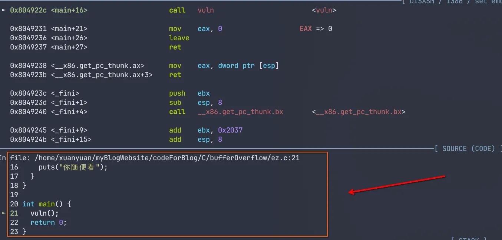
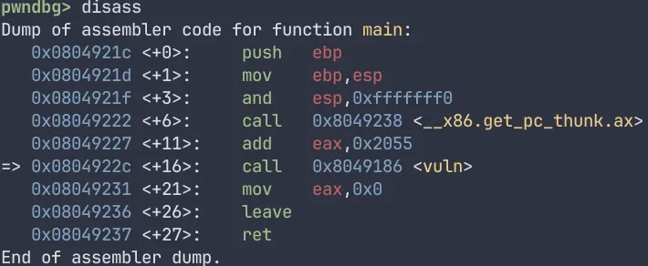
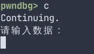
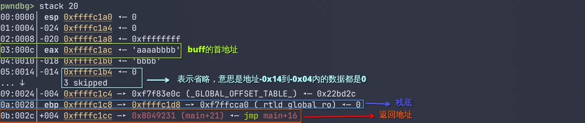
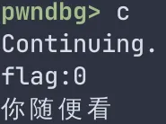
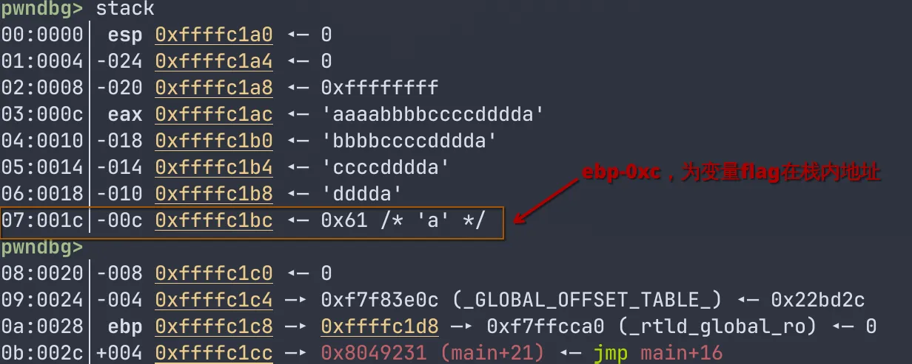
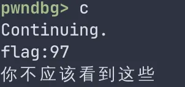

# 栈溢出

> 参考资料：
>
> [栈溢出原理 - CTF Wiki](https://ctf-wiki.org/pwn/linux/user-mode/stackoverflow/x86/stackoverflow-basic/)
>
> [PWN入门（1-2）-缓冲区溢出之栈溢出（strcpy） · Yuque](https://www.yuque.com/cyberangel/rg9gdm/wm5ozl)

## 0x01 什么是栈溢出

### 栈溢出漏洞的历史

栈溢出漏洞最早可以追溯到1972年，当时研究人员发现程序如果不对输入长度进行限制，可能导致内存被覆盖。但真正让大众意识到其危害的，是**1988年的莫里斯蠕虫**。这个蠕虫利用Unix系统中一个服务的栈溢出漏洞，通过发送超长字符串覆盖了程序的返回地址，从而在目标机器上运行恶意代码。一夜之间，互联网上20%的计算机被感染，成为历史上首次大规模网络安全事件。

### 什么是栈溢出

栈溢出（Stack Overflow）是程序中最常见的安全漏洞之一，其核心原理就是程序向栈中某个变量写入的字节数超过了该变量所申请的字节数，导致与该变量相邻的栈内存储存的其他值被改变。这种问题属于一种**缓冲区漏洞**，与其相似的还有堆溢出，bss段溢出等等。栈溢出轻则导致程序崩溃，重则可以使攻击者控制程序的执行流程，是一种简单但是强大的漏洞。

同时，我们也不难发现，发生栈溢出的前提是：

- 程序必须向栈上写入数据

- 写入的数据大小没有得到良好的控制

## 0x02 基本示例

下面是一个简单的示例程序：

```c
#include <stdio.h>
#include <string.h>

void vuln() {
  char buff[16];
  int flag = 0;

  puts("请输入数据：");
  gets(buff);

  if (flag) {
    printf("flag:%d\n", flag);
    puts("你不应该看到这些");
  } else {
    printf("flag:%d\n", flag);
    puts("你随便看");
  }
}

int main() {
  while (1) {
    vuln();
  }
  return 0;
}
```

在Linux上使用如下命令编译

```bash
gcc -std=c90 -m32 -fno-stack-protector -no-pie -z execstack -z norelro ez.c -o ez
```

这个程序也非常好理解，程序定义了两个变量：`buff`和`flag`，这二位在栈内的布局如下：

```
-0000001C buff[0]
-0000001B buff[1]
-0000001A buff[2]
-00000019 buff[3]
-00000018 buff[4]
-00000017 buff[5]
-00000016 buff[6]
-00000015 buff[7]
-00000014 buff[8]
-00000013 buff[9]
-00000012 buff[10]
-00000011 buff[11]
-00000010 buff[12]
-0000000F buff[13]
-0000000E buff[14]
-0000000D buff[15]
-0000000C flag
+00000000 saved_ebp
+00000004 return_address
```

> 一般来说，在栈帧内，需要占用大量空间的变量，比如数组，会放在靠近相对栈顶的地方，也就是较低地址。而占用空间比较小的变量，比如，int，char等等，会放在相对靠近栈底的地方，也就是叫高地址。但是，他们也和传入栈的参数一样，先定义变量会放在靠近栈底的地方。比如下面这个程序。
>
> ```
> #include <stdio.h>
> 
> int main() {
> int a = 1;
> int b = 2;
> int c = 3;
> char arr_1[16];
> char arr_2[16];
> char arr_3[16];
> 
> gets(arr_1);
> gets(arr_2);
> gets(arr_3);
> return 0;
> }
> ```
>
> 其栈帧布局如下
>
> ```
> -00000044 arr_3           db 16 dup(?)
> -00000034 arr_2           db 16 dup(?)
> -00000024 arr_1           db 16 dup(?)
> -00000014 c               dd ?
> -00000010 b               dd ?
> -0000000C a               dd ?
> -00000008 anonymous_0     dd ?
> -00000004                 db ? ; undefined
> -00000003                 db ? ; undefined
> -00000002                 db ? ; undefined
> -00000001                 db ? ; undefined
> +00000000  s              db 4 dup(?)
> +00000004  r              db 4 dup(?)
> ```

之后程序会向buff中对入用户输入的数据，然后程序对`flag`变量进行判断，如果等于0，则执行

```c
printf("flag:%d\n", flag);
puts("你随便看");
```

如果不为0,则执行

```c
 printf("flag:%d\n", flag);
 puts("你不应该看到这些");
```

但是在正常执行流程中，`flag`恒为0，不可能执行该代码。

但是，值得注意的是，该程序并没有对用户输入数据的多少做限定，`gets`函数会一致读取你输入的数据，直到你按下回车。这就会导致一个问题，如果你输入的字节数大于`buff`所申请的字节数，那么，多读入字节，会**溢出**到与`buff`相邻这内存中。

下面来实操看看

由于我们在编译的过程中使用了`-g`选项。gcc保留了调试信息，所以我们在使用gdb的时候，就可以看到程序具体执行到了源码的哪个部分。前提是你的源码和程序在一个目录下。



我们可以看到，下一步该执行`call vuln`了，我们使用`si`命令步入`vuln`函数



我们使用`b *0x080491c0`在`0x080491c0`处下一个断点，作用时让程序执行到这里会自动暂停。然后我们输入`c`，让程序继续运行



下面，我们输入`aaaabbbb`，一共八字节的数据，然后程序暂停，我们来看看栈



我们输入的字节数小于`buff`申请的字节数，没有造成栈溢出，无事发生。同时，也能注意到，虽然栈是从高到低生长的，但是向栈内部的数组内填充数据时，却是从低到高填充的。我们继续输入`c`查看程序运行情况



可以看到`flag`变量依旧为0。

程序继续执行，读取我们的输入，这一次，我么输入17个字节，根据上文中vuln函数的栈布局，我们可知，`flag`变量与`buff`数组相邻，且由于`buff`内的数据是有低到高填充的，所以，多输入的哪一个字节，就会覆盖掉原本在栈中储存的`flag`变量的值。

这一次，我们输入“aaaabbbbccccdddda”，多出来的哪一个字节是`a`

继续执行，看看这次输出了什么



可以看到，输出变了，`flag`值变成了十进制的91,也就是十六进制的0x61,在ASCII码表中对应着字符“a”。

如上，就是关于栈溢出的介绍
