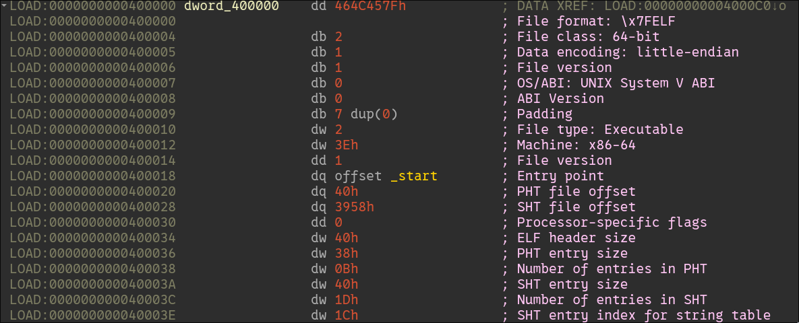

# Pwn 入门之五：ELF 概要

> 本节理解难度不低，并不需要全部掌握，了解即可

## 0x00 什么是 ELF

ELF（Executable and Linkable Format，可执行与可链接格式）， 是 Linux 及其他类 Unix 操作系统中常用的一种二进制文件格式。

之前的学习中，我们了解了 CPU 如何通过寄存器和汇编指令执行程序，以及函数在运行过程中如何使用栈空间。但是，我们还没有了解这些程序在磁盘中是如何存储的，以及操作系统是如何将其加载到内存中并执行的。

一个程序除了包含 CPU 可以执行的机器指令之外，还需要包含程序使用的数据、程序入口地址、目标 CPU 架构、内存访问权限等信息。而 ELF 就规定了这些信息在文件中的组织方式。

### 1. ELF 文件的类型

ELF 并不单指可执行文件，根据文件用途的不同，常见的 ELF 文件可以分为以下三种类型：

| 类型                             | 标识      | 常见文件              | 作用                                   |
| -------------------------------- | --------- | --------------------- | -------------------------------------- |
| 可重定位文件（Relocatable File） | `ET_REL`  | `.o`                  | 编译后尚未完成链接的目标文件           |
| 可执行文件（Executable File）    | `ET_EXEC` | 普通可执行程序        | 用于加载并执行                         |
| 共享目标文件（Shared Object）    | `ET_DYN`  | `.so`、PIE 可执行程序 | 用于动态链接或作为位置无关的可执行程序 |

### 2. 如何识别 ELF 文件

在 Linux 中，我们可以使用 `file` 命令查看一个文件的类型及其基本信息。

```bash
file hello
```

典型的输出结果如下：

```text
hello: ELF 64-bit LSB executable, x86-64, version 1 (SYSV),
dynamically linked, interpreter /lib64/ld-linux-x86-64.so.2,
not stripped
```

从上述信息中，我们可以得到：

| 字段                 | 含义                           |
| -------------------- | ------------------------------ |
| `ELF`                | 文件采用 ELF 格式              |
| `64-bit`             | 64 位程序                      |
| `LSB`                | 采用小端字节序                 |
| `executable`         | 可执行文件                     |
| `x86-64`             | 目标 CPU 架构                  |
| `dynamically linked` | 采用动态链接                   |
| `interpreter`        | 程序指定的动态链接器           |
| `not stripped`       | 文件尚未被剥离常规符号表等信息 |

在 Pwn 中，当我们拿到一道陌生的题目时，通常可以先使用 `file` 命令获取目标程序的基本信息。

### 3. ELF 的作用

ELF 主要服务于两个过程：**链接（Linking）与执行（Execution）**。

- **链接：** 链接器需要根据 ELF 中的信息，将不同目标文件中的代码与数据进行组织，处理符号引用与重定位，生成最终的可执行文件或共享库。
- **执行：** 操作系统需要根据 ELF 中的信息，将程序的代码与数据映射到进程的虚拟地址空间，设置相应的内存访问权限，并确定程序的入口点。

也正因如此，ELF 文件具有两种不同的组织视图，分别为链接视图（Linking View）和执行视图（Execution View）。

这两种视图并不是两种不同的文件格式，而是对同一个 ELF 文件从不同用途出发进行的描述。

## 0x01 ELF 文件结构

### 1. ELF 的整体结构

一个典型的 ELF 可执行文件主要由以下四个部分组成：

| 组成部分             | 中文名称   | 作用                                |
| -------------------- | ---------- | ----------------------------------- |
| ELF Header           | ELF 文件头 | 描述文件的基本信息                  |
| Program Header Table | 程序头表   | 描述程序在运行时如何被加载          |
| Sections             | 节及其内容 | 存放程序的代码、数据等内容          |
| Section Header Table | 节头表     | 描述各个 Section 的位置、大小及属性 |

一个典型的 ELF 文件结构如下：

%22%20viewBox%3D%220%200%20340%20382%22%20width%3D%22100%25%22%20xmlns%3D%22http%3A%2F%2Fwww.w3.org%2F2000%2Fsvg%22%3E%3Crect%20x%3D%2242%22%20y%3D%2215%22%20width%3D%22190%22%20height%3D%2242%22%20fill%3D%22%2364748b%22%20fill-opacity%3D%22.09%22%20stroke%3D%22%2364748b%22%2F%3E%3Ctext%20x%3D%22137%22%20y%3D%2240%22%20font-size%3D%2212%22%20fill%3D%22currentColor%22%20text-anchor%3D%22middle%22%3EELF%20Header%3C%2Ftext%3E%3Crect%20x%3D%2242%22%20y%3D%2257%22%20width%3D%22190%22%20height%3D%2250%22%20fill%3D%22%23d97706%22%20fill-opacity%3D%22.09%22%20stroke%3D%22%23d97706%22%2F%3E%3Ctext%20x%3D%22137%22%20y%3D%2286%22%20font-size%3D%2212%22%20fill%3D%22currentColor%22%20text-anchor%3D%22middle%22%3EProgram%20Header%20Table%3C%2Ftext%3E%3Crect%20x%3D%2242%22%20y%3D%22107%22%20width%3D%22190%22%20height%3D%2244%22%20fill%3D%22%232563eb%22%20fill-opacity%3D%22.09%22%20stroke%3D%22%232563eb%22%2F%3E%3Ctext%20x%3D%22137%22%20y%3D%22133%22%20font-size%3D%2212%22%20fill%3D%22currentColor%22%20text-anchor%3D%22middle%22%3E.text%3C%2Ftext%3E%3Crect%20x%3D%2242%22%20y%3D%22151%22%20width%3D%22190%22%20height%3D%2244%22%20fill%3D%22%232563eb%22%20fill-opacity%3D%22.09%22%20stroke%3D%22%232563eb%22%2F%3E%3Ctext%20x%3D%22137%22%20y%3D%22177%22%20font-size%3D%2212%22%20fill%3D%22currentColor%22%20text-anchor%3D%22middle%22%3E.rodata%3C%2Ftext%3E%3Crect%20x%3D%2242%22%20y%3D%22195%22%20width%3D%22190%22%20height%3D%2244%22%20fill%3D%22%232563eb%22%20fill-opacity%3D%22.09%22%20stroke%3D%22%232563eb%22%2F%3E%3Ctext%20x%3D%22137%22%20y%3D%22221%22%20font-size%3D%2212%22%20fill%3D%22currentColor%22%20text-anchor%3D%22middle%22%3E.data%3C%2Ftext%3E%3Crect%20x%3D%2242%22%20y%3D%22239%22%20width%3D%22190%22%20height%3D%2244%22%20fill%3D%22%232563eb%22%20fill-opacity%3D%22.09%22%20stroke%3D%22%232563eb%22%2F%3E%3Ctext%20x%3D%22137%22%20y%3D%22265%22%20font-size%3D%2212%22%20fill%3D%22currentColor%22%20text-anchor%3D%22middle%22%3E...%3C%2Ftext%3E%3Crect%20x%3D%2242%22%20y%3D%22283%22%20width%3D%22190%22%20height%3D%2244%22%20fill%3D%22%232563eb%22%20fill-opacity%3D%22.09%22%20stroke%3D%22%232563eb%22%2F%3E%3Ctext%20x%3D%22137%22%20y%3D%22309%22%20font-size%3D%2212%22%20fill%3D%22currentColor%22%20text-anchor%3D%22middle%22%3E.symtab%20%2F%20.strtab%3C%2Ftext%3E%3Crect%20x%3D%2242%22%20y%3D%22327%22%20width%3D%22190%22%20height%3D%2242%22%20fill%3D%22%230d9488%22%20fill-opacity%3D%22.09%22%20stroke%3D%22%230d9488%22%2F%3E%3Ctext%20x%3D%22137%22%20y%3D%22352%22%20font-size%3D%2212%22%20fill%3D%22currentColor%22%20text-anchor%3D%22middle%22%3ESection%20Header%20Table%3C%2Ftext%3E%3Ctext%20x%3D%2232%22%20y%3D%2221%22%20text-anchor%3D%22end%22%20font-size%3D%2210%22%20fill%3D%22currentColor%22%3E0x0%3C%2Ftext%3E%3Cpath%20d%3D%22M240%20107%20h9%20v220%20h-9%22%20fill%3D%22none%22%20stroke%3D%22%232563eb%22%20stroke-width%3D%221.5%22%2F%3E%3Ctext%20x%3D%22260%22%20y%3D%22211%22%20font-size%3D%2211%22%20fill%3D%22currentColor%22%3ESections%3C%2Ftext%3E%3Ctext%20x%3D%22260%22%20y%3D%22227%22%20font-size%3D%2211%22%20fill%3D%22currentColor%22%3E%E8%8A%82%E5%8F%8A%E5%85%B6%E5%86%85%E5%AE%B9%3C%2Ftext%3E%3Cpath%20d%3D%22M22%2035%20V350%20m-4%20-6%20l4%206%20l4%20-6%22%20fill%3D%22none%22%20stroke%3D%22currentColor%22%20opacity%3D%22.5%22%2F%3E%3Ctext%20transform%3D%22translate(12%20194)%20rotate(-90)%22%20text-anchor%3D%22middle%22%20font-size%3D%2210%22%20fill%3D%22currentColor%22%3E%E6%96%87%E4%BB%B6%E5%81%8F%E7%A7%BB%E5%A2%9E%E5%A4%A7%3C%2Ftext%3E%3C%2Fsvg%3E)

需要注意的是，ELF 文件中的 Program Header Table 和 Section Header Table 本质上都是由多个表项组成的数组，它们负责描述文件中的相关内容。

### 2. ELF Header（ELF 文件头）

ELF Header 位于 ELF 文件的起始位置，记录了整个 ELF 文件的基本属性。

对于一个 64 位 ELF 文件，其 ELF Header 的大小通常为 64 字节。

我们可以使用以下命令查看 ELF Header：

```bash
readelf -h hello
```

典型的输出结果如下（省略部分字段）：

```text
ELF Header:
  Magic:   7f 45 4c 46 02 01 01 00 ...
  Class:                             ELF64
  Data:                              2's complement, little endian
  Version:                           1 (current)
  Type:                              EXEC (Executable file)
  Machine:                           Advanced Micro Devices X86-64
  Entry point address:               0x401040
  Start of program headers:          64 (bytes into file)
  ...
```

也可以在 IDA 中的进行查看，在 IDA-viewA 窗口中拉到最上面，就可看到：



其中，我们目前需要关注以下几个字段：

| 字段                     | 含义                            |
| ------------------------ | ------------------------------- |
| Magic                    | 用于识别 ELF 文件的魔数         |
| Class                    | ELF 文件的位数（32 位或 64 位） |
| Data                     | 文件采用的字节序                |
| Type                     | ELF 文件的类型                  |
| Machine                  | 程序所对应的 CPU 架构           |
| Entry point address      | 程序的入口虚拟地址              |
| Start of program headers | 程序头表在文件中的偏移          |
| Start of section headers | 节头表在文件中的偏移            |

#### 魔数

> ~~是魔数而不是魔术~~

魔数，在当前这种情况下也可以称作「文件头」。人类区分文件类型通常依赖的是文件后缀，形如`.exe`、`.txt`、`.docx` 等。但是操作系统区分文件类型却不是考这些后缀，而是靠每个文件开头几字节的「魔数」来区分

所有符合 ELF 格式的文件，其前四个字节均为：

%22%20text-anchor%3D%22middle%22%3E%0A%20%20%20%20%3Ctext%20x%3D%2291%22%20y%3D%2231%22%20font-size%3D%2216%22%20fill%3D%22%23AAAAAA%22%3E0x00%3C%2Ftext%3E%0A%20%20%20%20%3Crect%20y%3D%2241%22%20width%3D%22182%22%20height%3D%2267%22%20rx%3D%227%22%20fill%3D%22%23262626%22%20stroke%3D%22%233D3D3D%22%3E%3C%2Frect%3E%0A%20%20%20%20%3Ctext%20x%3D%2291%22%20y%3D%2286%22%20font-size%3D%2234%22%20font-weight%3D%22bold%22%20fill%3D%22%23FFFFFF%22%3E7F%3C%2Ftext%3E%0A%20%20%20%20%3Ctext%20x%3D%2291%22%20y%3D%22130%22%20font-size%3D%2216%22%20fill%3D%22%23AAAAAA%22%3EDEL%3C%2Ftext%3E%0A%20%20%3C%2Fg%3E%0A%0A%20%20%3C!--%200x01%20--%3E%0A%20%20%3Cg%20transform%3D%22translate(212%2C%200)%22%20text-anchor%3D%22middle%22%3E%0A%20%20%20%20%3Ctext%20x%3D%2291%22%20y%3D%2231%22%20font-size%3D%2216%22%20fill%3D%22%23AAAAAA%22%3E0x01%3C%2Ftext%3E%0A%20%20%20%20%3Crect%20y%3D%2241%22%20width%3D%22182%22%20height%3D%2267%22%20rx%3D%227%22%20fill%3D%22%23262626%22%20stroke%3D%22%233D3D3D%22%3E%3C%2Frect%3E%0A%20%20%20%20%3Ctext%20x%3D%2291%22%20y%3D%2286%22%20font-size%3D%2234%22%20font-weight%3D%22bold%22%20fill%3D%22%23FFFFFF%22%3E45%3C%2Ftext%3E%0A%20%20%20%20%3Ctext%20x%3D%2291%22%20y%3D%22130%22%20font-size%3D%2216%22%20fill%3D%22%23AAAAAA%22%3EE%3C%2Ftext%3E%0A%20%20%3C%2Fg%3E%0A%0A%20%20%3C!--%200x02%20--%3E%0A%20%20%3Cg%20transform%3D%22translate(406%2C%200)%22%20text-anchor%3D%22middle%22%3E%0A%20%20%20%20%3Ctext%20x%3D%2291%22%20y%3D%2231%22%20font-size%3D%2216%22%20fill%3D%22%23AAAAAA%22%3E0x02%3C%2Ftext%3E%0A%20%20%20%20%3Crect%20y%3D%2241%22%20width%3D%22182%22%20height%3D%2267%22%20rx%3D%227%22%20fill%3D%22%23262626%22%20stroke%3D%22%233D3D3D%22%3E%3C%2Frect%3E%0A%20%20%20%20%3Ctext%20x%3D%2291%22%20y%3D%2286%22%20font-size%3D%2234%22%20font-weight%3D%22bold%22%20fill%3D%22%23FFFFFF%22%3E4C%3C%2Ftext%3E%0A%20%20%20%20%3Ctext%20x%3D%2291%22%20y%3D%22130%22%20font-size%3D%2216%22%20fill%3D%22%23AAAAAA%22%3EL%3C%2Ftext%3E%0A%20%20%3C%2Fg%3E%0A%0A%20%20%3C!--%200x03%20--%3E%0A%20%20%3Cg%20transform%3D%22translate(600%2C%200)%22%20text-anchor%3D%22middle%22%3E%0A%20%20%20%20%3Ctext%20x%3D%2291%22%20y%3D%2231%22%20font-size%3D%2216%22%20fill%3D%22%23AAAAAA%22%3E0x03%3C%2Ftext%3E%0A%20%20%20%20%3Crect%20y%3D%2241%22%20width%3D%22182%22%20height%3D%2267%22%20rx%3D%227%22%20fill%3D%22%23262626%22%20stroke%3D%22%233D3D3D%22%3E%3C%2Frect%3E%0A%20%20%20%20%3Ctext%20x%3D%2291%22%20y%3D%2286%22%20font-size%3D%2234%22%20font-weight%3D%22bold%22%20fill%3D%22%23FFFFFF%22%3E46%3C%2Ftext%3E%0A%20%20%20%20%3Ctext%20x%3D%2291%22%20y%3D%22130%22%20font-size%3D%2216%22%20fill%3D%22%23AAAAAA%22%3EF%3C%2Ftext%3E%0A%20%20%3C%2Fg%3E%0A%0A%20%20%3C!--%20%E5%9B%BE%E6%B3%A8%20--%3E%0A%20%20%3Ctext%20x%3D%2218%22%20y%3D%22162%22%20font-size%3D%2216%22%20fill%3D%22%23AAAAAA%22%3E%0A%20%20%20%20ELF%20Magic%20Number%EF%BC%9A0x7F%20%2B%20ASCII%20%E5%AD%97%E7%AC%A6%20ELF%0A%20%20%3C%2Ftext%3E%0A%0A%3C%2Fsvg%3E)

#### Entry Point（程序入口点）

Entry Point 记录了 ELF 文件的入口虚拟地址。

需要注意，**程序入口点并不等于** `main` **函数的地址。**

对于普通的 C 语言可执行程序，其 ELF 入口点通常对应 `_start` 函数。程序在执行 `main` 之前，还需要完成一系列初始化工作。

关于这一点，我们将在后面的 ELF 启动流程中详细介绍。

### 3. Section（节）

一个程序中存在着许多不同类型的数据，例如机器指令、全局变量、字符串常量等。

ELF 将这些具有不同用途的内容组织到不同的 Section 中。

例如，我们编写如下 C 语言程序：

```c
#include <stdio.h>

int global_init = 100;
int global_uninit;

const char message[] = "Hello, ELF!";

int main(void)
{
    int local = 200;

    printf("%s\n", message);
    getchar();

    return 0;
}
```

将其编译为一个 ELF 文件后，上述程序中的不同内容，通常会被组织到以下几个 Section 中：

%22%20viewBox%3D%220%200%20340%20270%22%20width%3D%22100%25%22%20xmlns%3D%22http%3A%2F%2Fwww.w3.org%2F2000%2Fsvg%22%3E%3Ctext%20x%3D%2299%22%20y%3D%2219%22%20fill%3D%22currentColor%22%20font-size%3D%2213%22%20font-weight%3D%22600%22%20text-anchor%3D%22middle%22%3EC%20%E8%AF%AD%E8%A8%80%E7%A8%8B%E5%BA%8F%3C%2Ftext%3E%3Ctext%20x%3D%22280%22%20y%3D%2219%22%20fill%3D%22currentColor%22%20font-size%3D%2213%22%20font-weight%3D%22600%22%20text-anchor%3D%22middle%22%3EELF%20Section%3C%2Ftext%3E%3Crect%20x%3D%226%22%20y%3D%2235%22%20width%3D%22185%22%20height%3D%2235%22%20rx%3D%224%22%20fill%3D%22%232563eb%22%20fill-opacity%3D%22.06%22%20stroke%3D%22%232563eb%22%2F%3E%3Ctext%20x%3D%2298%22%20y%3D%2257%22%20font-size%3D%2211%22%20text-anchor%3D%22middle%22%20fill%3D%22currentColor%22%3Emain%20%E5%87%BD%E6%95%B0%E7%9A%84%E6%9C%BA%E5%99%A8%E6%8C%87%E4%BB%A4%3C%2Ftext%3E%3Cpath%20d%3D%22M191%2052.5%20H233%20m-5%20-4%20l5%204%20l-5%204%22%20fill%3D%22none%22%20stroke%3D%22%232563eb%22%2F%3E%3Crect%20x%3D%22240%22%20y%3D%2235%22%20width%3D%2294%22%20height%3D%2235%22%20rx%3D%224%22%20fill%3D%22%232563eb%22%20fill-opacity%3D%22.12%22%20stroke%3D%22%232563eb%22%2F%3E%3Ctext%20x%3D%22287%22%20y%3D%2257%22%20text-anchor%3D%22middle%22%20fill%3D%22currentColor%22%20font-size%3D%2212%22%20font-weight%3D%22500%22%3E.text%3C%2Ftext%3E%3Crect%20x%3D%226%22%20y%3D%2283%22%20width%3D%22185%22%20height%3D%2235%22%20rx%3D%224%22%20fill%3D%22%230d9488%22%20fill-opacity%3D%22.06%22%20stroke%3D%22%230d9488%22%2F%3E%3Ctext%20x%3D%2298%22%20y%3D%22105%22%20font-size%3D%2211%22%20text-anchor%3D%22middle%22%20fill%3D%22currentColor%22%3Emessage%5B%5D%3C%2Ftext%3E%3Cpath%20d%3D%22M191%20100.5%20H233%20m-5%20-4%20l5%204%20l-5%204%22%20fill%3D%22none%22%20stroke%3D%22%230d9488%22%2F%3E%3Crect%20x%3D%22240%22%20y%3D%2283%22%20width%3D%2294%22%20height%3D%2235%22%20rx%3D%224%22%20fill%3D%22%230d9488%22%20fill-opacity%3D%22.12%22%20stroke%3D%22%230d9488%22%2F%3E%3Ctext%20x%3D%22287%22%20y%3D%22105%22%20text-anchor%3D%22middle%22%20fill%3D%22currentColor%22%20font-size%3D%2212%22%20font-weight%3D%22500%22%3E.rodata%3C%2Ftext%3E%3Crect%20x%3D%226%22%20y%3D%22131%22%20width%3D%22185%22%20height%3D%2235%22%20rx%3D%224%22%20fill%3D%22%23d97706%22%20fill-opacity%3D%22.06%22%20stroke%3D%22%23d97706%22%2F%3E%3Ctext%20x%3D%2298%22%20y%3D%22153%22%20font-size%3D%2211%22%20text-anchor%3D%22middle%22%20fill%3D%22currentColor%22%3Eglobal_init%20%3D%20100%3C%2Ftext%3E%3Cpath%20d%3D%22M191%20148.5%20H233%20m-5%20-4%20l5%204%20l-5%204%22%20fill%3D%22none%22%20stroke%3D%22%23d97706%22%2F%3E%3Crect%20x%3D%22240%22%20y%3D%22131%22%20width%3D%2294%22%20height%3D%2235%22%20rx%3D%224%22%20fill%3D%22%23d97706%22%20fill-opacity%3D%22.12%22%20stroke%3D%22%23d97706%22%2F%3E%3Ctext%20x%3D%22287%22%20y%3D%22153%22%20text-anchor%3D%22middle%22%20fill%3D%22currentColor%22%20font-size%3D%2212%22%20font-weight%3D%22500%22%3E.data%3C%2Ftext%3E%3Crect%20x%3D%226%22%20y%3D%22179%22%20width%3D%22185%22%20height%3D%2235%22%20rx%3D%224%22%20fill%3D%22%23d97706%22%20fill-opacity%3D%22.06%22%20stroke%3D%22%23d97706%22%2F%3E%3Ctext%20x%3D%2298%22%20y%3D%22201%22%20font-size%3D%2211%22%20text-anchor%3D%22middle%22%20fill%3D%22currentColor%22%3Eglobal_uninit%3C%2Ftext%3E%3Cpath%20d%3D%22M191%20196.5%20H233%20m-5%20-4%20l5%204%20l-5%204%22%20fill%3D%22none%22%20stroke%3D%22%23d97706%22%2F%3E%3Crect%20x%3D%22240%22%20y%3D%22179%22%20width%3D%2294%22%20height%3D%2235%22%20rx%3D%224%22%20fill%3D%22%23d97706%22%20fill-opacity%3D%22.12%22%20stroke%3D%22%23d97706%22%2F%3E%3Ctext%20x%3D%22287%22%20y%3D%22201%22%20text-anchor%3D%22middle%22%20fill%3D%22currentColor%22%20font-size%3D%2212%22%20font-weight%3D%22500%22%3E.bss%3C%2Ftext%3E%3Crect%20x%3D%226%22%20y%3D%22227%22%20width%3D%22185%22%20height%3D%2235%22%20rx%3D%224%22%20stroke%3D%22%2364748b%22%20stroke-dasharray%3D%224%203%22%20fill%3D%22%2364748b%22%20fill-opacity%3D%22.06%22%2F%3E%3Ctext%20x%3D%2298%22%20y%3D%22249%22%20text-anchor%3D%22middle%22%20font-size%3D%2211%22%20fill%3D%22currentColor%22%3Elocal%20%3D%20200%3C%2Ftext%3E%3Cpath%20d%3D%22M191%20244.5%20H233%20m-5%20-4%20l5%204%20l-5%204%22%20stroke%3D%22%2364748b%22%20stroke-dasharray%3D%223%202%22%20fill%3D%22none%22%2F%3E%3Crect%20x%3D%22240%22%20y%3D%22227%22%20width%3D%2294%22%20height%3D%2235%22%20rx%3D%224%22%20stroke%3D%22%2364748b%22%20stroke-dasharray%3D%224%203%22%20fill%3D%22%2364748b%22%20fill-opacity%3D%22.06%22%2F%3E%3Ctext%20x%3D%22287%22%20y%3D%22249%22%20text-anchor%3D%22middle%22%20font-size%3D%2211%22%20fill%3D%22currentColor%22%3E%E8%BF%90%E8%A1%8C%E6%97%B6%E6%A0%88%E7%A9%BA%E9%97%B4%3C%2Ftext%3E%3C%2Fsvg%3E)

#### **常见的 Section**

| Section   | 名称         | 作用                                         |
| --------- | ------------ | -------------------------------------------- |
| `.text`   | 代码节       | 存放程序的机器指令                           |
| `.rodata` | 只读数据节   | 存放字符串常量等只读数据                     |
| `.data`   | 数据节       | 存放具有非零初始值的可写全局变量、静态变量等 |
| `.bss`    | BSS 节       | 描述未初始化或零初始化的全局变量、静态变量等 |
| `.got`    | 全局偏移表   | 存放动态链接过程中使用的地址等信息           |
| `.plt`    | 过程链接表   | 存放辅助调用外部函数的指令                   |
| `.symtab` | 符号表       | 存放函数、变量等符号的信息                   |
| `.strtab` | 字符串表     | 存放符号名称等字符串                         |
| `.dynsym` | 动态符号表   | 存放动态链接所需的符号信息                   |
| `.dynstr` | 动态字符串表 | 存放动态链接所需的字符串                     |

其中，`.text`、`.rodata`、`.data`、`.bss` 是我们目前需要重点理解的四个 Section。

需要特别注意 `.bss` 节。

假设我们定义了一个未初始化的全局数组：

```
char buffer[0x100000];
```

这个数组需要占用 1 MiB 的内存空间，但 ELF 文件并不需要为其存储 1 MiB 的零字节。

`.bss` 通常采用 `SHT_NOBITS` 类型，仅通过相关 ELF 元数据描述所需的空间，而不在文件中存放对应的数据内容。在程序加载时，相应的内存区域会被零初始化。

因此，**ELF 文件在磁盘中占用的空间与其加载到内存后占用的空间并不完全相同。**

简单来说就是，磁盘中的 ELF 文件，更像是一个为后续创建一个在内存中可运行的ELF文件的“蓝图”。

#### Section Header Table（节头表）

既然 ELF 中存在多个 Section，那么相关工具是如何知道每个 Section 在文件中的位置、大小以及属性的呢？

这就需要用到 Section Header Table。

Section Header Table 由多个 Section Header 组成，每一个 Section Header 描述一个 Section

%22%20viewBox%3D%220%200%20340%20245%22%20width%3D%22100%25%22%20xmlns%3D%22http%3A%2F%2Fwww.w3.org%2F2000%2Fsvg%22%3E%3Ctext%20x%3D%22100%22%20y%3D%2217%22%20font-size%3D%2212%22%20font-weight%3D%22600%22%20text-anchor%3D%22middle%22%20fill%3D%22currentColor%22%3ESection%20Header%20Table%3C%2Ftext%3E%3Ctext%20x%3D%22282%22%20y%3D%2217%22%20font-size%3D%2212%22%20font-weight%3D%22600%22%20text-anchor%3D%22middle%22%20fill%3D%22currentColor%22%3ESections%3C%2Ftext%3E%3Crect%20x%3D%228%22%20y%3D%2232%22%20width%3D%22186%22%20height%3D%2249%22%20rx%3D%223%22%20fill%3D%22%232563eb%22%20fill-opacity%3D%22.07%22%20stroke%3D%22%232563eb%22%2F%3E%3Ctext%20x%3D%22101%22%20y%3D%2251%22%20text-anchor%3D%22middle%22%20font-size%3D%2212%22%20fill%3D%22currentColor%22%3E.text%20Header%3C%2Ftext%3E%3Ctext%20x%3D%22101%22%20y%3D%2267%22%20text-anchor%3D%22middle%22%20font-size%3D%2210%22%20fill%3D%22currentColor%22%20opacity%3D%22.7%22%3EOffset%20%2F%20Address%20%2F%20Size%20%2F%20Flags%3C%2Ftext%3E%3Cpath%20d%3D%22M194%2056%20H230%20m-5%20-4%20l5%204%20l-5%204%22%20stroke%3D%22%232563eb%22%20fill%3D%22none%22%2F%3E%3Crect%20x%3D%22239%22%20y%3D%2237%22%20width%3D%2294%22%20height%3D%2239%22%20rx%3D%223%22%20fill%3D%22%232563eb%22%20fill-opacity%3D%22.12%22%20stroke%3D%22%232563eb%22%20stroke-dasharray%3D%22none%22%2F%3E%3Ctext%20x%3D%22286%22%20y%3D%2261%22%20text-anchor%3D%22middle%22%20font-size%3D%2212%22%20fill%3D%22currentColor%22%3E.text%3C%2Ftext%3E%3Crect%20x%3D%228%22%20y%3D%2283%22%20width%3D%22186%22%20height%3D%2249%22%20rx%3D%223%22%20fill%3D%22%230d9488%22%20fill-opacity%3D%22.07%22%20stroke%3D%22%230d9488%22%2F%3E%3Ctext%20x%3D%22101%22%20y%3D%22102%22%20text-anchor%3D%22middle%22%20font-size%3D%2212%22%20fill%3D%22currentColor%22%3E.rodata%20Header%3C%2Ftext%3E%3Ctext%20x%3D%22101%22%20y%3D%22118%22%20text-anchor%3D%22middle%22%20font-size%3D%2210%22%20fill%3D%22currentColor%22%20opacity%3D%22.7%22%3EOffset%20%2F%20Address%20%2F%20Size%20%2F%20Flags%3C%2Ftext%3E%3Cpath%20d%3D%22M194%20107%20H230%20m-5%20-4%20l5%204%20l-5%204%22%20stroke%3D%22%230d9488%22%20fill%3D%22none%22%2F%3E%3Crect%20x%3D%22239%22%20y%3D%2288%22%20width%3D%2294%22%20height%3D%2239%22%20rx%3D%223%22%20fill%3D%22%230d9488%22%20fill-opacity%3D%22.12%22%20stroke%3D%22%230d9488%22%20stroke-dasharray%3D%22none%22%2F%3E%3Ctext%20x%3D%22286%22%20y%3D%22112%22%20text-anchor%3D%22middle%22%20font-size%3D%2212%22%20fill%3D%22currentColor%22%3E.rodata%3C%2Ftext%3E%3Crect%20x%3D%228%22%20y%3D%22134%22%20width%3D%22186%22%20height%3D%2249%22%20rx%3D%223%22%20fill%3D%22%23d97706%22%20fill-opacity%3D%22.07%22%20stroke%3D%22%23d97706%22%2F%3E%3Ctext%20x%3D%22101%22%20y%3D%22153%22%20text-anchor%3D%22middle%22%20font-size%3D%2212%22%20fill%3D%22currentColor%22%3E.data%20Header%3C%2Ftext%3E%3Ctext%20x%3D%22101%22%20y%3D%22169%22%20text-anchor%3D%22middle%22%20font-size%3D%2210%22%20fill%3D%22currentColor%22%20opacity%3D%22.7%22%3EOffset%20%2F%20Address%20%2F%20Size%20%2F%20Flags%3C%2Ftext%3E%3Cpath%20d%3D%22M194%20158%20H230%20m-5%20-4%20l5%204%20l-5%204%22%20stroke%3D%22%23d97706%22%20fill%3D%22none%22%2F%3E%3Crect%20x%3D%22239%22%20y%3D%22139%22%20width%3D%2294%22%20height%3D%2239%22%20rx%3D%223%22%20fill%3D%22%23d97706%22%20fill-opacity%3D%22.12%22%20stroke%3D%22%23d97706%22%20stroke-dasharray%3D%22none%22%2F%3E%3Ctext%20x%3D%22286%22%20y%3D%22163%22%20text-anchor%3D%22middle%22%20font-size%3D%2212%22%20fill%3D%22currentColor%22%3E.data%3C%2Ftext%3E%3Crect%20x%3D%228%22%20y%3D%22185%22%20width%3D%22186%22%20height%3D%2249%22%20rx%3D%223%22%20fill%3D%22%23d97706%22%20fill-opacity%3D%22.07%22%20stroke%3D%22%23d97706%22%2F%3E%3Ctext%20x%3D%22101%22%20y%3D%22204%22%20text-anchor%3D%22middle%22%20font-size%3D%2212%22%20fill%3D%22currentColor%22%3E.bss%20Header%3C%2Ftext%3E%3Ctext%20x%3D%22101%22%20y%3D%22220%22%20text-anchor%3D%22middle%22%20font-size%3D%2210%22%20fill%3D%22currentColor%22%20opacity%3D%22.7%22%3EOffset%20%2F%20Address%20%2F%20Size%20%2F%20Flags%3C%2Ftext%3E%3Cpath%20d%3D%22M194%20209%20H230%20m-5%20-4%20l5%204%20l-5%204%22%20stroke%3D%22%23d97706%22%20fill%3D%22none%22%2F%3E%3Crect%20x%3D%22239%22%20y%3D%22190%22%20width%3D%2294%22%20height%3D%2239%22%20rx%3D%223%22%20fill%3D%22%23d97706%22%20fill-opacity%3D%22.12%22%20stroke%3D%22%23d97706%22%20stroke-dasharray%3D%224%203%22%2F%3E%3Ctext%20x%3D%22286%22%20y%3D%22205%22%20text-anchor%3D%22middle%22%20font-size%3D%2212%22%20fill%3D%22currentColor%22%3E.bss%3C%2Ftext%3E%3Ctext%20x%3D%22286%22%20y%3D%22219%22%20font-size%3D%229%22%20fill%3D%22currentColor%22%20text-anchor%3D%22middle%22%3E%E6%97%A0%E5%AE%9E%E9%99%85%E6%96%87%E4%BB%B6%E6%95%B0%E6%8D%AE%3C%2Ftext%3E%3C%2Fsvg%3E)

我们可以通过以下命令查看 ELF 文件的 Section Header Table：

```
readelf -S hello
```

其中常见的字段如下：

| 字段    | 含义                                         |
| ------- | -------------------------------------------- |
| Name    | Section 的名称                               |
| Type    | Section 的类型                               |
| Address | Section 的虚拟地址（适用于参与内存映射的节） |
| Offset  | Section 在 ELF 文件中的偏移                  |
| Size    | Section 的大小                               |
| Flags   | Section 的属性                               |

Section 主要服务于程序的链接以及静态分析。在后续使用 IDA 时，我们也会经常接触这些 Section。

### 4. Segment（段）

在前面的内容中，我们了解到 ELF 使用 Section 对不同类型的数据进行组织。

但是，对于操作系统而言，它在加载程序时真正需要关心的是：

- ELF 文件中的哪些内容需要被加载到内存？
- 这些内容应该被加载到什么虚拟地址？
- 这些内容需要占用多大的内存空间？
- 对应的内存区域应该具有什么访问权限？

这些信息主要由 **Segment（段）** 及其对应的 Program Header 描述。

#### Program Header Table（程序头表）

Program Header Table 由多个 Program Header 组成，每个 Program Header 描述一个 Segment 或相关的运行时信息。

我们可以使用以下命令查看 ELF 文件的 Program Header Table：

```bash
readelf -l hello
```

其中常见的 Program Header 类型如下：

| 类型         | 作用                           |
| ------------ | ------------------------------ |
| `PT_LOAD`    | 描述需要加载到内存中的区域     |
| `PT_INTERP`  | 指定程序所使用的动态链接器路径 |
| `PT_DYNAMIC` | 描述动态链接所需要的信息       |
| `PT_PHDR`    | 描述程序头表自身的位置及大小   |

目前我们主要关注 `PT_LOAD`。

一个 `PT_LOAD` Segment 通常可以包含多个 Section。例如，`.text` 与 `.plt` 都包含需要被 CPU 执行的机器指令，因此它们通常会被组织到同一个具有执行权限的 Segment 中。

#### Section 与 Segment 的关系

%22%20viewBox%3D%220%200%20340%20338%22%20width%3D%22100%25%22%20xmlns%3D%22http%3A%2F%2Fwww.w3.org%2F2000%2Fsvg%22%3E%3Ctext%20x%3D%2273%22%20y%3D%2218%22%20text-anchor%3D%22middle%22%20fill%3D%22currentColor%22%20font-size%3D%2213%22%20font-weight%3D%22600%22%3ESection%3C%2Ftext%3E%3Ctext%20x%3D%2273%22%20y%3D%2234%22%20text-anchor%3D%22middle%22%20fill%3D%22currentColor%22%20font-size%3D%2210%22%20opacity%3D%22.65%22%3E%E9%93%BE%E6%8E%A5%E8%A7%86%E5%9B%BE%3C%2Ftext%3E%3Ctext%20x%3D%22263%22%20y%3D%2218%22%20text-anchor%3D%22middle%22%20fill%3D%22currentColor%22%20font-size%3D%2213%22%20font-weight%3D%22600%22%3ESegment%3C%2Ftext%3E%3Ctext%20x%3D%22263%22%20y%3D%2234%22%20text-anchor%3D%22middle%22%20fill%3D%22currentColor%22%20font-size%3D%2210%22%20opacity%3D%22.65%22%3E%E6%89%A7%E8%A1%8C%E8%A7%86%E5%9B%BE%3C%2Ftext%3E%3Crect%20x%3D%2210%22%20y%3D%2246%22%20width%3D%22126%22%20height%3D%2229%22%20fill%3D%22%232563eb%22%20fill-opacity%3D%22.09%22%20stroke%3D%22%232563eb%22%2F%3E%3Ctext%20x%3D%2273%22%20y%3D%2265%22%20text-anchor%3D%22middle%22%20fill%3D%22currentColor%22%20font-size%3D%2212%22%3E.text%3C%2Ftext%3E%3Crect%20x%3D%2210%22%20y%3D%2276%22%20width%3D%22126%22%20height%3D%2229%22%20fill%3D%22%232563eb%22%20fill-opacity%3D%22.09%22%20stroke%3D%22%232563eb%22%2F%3E%3Ctext%20x%3D%2273%22%20y%3D%2295%22%20text-anchor%3D%22middle%22%20fill%3D%22currentColor%22%20font-size%3D%2212%22%3E.plt%3C%2Ftext%3E%3Crect%20x%3D%2210%22%20y%3D%22120%22%20width%3D%22126%22%20height%3D%2229%22%20fill%3D%22%230d9488%22%20fill-opacity%3D%22.09%22%20stroke%3D%22%230d9488%22%2F%3E%3Ctext%20x%3D%2273%22%20y%3D%22139%22%20text-anchor%3D%22middle%22%20fill%3D%22currentColor%22%20font-size%3D%2212%22%3E.rodata%3C%2Ftext%3E%3Crect%20x%3D%2210%22%20y%3D%22164%22%20width%3D%22126%22%20height%3D%2229%22%20fill%3D%22%23d97706%22%20fill-opacity%3D%22.09%22%20stroke%3D%22%23d97706%22%2F%3E%3Ctext%20x%3D%2273%22%20y%3D%22183%22%20text-anchor%3D%22middle%22%20fill%3D%22currentColor%22%20font-size%3D%2212%22%3E.data%3C%2Ftext%3E%3Crect%20x%3D%2210%22%20y%3D%22194%22%20width%3D%22126%22%20height%3D%2229%22%20fill%3D%22%23d97706%22%20fill-opacity%3D%22.09%22%20stroke%3D%22%23d97706%22%2F%3E%3Ctext%20x%3D%2273%22%20y%3D%22213%22%20text-anchor%3D%22middle%22%20fill%3D%22currentColor%22%20font-size%3D%2212%22%3E.got%3C%2Ftext%3E%3Crect%20x%3D%2210%22%20y%3D%22224%22%20width%3D%22126%22%20height%3D%2229%22%20fill%3D%22%23d97706%22%20fill-opacity%3D%22.09%22%20stroke%3D%22%23d97706%22%2F%3E%3Ctext%20x%3D%2273%22%20y%3D%22243%22%20text-anchor%3D%22middle%22%20fill%3D%22currentColor%22%20font-size%3D%2212%22%3E.bss%3C%2Ftext%3E%3Crect%20x%3D%2210%22%20y%3D%22268%22%20width%3D%22126%22%20height%3D%2229%22%20fill%3D%22%2364748b%22%20fill-opacity%3D%22.09%22%20stroke%3D%22%2364748b%22%2F%3E%3Ctext%20x%3D%2273%22%20y%3D%22287%22%20text-anchor%3D%22middle%22%20fill%3D%22currentColor%22%20font-size%3D%2212%22%3E.symtab%3C%2Ftext%3E%3Crect%20x%3D%2210%22%20y%3D%22298%22%20width%3D%22126%22%20height%3D%2229%22%20fill%3D%22%2364748b%22%20fill-opacity%3D%22.09%22%20stroke%3D%22%2364748b%22%2F%3E%3Ctext%20x%3D%2273%22%20y%3D%22317%22%20text-anchor%3D%22middle%22%20fill%3D%22currentColor%22%20font-size%3D%2212%22%3E.strtab%3C%2Ftext%3E%3Cpath%20d%3D%22M143%2046%20h12%20v59%20h-12%20M155%2075.5%20H192%20m-5%20-4%20l5%204%20l-5%204%22%20fill%3D%22none%22%20stroke%3D%22%232563eb%22%2F%3E%3Crect%20x%3D%22200%22%20y%3D%2246%22%20width%3D%22132%22%20height%3D%2259%22%20rx%3D%223%22%20fill%3D%22%232563eb%22%20fill-opacity%3D%22.1%22%20stroke%3D%22%232563eb%22%2F%3E%3Ctext%20x%3D%22266%22%20y%3D%2272.5%22%20font-size%3D%2212%22%20fill%3D%22currentColor%22%20text-anchor%3D%22middle%22%3EPT_LOAD%3C%2Ftext%3E%3Ctext%20x%3D%22266%22%20y%3D%2290.5%22%20text-anchor%3D%22middle%22%20fill%3D%22currentColor%22%20font-size%3D%2211%22%3ER-X%3C%2Ftext%3E%3Cpath%20d%3D%22M143%20120%20h12%20v29%20h-12%20M155%20134.5%20H192%20m-5%20-4%20l5%204%20l-5%204%22%20fill%3D%22none%22%20stroke%3D%22%230d9488%22%2F%3E%3Crect%20x%3D%22200%22%20y%3D%22120%22%20width%3D%22132%22%20height%3D%2229%22%20rx%3D%223%22%20fill%3D%22%230d9488%22%20fill-opacity%3D%22.1%22%20stroke%3D%22%230d9488%22%2F%3E%3Ctext%20x%3D%22266%22%20y%3D%22138.5%22%20font-size%3D%2212%22%20fill%3D%22currentColor%22%20text-anchor%3D%22middle%22%3EPT_LOAD%20%C2%B7%20R--%3C%2Ftext%3E%3Cpath%20d%3D%22M143%20164%20h12%20v89%20h-12%20M155%20208.5%20H192%20m-5%20-4%20l5%204%20l-5%204%22%20fill%3D%22none%22%20stroke%3D%22%23d97706%22%2F%3E%3Crect%20x%3D%22200%22%20y%3D%22164%22%20width%3D%22132%22%20height%3D%2289%22%20rx%3D%223%22%20fill%3D%22%23d97706%22%20fill-opacity%3D%22.1%22%20stroke%3D%22%23d97706%22%2F%3E%3Ctext%20x%3D%22266%22%20y%3D%22205.5%22%20font-size%3D%2212%22%20fill%3D%22currentColor%22%20text-anchor%3D%22middle%22%3EPT_LOAD%3C%2Ftext%3E%3Ctext%20x%3D%22266%22%20y%3D%22223.5%22%20text-anchor%3D%22middle%22%20fill%3D%22currentColor%22%20font-size%3D%2211%22%3ERW-%3C%2Ftext%3E%3Cpath%20d%3D%22M143%20268%20h12%20v59%20h-12%20M155%20297.5%20H192%22%20stroke%3D%22%2364748b%22%20stroke-dasharray%3D%223%203%22%20fill%3D%22none%22%2F%3E%3Ctext%20x%3D%22266%22%20y%3D%22293%22%20font-size%3D%2211%22%20fill%3D%22currentColor%22%20text-anchor%3D%22middle%22%3E%E9%80%9A%E5%B8%B8%E4%B8%8D%E5%8F%82%E4%B8%8E%3C%2Ftext%3E%3Ctext%20x%3D%22266%22%20y%3D%22309%22%20font-size%3D%2211%22%20fill%3D%22currentColor%22%20text-anchor%3D%22middle%22%3E%E8%BF%90%E8%A1%8C%E6%97%B6%E5%86%85%E5%AD%98%E6%98%A0%E5%B0%84%3C%2Ftext%3E%3C%2Fsvg%3E)

图中涉及三种内存访问权限：

| 权限         | 含义     |
| ------------ | -------- |
| R（Read）    | 允许读取 |
| W（Write）   | 允许写入 |
| X（Execute） | 允许执行 |

例如，存放机器指令的区域通常具有 `R-X` 权限，而存放可写全局变量的区域通常具有 `RW-` 权限。

需要注意，这并不意味着 ELF 中的所有 Section 都必须被加载到内存中。例如，普通的 `.symtab` 和 `.strtab` 主要用于链接和程序分析，通常不需要参与程序运行时的内存映射。

此外，Segment 与 Section 也并不是严格的一一对应关系，不同类型的 Segment 甚至可以描述相互重叠的文件区域。

### 5. ELF 的两种视图

现在，我们可以正式认识 ELF 的两种视图。

%22%20viewBox%3D%220%200%20340%20238%22%20width%3D%22100%25%22%20xmlns%3D%22http%3A%2F%2Fwww.w3.org%2F2000%2Fsvg%22%3E%3Ctext%20x%3D%2286%22%20y%3D%2217%22%20text-anchor%3D%22middle%22%20font-size%3D%2213%22%20font-weight%3D%22600%22%20fill%3D%22currentColor%22%3ELinking%20View%3C%2Ftext%3E%3Ctext%20x%3D%22254%22%20y%3D%2217%22%20text-anchor%3D%22middle%22%20font-size%3D%2213%22%20font-weight%3D%22600%22%20fill%3D%22currentColor%22%3EExecution%20View%3C%2Ftext%3E%3Crect%20x%3D%228%22%20y%3D%2230%22%20width%3D%22150%22%20height%3D%2230%22%20fill%3D%22%2364748b%22%20fill-opacity%3D%22.09%22%20stroke%3D%22%2364748b%22%20stroke-dasharray%3D%22none%22%2F%3E%3Ctext%20x%3D%2283%22%20y%3D%2249%22%20fill%3D%22currentColor%22%20font-size%3D%2210.5%22%20text-anchor%3D%22middle%22%3EELF%20Header%3C%2Ftext%3E%3Crect%20x%3D%228%22%20y%3D%2260%22%20width%3D%22150%22%20height%3D%2232%22%20fill%3D%22%2364748b%22%20fill-opacity%3D%22.09%22%20stroke%3D%22%2364748b%22%20stroke-dasharray%3D%224%203%22%2F%3E%3Ctext%20x%3D%2283%22%20y%3D%2280%22%20fill%3D%22currentColor%22%20font-size%3D%2210.5%22%20text-anchor%3D%22middle%22%3EProgram%20Header%20Table%3C%2Ftext%3E%3Crect%20x%3D%228%22%20y%3D%2292%22%20width%3D%22150%22%20height%3D%2232%22%20fill%3D%22%232563eb%22%20fill-opacity%3D%22.09%22%20stroke%3D%22%232563eb%22%20stroke-dasharray%3D%22none%22%2F%3E%3Ctext%20x%3D%2283%22%20y%3D%22112%22%20fill%3D%22currentColor%22%20font-size%3D%2210.5%22%20text-anchor%3D%22middle%22%3ESection%201%3C%2Ftext%3E%3Crect%20x%3D%228%22%20y%3D%22124%22%20width%3D%22150%22%20height%3D%2232%22%20fill%3D%22%232563eb%22%20fill-opacity%3D%22.09%22%20stroke%3D%22%232563eb%22%20stroke-dasharray%3D%22none%22%2F%3E%3Ctext%20x%3D%2283%22%20y%3D%22144%22%20fill%3D%22currentColor%22%20font-size%3D%2210.5%22%20text-anchor%3D%22middle%22%3ESection%202%3C%2Ftext%3E%3Crect%20x%3D%228%22%20y%3D%22156%22%20width%3D%22150%22%20height%3D%2232%22%20fill%3D%22%232563eb%22%20fill-opacity%3D%22.09%22%20stroke%3D%22%232563eb%22%20stroke-dasharray%3D%22none%22%2F%3E%3Ctext%20x%3D%2283%22%20y%3D%22176%22%20fill%3D%22currentColor%22%20font-size%3D%2210.5%22%20text-anchor%3D%22middle%22%3E...%3C%2Ftext%3E%3Crect%20x%3D%228%22%20y%3D%22188%22%20width%3D%22150%22%20height%3D%2232%22%20fill%3D%22%230d9488%22%20fill-opacity%3D%22.09%22%20stroke%3D%22%230d9488%22%20stroke-dasharray%3D%22none%22%2F%3E%3Ctext%20x%3D%2283%22%20y%3D%22208%22%20fill%3D%22currentColor%22%20font-size%3D%2210.5%22%20text-anchor%3D%22middle%22%3ESection%20Header%20Table%3C%2Ftext%3E%3Crect%20x%3D%22182%22%20y%3D%2230%22%20width%3D%22150%22%20height%3D%2230%22%20fill%3D%22%2364748b%22%20fill-opacity%3D%22.09%22%20stroke%3D%22%2364748b%22%20stroke-dasharray%3D%22none%22%2F%3E%3Ctext%20x%3D%22257%22%20y%3D%2249%22%20fill%3D%22currentColor%22%20font-size%3D%2210.5%22%20text-anchor%3D%22middle%22%3EELF%20Header%3C%2Ftext%3E%3Crect%20x%3D%22182%22%20y%3D%2260%22%20width%3D%22150%22%20height%3D%2232%22%20fill%3D%22%23d97706%22%20fill-opacity%3D%22.09%22%20stroke%3D%22%23d97706%22%20stroke-dasharray%3D%22none%22%2F%3E%3Ctext%20x%3D%22257%22%20y%3D%2280%22%20fill%3D%22currentColor%22%20font-size%3D%2210.5%22%20text-anchor%3D%22middle%22%3EProgram%20Header%20Table%3C%2Ftext%3E%3Crect%20x%3D%22182%22%20y%3D%2292%22%20width%3D%22150%22%20height%3D%2264%22%20fill%3D%22%23d97706%22%20fill-opacity%3D%22.09%22%20stroke%3D%22%23d97706%22%20stroke-dasharray%3D%22none%22%2F%3E%3Ctext%20x%3D%22257%22%20y%3D%22128%22%20fill%3D%22currentColor%22%20font-size%3D%2210.5%22%20text-anchor%3D%22middle%22%3ESegment%201%3C%2Ftext%3E%3Crect%20x%3D%22182%22%20y%3D%22156%22%20width%3D%22150%22%20height%3D%2232%22%20fill%3D%22%23d97706%22%20fill-opacity%3D%22.09%22%20stroke%3D%22%23d97706%22%20stroke-dasharray%3D%22none%22%2F%3E%3Ctext%20x%3D%22257%22%20y%3D%22176%22%20fill%3D%22currentColor%22%20font-size%3D%2210.5%22%20text-anchor%3D%22middle%22%3ESegment%202%20...%3C%2Ftext%3E%3Crect%20x%3D%22182%22%20y%3D%22188%22%20width%3D%22150%22%20height%3D%2232%22%20fill%3D%22%2364748b%22%20fill-opacity%3D%22.09%22%20stroke%3D%22%2364748b%22%20stroke-dasharray%3D%224%203%22%2F%3E%3Ctext%20x%3D%22257%22%20y%3D%22208%22%20fill%3D%22currentColor%22%20font-size%3D%2210.5%22%20text-anchor%3D%22middle%22%3ESection%20Header%20Table%3C%2Ftext%3E%3C%2Fsvg%3E)

| 对比项                  | 链接视图（Linking View）     | 执行视图（Execution View） |
| ----------------------- | ---------------------------- | -------------------------- |
| 基本组织单位            | Section                      | Segment                    |
| 描述结构                | Section Header Table         | Program Header Table       |
| 主要使用者              | 链接器、静态分析工具         | 操作系统加载器、动态链接器 |
| 关注内容                | 代码、数据、符号等内容的组织 | 内存映射、地址、访问权限   |
| 对普通 ELF 执行是否必需 | 否                           | 是                         |

两种视图描述的是同一个 ELF 文件，而不是两份不同的数据。

对于一个可执行 ELF 文件，即使移除了 Section Header Table，只要程序加载和运行所需的信息仍然完整，操作系统通常仍然能够正常执行该程序。

这是因为 Linux 内核在加载 ELF 时，主要依据的是 Program Header Table，而不是 Section Header Table。

至此，我们已经了解了 ELF 文件在磁盘中的基本结构。但这些存储在磁盘中的代码与数据并不能直接被当作正在运行的程序使用。

## 0x02 ELF 启动流程简述

在 C 语言的学习中，我们通常认为一个程序从 `main` 函数开始执行。但实际上，当我们在 Linux 终端中执行一个 ELF 程序时，在进入 `main` 函数之前，操作系统和 C 语言运行时已经完成了一系列初始化工作。

下面以 Linux x86-64 环境下，使用 glibc 的动态链接 C 程序为例，介绍 ELF 的启动流程。

### 1.  ELF 的启动流程介绍

整个程序的启动与退出过程可以简化为：

%22%20viewBox%3D%220%200%20600%20448%22%20width%3D%22100%25%22%20xmlns%3D%22http%3A%2F%2Fwww.w3.org%2F2000%2Fsvg%22%3E%3Crect%20x%3D%221%22%20y%3D%221%22%20width%3D%22598%22%20height%3D%22446%22%20rx%3D%2210%22%20fill%3D%22%23191919%22%20stroke%3D%22%23333333%22%2F%3E%3Crect%20x%3D%2260%22%20y%3D%2216%22%20width%3D%22480%22%20height%3D%2245%22%20rx%3D%225%22%20fill%3D%22%23262626%22%20stroke%3D%22%23444444%22%2F%3E%3Ctext%20x%3D%22300%22%20y%3D%2234%22%20font-size%3D%2215%22%20font-weight%3D%22bold%22%20fill%3D%22%23FFFFFF%22%20text-anchor%3D%22middle%22%3Eexecve()%3C%2Ftext%3E%3Ctext%20x%3D%22300%22%20y%3D%2251%22%20font-size%3D%2211%22%20fill%3D%22%23AAAAAA%22%20text-anchor%3D%22middle%22%3E%E8%AF%B7%E6%B1%82%E6%89%A7%E8%A1%8C%20ELF%20%E6%96%87%E4%BB%B6%3C%2Ftext%3E%3Cpath%20d%3D%22M300%2061%20v12%20m-4%20-4%20l4%204%20l4%20-4%22%20stroke%3D%22%23AAAAAA%22%20fill%3D%22none%22%2F%3E%3Crect%20x%3D%2260%22%20y%3D%2276%22%20width%3D%22480%22%20height%3D%2245%22%20rx%3D%225%22%20fill%3D%22%23262626%22%20stroke%3D%22%23444444%22%2F%3E%3Ctext%20x%3D%22300%22%20y%3D%2294%22%20font-size%3D%2215%22%20font-weight%3D%22bold%22%20fill%3D%22%23FFFFFF%22%20text-anchor%3D%22middle%22%3ELinux%20Kernel%3C%2Ftext%3E%3Ctext%20x%3D%22300%22%20y%3D%22111%22%20font-size%3D%2211%22%20fill%3D%22%23AAAAAA%22%20text-anchor%3D%22middle%22%3E%E5%8A%A0%E8%BD%BD%20ELF%EF%BC%8C%E5%BB%BA%E7%AB%8B%E8%99%9A%E6%8B%9F%E5%9C%B0%E5%9D%80%E7%A9%BA%E9%97%B4%3C%2Ftext%3E%3Cpath%20d%3D%22M300%20121%20v12%20m-4%20-4%20l4%204%20l4%20-4%22%20stroke%3D%22%23AAAAAA%22%20fill%3D%22none%22%2F%3E%3Crect%20x%3D%2260%22%20y%3D%22136%22%20width%3D%22480%22%20height%3D%2245%22%20rx%3D%225%22%20fill%3D%22%23262626%22%20stroke%3D%22%23444444%22%2F%3E%3Ctext%20x%3D%22300%22%20y%3D%22154%22%20font-size%3D%2215%22%20font-weight%3D%22bold%22%20fill%3D%22%23FFFFFF%22%20text-anchor%3D%22middle%22%3Eld-linux-x86-64.so.2%3C%2Ftext%3E%3Ctext%20x%3D%22300%22%20y%3D%22171%22%20font-size%3D%2211%22%20fill%3D%22%23AAAAAA%22%20text-anchor%3D%22middle%22%3E%E5%8A%A0%E8%BD%BD%E5%85%B1%E4%BA%AB%E5%BA%93%EF%BC%8C%E5%AE%8C%E6%88%90%E5%BF%85%E8%A6%81%E7%9A%84%E5%8A%A8%E6%80%81%E9%93%BE%E6%8E%A5%3C%2Ftext%3E%3Cpath%20d%3D%22M300%20181%20v12%20m-4%20-4%20l4%204%20l4%20-4%22%20stroke%3D%22%23AAAAAA%22%20fill%3D%22none%22%2F%3E%3Crect%20x%3D%2260%22%20y%3D%22196%22%20width%3D%22480%22%20height%3D%2245%22%20rx%3D%225%22%20fill%3D%22%23262626%22%20stroke%3D%22%23444444%22%2F%3E%3Ctext%20x%3D%22300%22%20y%3D%22214%22%20font-size%3D%2215%22%20font-weight%3D%22bold%22%20fill%3D%22%23FFFFFF%22%20text-anchor%3D%22middle%22%3E_start%3C%2Ftext%3E%3Ctext%20x%3D%22300%22%20y%3D%22231%22%20font-size%3D%2211%22%20fill%3D%22%23AAAAAA%22%20text-anchor%3D%22middle%22%3E%E8%BF%9B%E5%85%A5%20ELF%20%E7%A8%8B%E5%BA%8F%E5%85%A5%E5%8F%A3%E7%82%B9%3C%2Ftext%3E%3Cpath%20d%3D%22M300%20241%20v12%20m-4%20-4%20l4%204%20l4%20-4%22%20stroke%3D%22%23AAAAAA%22%20fill%3D%22none%22%2F%3E%3Crect%20x%3D%2260%22%20y%3D%22256%22%20width%3D%22480%22%20height%3D%2245%22%20rx%3D%225%22%20fill%3D%22%23262626%22%20stroke%3D%22%23444444%22%2F%3E%3Ctext%20x%3D%22300%22%20y%3D%22274%22%20font-size%3D%2215%22%20font-weight%3D%22bold%22%20fill%3D%22%23FFFFFF%22%20text-anchor%3D%22middle%22%3E__libc_start_main%3C%2Ftext%3E%3Ctext%20x%3D%22300%22%20y%3D%22291%22%20font-size%3D%2211%22%20fill%3D%22%23AAAAAA%22%20text-anchor%3D%22middle%22%3E%E5%88%9D%E5%A7%8B%E5%8C%96%20C%20%E8%AF%AD%E8%A8%80%E8%BF%90%E8%A1%8C%E7%8E%AF%E5%A2%83%3C%2Ftext%3E%3Cpath%20d%3D%22M300%20301%20v12%20m-4%20-4%20l4%204%20l4%20-4%22%20stroke%3D%22%23AAAAAA%22%20fill%3D%22none%22%2F%3E%3Crect%20x%3D%2260%22%20y%3D%22316%22%20width%3D%22480%22%20height%3D%2245%22%20rx%3D%225%22%20fill%3D%22%2320382D%22%20stroke%3D%22%235DAA80%22%2F%3E%3Ctext%20x%3D%22300%22%20y%3D%22334%22%20font-size%3D%2215%22%20font-weight%3D%22bold%22%20fill%3D%22%23FFFFFF%22%20text-anchor%3D%22middle%22%3Emain%3C%2Ftext%3E%3Ctext%20x%3D%22300%22%20y%3D%22351%22%20font-size%3D%2211%22%20fill%3D%22%23AAAAAA%22%20text-anchor%3D%22middle%22%3E%E6%89%A7%E8%A1%8C%E7%94%A8%E6%88%B7%E7%BC%96%E5%86%99%E7%9A%84%E7%A8%8B%E5%BA%8F%3C%2Ftext%3E%3Cpath%20d%3D%22M300%20361%20v12%20m-4%20-4%20l4%204%20l4%20-4%22%20stroke%3D%22%23AAAAAA%22%20fill%3D%22none%22%2F%3E%3Crect%20x%3D%2260%22%20y%3D%22376%22%20width%3D%22480%22%20height%3D%2245%22%20rx%3D%225%22%20fill%3D%22%23262626%22%20stroke%3D%22%23444444%22%2F%3E%3Ctext%20x%3D%22300%22%20y%3D%22394%22%20font-size%3D%2215%22%20font-weight%3D%22bold%22%20fill%3D%22%23FFFFFF%22%20text-anchor%3D%22middle%22%3Eexit%3C%2Ftext%3E%3Ctext%20x%3D%22300%22%20y%3D%22411%22%20font-size%3D%2211%22%20fill%3D%22%23AAAAAA%22%20text-anchor%3D%22middle%22%3E%E9%80%80%E5%87%BA%E7%A8%8B%E5%BA%8F%3C%2Ftext%3E%3C%2Fsvg%3E)

对于一个使用 glibc 的普通动态链接 ELF 程序，其启动流程如下：

1. `execve()`：Shell 通常在子进程中调用该系统调用，请求 Linux 内核执行指定的 ELF 文件。
2. **Linux Kernel（Linux 内核）**：解析 ELF 文件，根据 Program Header Table 将程序加载到虚拟内存中，建立初始运行环境，并加载 ELF 指定的动态链接器。
3. `ld-linux-x86-64.so.2`**（动态链接器）**：加载程序所依赖的共享库（如 `libc.so.6`），完成必要的符号解析、重定位及初始化工作，随后将控制权交给程序的入口点。
4. `_start`：普通 C 程序自身的入口代码，通常对应 ELF Header 中记录的 Entry Point，负责准备参数并调用 `__libc_start_main`。
5. `__libc_start_main`：完成 C 语言运行环境的相关初始化工作，并调用 `main` 函数。
6. `main`：开始执行我们所编写的程序逻辑。
7. `exit`：当 `main` 函数正常返回后，C 运行时通过 `exit` 进行退出处理，最终由操作系统终止进程并回收相关资源。

因此，`main` **函数并不是 ELF 程序真正的入口点，而是经过一系列加载与初始化操作后，由 C 语言运行时调用的函数。**

这也是为什么我们在后续使用 IDA 分析 ELF 文件时，即使自己只编写了一个 `main` 函数，也会看到 `_start` 等由编译工具链引入的其他函数。

## 0x03 总结

本篇文章主要介绍了 ELF 文件的基本概念、文件结构以及启动流程。

我们需要掌握以下几点：

- **ELF**：Linux 中常用的二进制文件格式，用于组织程序的代码、数据及相关信息。
- **ELF Header**：描述 ELF 文件的基本属性，包括程序架构、字节序、文件类型及入口点。
- **Section（节）**：从链接的角度组织程序的代码、数据、符号等内容。
- **Segment（段）**：从执行的角度描述程序的加载方式及内存访问权限。
- **启动流程**：ELF 程序经过内核加载、动态链接及 C 运行时初始化后，才会进入 `main` 函数。

我们不需要记住 ELF 中的每一个字段，也不需要深入研究操作系统加载 ELF 的具体实现。现阶段，只需要对 ELF 的结构与运行过程建立一个整体的认识即可。

